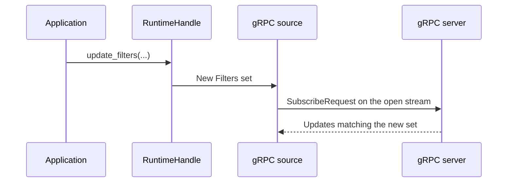

A `RuntimeHandle` changes the [filter set](/docs/reference/glossary#shipstern) of a running runtime: the map of parser IDs to prefilters that becomes the gRPC subscription. The Yellowstone gRPC source sends each new set as a `SubscribeRequest` on the open stream, and the server replaces the subscription without a reconnect. Delivery across the switch is not guaranteed to be gap-free.

`FilterPipeline` builds filters from runtime values before startup; `RuntimeHandle` changes the subscription after startup. See [Build filters at runtime](/docs/filtering/prefilters#build-filters-at-runtime-with-filterpipeline).

## Quick start

<include cwd lang="rust">./examples/snippets/src/filters.rs#live-updates</include>

`try_build` returns `BuilderError`, which is not `Send + Sync` because its `Metrics` variant holds a `Box<dyn Error>`. `?` converts it into `Box<dyn std::error::Error>`, as here, but not into `anyhow::Error`. With anyhow, convert it first: `.try_build::<YellowstoneGrpcSource>(config).map_err(|e| anyhow::anyhow!("{e}"))?`.

Handles are cheap to clone and share one view of the filters. No handle method awaits, so a handle works from async code and from a plain thread beside a blocking `run()`.

`handle()` exists only when the runtime's source implements `FilterUpdateSource`. Among the built-in sources, only `YellowstoneGrpcSource` does. For a source picked at startup, box it as `Box<dyn FilterUpdateSource>` rather than `Box<dyn SourceTrait>` to keep the handle.

## Handle methods

| Method | Does |
| --- | --- |
| `filters()` | Returns the last filter set handed to the source |
| `update_filters(\|filters\| ..)` | Edits the current set under a lock, then sends it |
| `send_filter_update(filters)` | Replaces the whole set |
| `reset_filters()` | Restores the set the runtime started with |

<include cwd lang="rust">./examples/snippets/src/filters.rs#live-updates-reset</include>

Make any change that starts from the current set through `update_filters`. Reading `filters()` and sending the result back does not hold the lock, so two callers that do this lose one of the edits.

Each submitted set replaces the whole subscription, which is what the server does with a mid-stream request. Always send the complete set.

## The `Filters` map

`Filters` is keyed by parser ID and offers `get`, `insert`, `merge`, `remove` and `parser_ids`.

- `merge` combines fields using the [prefilter merge rules](/docs/filtering/prefilters#how-prefilters-merge). It is not a logical OR: required account sets combine with AND, and comparisons can be cleared. Adding keys to an empty set can narrow it.
- `insert` replaces one parser's prefilter outright.
- **Instruction parsers share one entry.** The runtime bundles every instruction parser behind `InstructionPipeline::ID`, so the set holds a single entry whose prefilter is their field-specific merge. Key instruction changes there; naming an individual instruction parser is refused as unknown.

<include cwd lang="rust">./examples/snippets/src/filters.rs#live-updates-instructions</include>

## Errors and guarantees

| Result | Meaning |
| --- | --- |
| `Ok(())` | The set reached the source, or matched the current set and was not sent. It does not mean the server applied it. |
| `FilterUpdateError::UnknownParser` | The set names a parser with no registered pipeline. Nothing was sent. |
| `FilterUpdateError::Closed` | The runtime has stopped. |

Only the newest set matters: two quick updates may reach the source as the second alone.

A runtime with a handle reconnects only at `confirmed` or `finalized` commitment. There the source [resumes from a slot checkpoint](/docs/sources/yellowstone-grpc#resume-from-a-slot-checkpoint) with the newest set, so a set sent while the source is between connections is applied on the new stream. After a resume, the source holds a new set until the server sends data for the resumed request.

At `processed`, a handle turns reconnect off, and the first stream loss ends the run. With `auto-reconnect = false`, the source does not reconnect at any commitment.

## Latency

The server applies a new set promptly, but two delays come before handlers see it. While the runtime buffer is full, the source has not yet sent the set. After the source sends it, the updates already queued drain first. Both delays equal how far behind the pipeline already is: one running 15 seconds behind keeps receiving the old set for about 15 seconds. A pipeline that keeps pace sees the change almost at once.

<Warning>
A set the server refuses, for example for exceeding its filter limits, comes back as a stream error. At `processed` the run ends. At `confirmed` or `finalized`, `ResourceExhausted` counts as recoverable, so the source subscribes again with the same refused set until `reconnect-max-retries` runs out, then ends the run. Check new sets against the provider's limits before sending them, and look for `filter_updates_sent` in the stream-error log to tell a refused update from an unrelated error.
</Warning>

## Provider support

Both `yellowstone-grpc-geyser` and `richat` apply mid-stream requests to a live subscription. A deployment behind infrastructure that does not forward them will ignore the update.

## See also

- [Prefilters](/docs/filtering/prefilters): every filter option and its composition rules.
- [Yellowstone gRPC source](/docs/sources/yellowstone-grpc): reconnect settings that affect updates.
