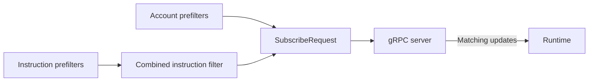

A prefilter states which updates a parser needs: account keys and owners, transaction accounts, slots, blocks. Each parser returns one from `Parser::prefilter()`, and the runtime collects them into one Yellowstone `SubscribeRequest` with an entry per parser ID. The gRPC server sends only the updates that match an entry and tags each update with the entries it matched, so the runtime passes it only to those pipelines.

The Yellowstone gRPC and Fumarole sources send this request to the server. The RPC and snapshot sources use only the account owners, the preconf source uses only the transaction prefilters, and Jetstreamer checks only which kinds of update each prefilter asks for. See [Know the limits](/docs/sources#know-the-limits).

## Build a prefilter

<include cwd lang="rust">./examples/snippets/src/filters.rs#build-prefilter</include>

`build()` checks local constraints such as account comparison counts, memcmp sizes and key lengths, and returns `PrefilterError` for invalid inputs. It also refuses an option set twice. The server checks provider-specific limits, such as maximum key counts, when the request arrives.

## Combine filter conditions

Within one prefilter, different matching axes combine with AND. Values within a key set usually combine with OR, except the transaction required accounts, which must all be present. Plain keys and their cuckoo filter share one axis, so a match in either counts.

| Conditions | Match rule |
| --- | --- |
| `accounts([A, B])` | Account A **or** B |
| `account_owners([P, Q])` | Owner P **or** Q |
| Account keys + owners + comparisons | A listed key **and** a listed owner **and** every comparison |
| `transaction_accounts_include([A, B])` | At least one of A **or** B |
| `transaction_accounts([A, B])` | Both A **and** B |
| Transaction include + required + exclude + vote | Every configured condition must pass; any excluded key rejects the transaction |

For accounts, this filter matches `first` or `second`, owned by `token_program`, with exactly 165 bytes of data:

<include cwd lang="rust">./examples/snippets/src/filters.rs#combine-account-filters</include>

For transactions, this filter requires `token_program` and at least one of `first` or `second`. It rejects vote transactions and transactions that contain `excluded`:

<include cwd lang="rust">./examples/snippets/src/filters.rs#combine-transaction-filters</include>

A transaction prefilter excludes failed transactions by default (`failed = Some(false)`). The builder has no setter for it: set `TransactionPrefilter.failed` on the built prefilter to change it. On merge, two different values, including `None`, become `None`, which receives both. An empty key set leaves that axis unrestricted.

For two independent account conditions, such as `(owner P AND size 165) OR (owner Q AND size 82)`, register separate account parsers with distinct IDs and prefilters. The server delivers updates matching either subscription entry. Calling `.account_filters(...)` twice does not express OR. It is a duplicate-option error.

Instruction parsers do not get separate OR branches. The runtime combines their prefilters into one `InstructionPipeline` entry with the [merge rules](#how-prefilters-merge).

## Account options

| Method | Matches |
| --- | --- |
| `accounts(keys)` | These specific accounts |
| `account_owners(keys)` | Accounts owned by these programs |
| `account_filters(filters)` | Accounts passing every comparison (the server ANDs them) |
| `account_nonempty_txn_signature(bool)` | Only updates with (`true`) or without (`false`) a transaction signature |
| `accounts_include_all()` | Every account, with no key or owner restriction |
| `account_cuckoo(keys)` | These accounts, sent as a [cuckoo filter](#send-large-key-sets-as-cuckoo-filters) |

`AccountFilter` comparisons:

| Variant | Compares |
| --- | --- |
| `Memcmp { offset, data }` | Bytes at an offset. `data` is `MemcmpData::Bytes`, `Base58` or `Base64`. |
| `DataSize(n)` | Account data length equals `n` |
| `TokenAccountState(true)` | Initialised SPL token accounts only |
| `Lamports(cmp)` | Balance `Eq`, `Ne`, `Lt` or `Gt` a value |

Pair comparisons with `accounts` or `account_owners`. On their own they count as an unfiltered subscription, which some servers refuse.

### Limits checked at build time

| Rule | Limit |
| --- | --- |
| Comparisons per account prefilter | 4, after exact repeats are removed |
| `DataSize` comparisons | At most 1 |
| Memcmp data | 1 to 128 bytes decoded; base58 up to 175 characters, base64 up to 172 |
| `TokenAccountState` | Only `true` |

## Transaction options

| Method | Matches |
| --- | --- |
| `transaction_accounts_include(keys)` | Transactions that include **at least one** of these accounts |
| `transaction_accounts(keys)` | Transactions that include **all** of these accounts |
| `transaction_accounts_exclude(keys)` | Drops transactions touching any of these. Exclusion wins over everything else. |
| `transaction_vote(bool)` | Only vote (`true`) or only non-vote (`false`) transactions |
| `transaction_signature(sig)` | Only the transaction with this signature |
| `transaction_token_accounts(mode)` | Also matches the account sets against the owners of token balances (see below) |
| `transaction_cuckoo_accounts_include(keys)` | Like `transaction_accounts_include`, sent as a [cuckoo filter](#send-large-key-sets-as-cuckoo-filters) |

Pair `transaction_vote` and `transaction_accounts_exclude` with an include or required set. On their own they match every other transaction.

### Match a wallet through its token accounts

Tokens move between token accounts, so a transaction that sends tokens to a wallet need not include the wallet's own key. With `transaction_token_accounts`, the server also compares the account sets with the owners of the transaction's token balances. A wallet then matches transfers through its token accounts without listing them:

<include cwd lang="rust">./examples/snippets/src/filters.rs#token-accounts</include>

| `TokenAccounts` | Owners matched |
| --- | --- |
| `All` | Every owner of a pre or post token balance |
| `BalanceChanged` | Only owners whose balance changed, or whose token account the transaction created or closed |

## Slot, block meta and block options

| Method | Requests |
| --- | --- |
| `slots()` | Slot updates |
| `slot_interslot_updates(bool)` | With `true`: every slot status, including the ones the server emits between slots, such as `CreatedBank` and `Dead` (see below) |
| `block_metas()` | Block metadata updates |
| `block_footers(include_certificates)` | Alpenglow [block footers](/docs/runtime#receive-block-footers). `true` also requests the vote certificates in each footer. |
| `block_accounts_include(keys)` | Blocks touching these accounts |
| `block_cuckoo_accounts_include(keys)` | Like `block_accounts_include`, sent as a [cuckoo filter](#send-large-key-sets-as-cuckoo-filters) |
| `block_include_accounts()` | Account updates inside each block |
| `block_include_transactions()` | Transactions inside each block |
| `block_include_entries()` | Entries inside each block |

The server sends the interslot statuses only when the slot filter does not filter by commitment, so `slot_interslot_updates(true)` also sets `SlotPrefilter::filter_by_commitment` to `false`. The slot pipeline then gets every slot status, not only the one at the stream's commitment, so check `status` in the handler. Before 0.13.0 the server ignored the setting. Fumarole ignores `interslot_updates` but applies `filter_by_commitment`, so there the setting adds only the processed, confirmed and finalized statuses.

## Send large key sets as cuckoo filters

`account_cuckoo`, `transaction_cuckoo_accounts_include` and `block_cuckoo_accounts_include` send a key set as one Yellowstone cuckoo filter instead of a list of base58 keys, which keeps a request with thousands of keys small. The server matches a key that is in the plain list or in the filter.

<include cwd lang="rust">./examples/snippets/src/filters.rs#cuckoo</include>

A cuckoo filter can match keys that are not in the set, so check each update against the application's exact key set. `CuckooAccounts`, collected from the keys, has `contains` for this.

<Warning>
Not every server accepts these filters. richat 13.0.2 accepts the account variant but rejects the transaction and block fields with `InvalidArgument`, which stops the source. A server without cuckoo support ignores the filter, so a prefilter that has only a cuckoo set matches everything. A server with a lower size limit for the filter rejects it. Check provider support before enabling them.
</Warning>

## Build filters at runtime with `FilterPipeline`

`shipstern::filter_pipeline::FilterPipeline` takes a parser, handlers and a `PrefilterBuilder` with extra conditions, built from configuration, CLI arguments or another value known before the runtime starts.

This sample parses account keys supplied by the application and adds them to the SPL Token instruction subscription. The parser requires the Token Program; the extra include set requires at least one supplied key:

<include cwd lang="rust">./examples/snippets/src/filters.rs#runtime-filters</include>

`FilterPipeline::new` takes a builder, not a built `Prefilter`, and panics if the builder is invalid. Validate external values before constructing it, as the sample does for account keys. Empty key lists leave a field unrestricted, so the sample rejects an empty list. For full builder validation, call `build()` on one builder and construct another from the same settings for the pipeline, because `build()` consumes the builder.

`FilterPipeline` merges the extra conditions into the parser's prefilter with the [merge rules](#how-prefilters-merge) instead of ANDing them. Adding an include set to a parser that sets only required accounts narrows the subscription, as above. Adding keys to an existing include set widens it.

`FilterPipeline` sets the initial subscription. To change a running subscription, use [`RuntimeHandle`](/docs/filtering/live-filter-updates).

### Keep handler checks for exact selection

`FilterPipeline` does not check the extra conditions locally before parsing or calling handlers. All instruction pipelines share one subscription entry and receive the decoded instructions from its transactions. Registering another instruction pipeline can change that combined filter.

A matching transaction can also contain unrelated instructions. A transaction-level filter does not guarantee that each instruction references the selected key, so for exact selection, check the parsed instruction or raw update in the handler. See [Track a single mint](/docs/guides/track-a-single-mint).

## How prefilters merge

`FilterPipeline`, the combined instruction entry and `Filters::merge` in [live filter updates](/docs/filtering/live-filter-updates) all call `Prefilter::merge`. It merges field by field, so the result is neither the OR nor the AND of the two prefilters:

| Field | On merge |
| --- | --- |
| Account keys, owners, transaction/block include sets and cuckoo sets | Keys from both sides are combined |
| Transaction required accounts (`transaction_accounts`) | Keys from both sides are combined; **all** combined keys are required |
| Account comparisons | Kept if both sides list the same ones, otherwise dropped |
| `transaction_accounts_exclude` | Only keys both sides exclude are kept |
| `transaction_vote`, `transaction_signature`, `TransactionPrefilter.failed`, `account_nonempty_txn_signature` | Kept if both sides agree, otherwise reset to receive all |
| `transaction_token_accounts` | Kept if both sides agree. Otherwise the wider mode wins (`All`, then `BalanceChanged`, then unset) and `transaction_accounts_exclude` is cleared. |
| `block_include_accounts`, `block_include_transactions`, `block_include_entries`, `slot_interslot_updates`, the certificates of `block_footers` | On if either side turns it on |

For example, merging include sets `[A]` and `[B]` matches A OR B, while merging required sets `[A]` and `[B]` requires A AND B. An empty key set leaves that field unrestricted, so adding keys can narrow it.

The built-in instruction parsers put their program in the required set (`transaction_accounts`), and every instruction parser shares one merged entry, `InstructionPipeline::ID`. As a result, SPL Token and Token-2022 instruction parsers in one runtime receive only transactions that name both programs. [Index several programs](/docs/guides/index-several-programs) moves each program to the include set instead.

Account comparisons can disappear on merge: a parser with no comparisons plus extras containing `DataSize(165)` produces no comparisons. Conflicting vote flags, signatures or exclusions can also be cleared. Inspect the resulting prefilter instead of assuming every extra condition survives. To retain an exact combined predicate, build it in the parser's `prefilter()` or replace a registered entry with `Filters::insert` during a live update.

## See also

- [Live filter updates](/docs/filtering/live-filter-updates): change the subscription without reconnecting.
- [Yellowstone gRPC source](/docs/sources/yellowstone-grpc): request-level data slices.
- [Guide: watch a wallet's token moves](/docs/guides/watch-a-wallets-token-moves): `transaction_token_accounts` in a full program.
- [Guide: track many accounts](/docs/guides/track-many-accounts-with-a-cuckoo-filter): `account_cuckoo` with a key file and false-match checks.
