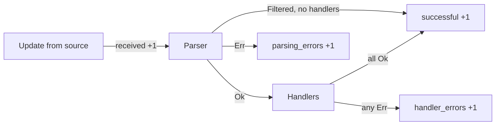

Shipstern counts received, successful and failed updates for every pipeline kind and registers the counters in a `prometheus::Registry` that the application supplies.

## Enable metrics

```toml title="Cargo.toml"
[dependencies]
shipstern = { version = "0.13.0", features = ["prometheus"] }
prometheus = "0.14"
```

Pass a registry to the builder before the build call with `.metrics(registry.clone())`, and keep the original `registry` for gathering. A clone shares its state, so both see the same metrics. `.metrics()` exists only with the `prometheus` feature on. The [Prometheus guide](/docs/guides/push-metrics-to-prometheus) shows a complete program.

<Note>
The runtime serves no HTTP endpoint. Gather the registry in the application and either serve it or push it to a Pushgateway. The guide pushes every 30 seconds.
</Note>

## How updates are counted



| Counter | Incremented |
| --- | --- |
| `*_received` | Once per update that arrives from the source, by update kind. |
| `*_successful` | Once per pipeline that finished without error. An update the parser returned as `Filtered` counts here too. |
| `*_parsing_errors` | Once per pipeline whose parser returned an error. |
| `*_handler_errors` | Once per pipeline where at least one handler returned an error. |
| `shipstern_instructions_*` | Once per instruction per instruction parser. |

These rules have two consequences:

- With several pipelines of one kind, one update adds to `*_successful` once per pipeline, so `successful` can exceed `received`.
- All instruction pipelines run as one bundle per transaction, and that bundle counts as a transaction pipeline. A transaction whose instructions all succeed adds one to `shipstern_transactions_successful`, even with no transaction pipeline registered. Instruction failures are counted only under `shipstern_instructions_*`.

## Counters

Every counter is an `IntCounter`.

| Update kind | Received | Successful | Parse errors | Handler errors |
| --- | --- | --- | --- | --- |
| Accounts | `shipstern_accounts_received` | `shipstern_accounts_successful` | `shipstern_accounts_parsing_errors` | `shipstern_accounts_handler_errors` |
| Transactions | `shipstern_transactions_received` | `shipstern_transactions_successful` | `shipstern_transactions_parsing_errors` | `shipstern_transactions_handler_errors` |
| Instructions | none | `shipstern_instructions_successful` | `shipstern_instructions_parsing_errors` | `shipstern_instructions_handler_errors` |
| Block metas | `shipstern_block_metas_received` | `shipstern_block_metas_successful` | `shipstern_block_metas_parsing_errors` | `shipstern_block_metas_handler_errors` |
| Block footers | `shipstern_block_footers_received` | `shipstern_block_footers_successful` | `shipstern_block_footers_parsing_errors` | `shipstern_block_footers_handler_errors` |
| Blocks | `shipstern_block_received` | `shipstern_block_successful` | `shipstern_block_parsing_errors` | `shipstern_block_handler_errors` |
| Slots | `shipstern_slots_received` | `shipstern_slots_successful` | `shipstern_slots_parsing_errors` | `shipstern_slots_handler_errors` |

Instructions have no `received` counter because they are derived from transactions; use `shipstern_transactions_received` for the input rate.

Counters are process-wide static values with no labels, so they cannot be split by parser. Several runtimes in one process share them, even when each registers its own registry. The runtime increments `*_received` when it reads an update from the channel, before the job runs. The counter therefore does not track processed or persisted records. A handler panic increments no counter.

The runtime exposes no queue-depth, handler-latency or checkpoint metric. Measure these in the application when an alert needs them.

Example queries:

```text
rate(shipstern_accounts_received[1m])
rate(shipstern_instructions_parsing_errors[5m])
```

## Local Prometheus stack

The Shipstern repository's `docker-compose.yaml` runs a Pushgateway on `:9091` and a Prometheus that scrapes it, with the UI on `http://localhost:9090`:

```bash
git clone https://github.com/solana-rpc/shipstern
cd shipstern
docker compose up
```

## See also

- [Push metrics to Prometheus](/docs/guides/push-metrics-to-prometheus): complete example with a 30-second push loop.
- [Tracing](/docs/observability/tracing): spans around every parse and handle.
