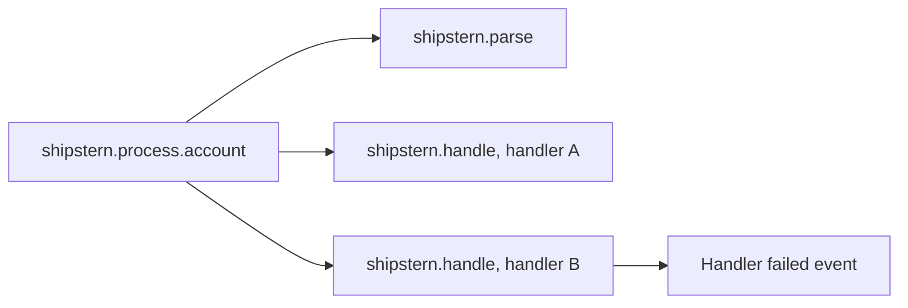

Shipstern instruments the runtime with the [`tracing`](https://docs.rs/tracing) crate. Install any `tracing` subscriber to see the spans, and add an OpenTelemetry layer to export them.

## Spans



The runtime processes each update inside a `shipstern.process.*` span. A standard `Pipeline` adds a `shipstern.parse` span around its parser and a `shipstern.handle` span around each handler. In 0.13.0, `FilterPipeline` does not add those child spans, but the update-level process span still applies. Jobs run on their own Tokio tasks, so the update spans are not children of `Runtime::run`.

| Span | Level | Wraps |
| --- | --- | --- |
| `Runtime::run` | info | The whole run |
| `shipstern.process.account` | info | Processing one account update |
| `shipstern.process.transaction` | info | Processing one transaction update and its instructions |
| `shipstern.process.block_meta` | info | Processing one block meta update |
| `shipstern.process.block_footer` | info | Processing one block footer update |
| `shipstern.process.block` | info | Processing one block update |
| `shipstern.process.slot` | info | Processing one slot update |
| `shipstern.parse` | debug | One `Parser::parse` call |
| `shipstern.handle` | debug | One `Handler::handle` call |

`shipstern.parse` and `shipstern.handle` have been at `debug` level since 0.10.0, so they stay out of `info` output.

A failed handler logs a `Handler failed` event at `error` level. Its fields are `err` (the error chain), `handler` (the pipeline's parser ID, not the handler's type name) and `type` (the type name of the update the pipeline received, not of the parsed value).

A parser error other than `Filtered` logs the same `Handler failed` event, with an `err` that starts `Error parsing input value`. A log alert on that message therefore also fires on parse errors.

## Enable output

Use `tracing-subscriber` with its `env-filter` feature, as in the [quickstart](/docs/get-started/quickstart), and set the levels in the environment:

```bash
# Runtime spans and application info logs
RUST_LOG=info cargo run -- --config ./Shipstern.toml

# Add the per-parse and per-handle spans
RUST_LOG=info,shipstern=debug cargo run -- --config ./Shipstern.toml
```

## Export with OpenTelemetry

The [`examples/tracing`](https://github.com/solana-rpc/shipstern/tree/v0.13.0/examples/tracing) project builds OTLP gRPC exporters for spans and logs with `opentelemetry-otlp`, `tracing-opentelemetry` and `opentelemetry-appender-tracing`. This excerpt sets up the span exporter:

```rust
use opentelemetry::trace::TracerProvider;
use tracing_subscriber::layer::SubscriberExt;

let span_exporter = opentelemetry_otlp::SpanExporter::builder()
    .with_tonic()
    .build()
    .expect("Error building span exporter!");

let tracer_provider = opentelemetry_sdk::trace::SdkTracerProvider::builder()
    .with_batch_exporter(span_exporter)
    .build();

let tracer = tracer_provider.tracer("shipstern_tracer");
let subscriber = tracing_subscriber::Registry::default()
    .with(tracing_opentelemetry::layer().with_tracer(tracer));

tracing::subscriber::set_global_default(subscriber).unwrap();
```

The upstream example also wraps both layers in a filter that passes only a few named events. Shipstern 0.13.0 emits none of them, so the example as released exports nothing from the runtime. The excerpt above leaves the filter out.

The repository's `opentelemetry-config.yaml` defines an OTLP receiver and a `debug` exporter, but only a `metrics` pipeline, so a Collector started with it does not process spans. Add a `traces` pipeline:

```yaml title="opentelemetry-config.yaml"
receivers:
  otlp:
    protocols:
      grpc:
      http:

exporters:
  debug:
    verbosity: detailed

service:
  pipelines:
    metrics:
      receivers: [otlp]
      exporters: [debug]
    traces:
      receivers: [otlp]
      exporters: [debug]
```

## See also

- [Metrics](/docs/observability/metrics): prometheus counters per pipeline kind.
- [Runtime](/docs/runtime): what happens on shutdown and errors.
