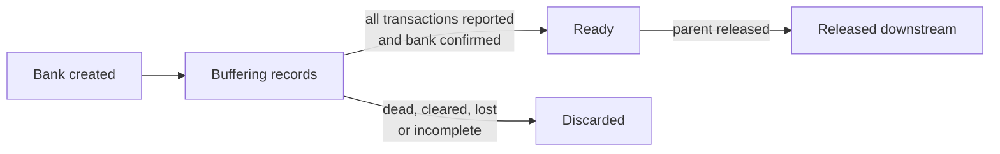

`shipstern-block-coordinator` holds parsed records per bank and releases a slot only when it is complete, one slot at a time, in slot order. The [Kafka sink](/docs/outputs/kafka-sink) is built on it. A Shipstern runtime processes updates on a worker pool, so results finish out of order. Without the coordinator, a reader can see part of a slot while the runtime still processes the rest.

At `processed` commitment a slot can have more than one bank. A bank is one execution of the slot by the node, and each update names its bank with a `bank_id`. The coordinator keeps records per (`slot`, `bank_id`) and releases only the bank that reaches confirmed.

## The lifecycle of a bank



## When a bank is released

A bank leaves the coordinator as an `InstructionSlot` when both gates pass:

| Gate | Passes when |
| --- | --- |
| Parse gate | The number of transactions reported as processed reaches the bank's executed transaction count. A bank with no transactions passes once it has frozen. |
| Commitment gate | The bank is committed: its own confirmed status arrived, or a committed child names its blockhash as the parent. |

Then ordering applies. A ready bank waits until its parent slot is released or discarded as incomplete, so output follows the chain. Before the first release, only a parent from before the stream started can be missing. A child of a dead slot waits for the slot's repair bank. A child confirmed before its fork-reported parent waits for that parent. Accounts follow the same chain order.

Inside a slot, records are sorted by transaction index, then instruction index. A second record with the same key replaces the first.

`InstructionSlot` and `AccountSlot` carry the `bank_id` of the released bank. `AccountSlot` also carries `parent_slot` and `blockhash`, so a consumer can check that consecutive slots chain.

With `require_tx_gate = true`, subscribe to every executed transaction, including failed ones, and report each transaction exactly once. A filtered transaction stream leaves the expected count unreachable. Reporting a transaction twice can release the bank before all its records arrive. The Kafka sink's `TransactionSubscription` already receives failed transactions.

A slot that never resolves holds back every later slot. The cause can be a lost BlockMeta, a missing commitment, or records for a slot the block machine never saw. When more banks wait than `max_pending_banks` allows, `run` stops with `CoordinatorError::TooManyPendingBanks`. Restart from the last checkpoint to replay the slot. If released slots stop while the stream is live, check the transaction subscription first.

## What is dropped

| Case | Result |
| --- | --- |
| Another bank of the same slot confirms | The other banks are discarded with no output. |
| The slot is reported dead | Its frozen banks are discarded. A repair bank of the slot can still win and is released. |
| The slot is reported forked off | No bank is dropped yet. The slot waits until it or one of its children is confirmed. |
| An `EntryUpdateParent` clears a bank that is still replaying | The bank is discarded as `Cleared`, and the coordinator frees its records at once. The slot replays under a new bank ID. |
| A bank's entry or transaction count does not match its BlockMeta | Discarded as incomplete. A bank that froze before its last entries arrived waits for them first. |
| Before the first release, a bank whose `CreatedBank` and first entry the stream never saw | Discarded, because the stream likely started inside it. |
| A malformed BlockMeta or Entry | Skipped. |
| Records arrive for a discarded bank | Ignored. The log level is `debug` for a bank that lost its slot to another bank, and `warn` for every other discarded bank. |
| Records arrive for a slot at or behind the last released slot | Ignored, with a warning. |

## Inputs it needs

`CoordinatorSource` is a source that wraps the Yellowstone gRPC connection for the coordinator. It changes the configured subscription:

- sets commitment to `processed`, so the coordinator sees transactions before confirmation;
- adds subscriptions for entries and bank invalidations, block metadata and slot lifecycle updates, including interslot updates;
- removes the block and block footer filters.

It sends entry, slot and block metadata updates to the coordinator only, and forwards account and transaction updates to the runtime. Block, block meta, block footer and slot pipelines registered on that runtime therefore receive nothing. When the runtime has any of them, the source logs one warning that names those update kinds.

Set `coordinator_input_tx` on `CoordinatorSourceConfig` before running. Without it, the source fails at connect with an I/O error.

The coordinator keys records by bank, so the server must send bank IDs (yellowstone-grpc proto 13 or newer). `CoordinatorSource` stops with an error at the first account update or bank status that has no bank ID. It does not reconnect, and it ignores `auto-reconnect` and `reconnect-max-retries`, so a stream loss ends the run. Run it under a supervisor and resume from the last checkpoint.

## Run the coordinator

```rust
impl<R: Send + 'static> BlockMachineCoordinator<R> {
    pub async fn run(
        input_rx: mpsc::Receiver<CoordinatorInput>,
        parsed_rx: mpsc::Receiver<CoordinatorMessage<R>>,
        instruction_output_tx: Option<mpsc::Sender<InstructionSlot<R>>>,
        account_output_tx: Option<mpsc::Sender<AccountSlot<R>>>,
        account_commit_at: AccountCommitAt,
        require_tx_gate: bool,
        max_pending_banks: usize,
    ) -> Result<(), CoordinatorError>;
}
```

| Argument | Meaning |
| --- | --- |
| `input_rx` | Slot lifecycle input from `CoordinatorSource` |
| `parsed_rx` | Records and transaction reports from handlers, sent through a `CoordinatorHandle` |
| `instruction_output_tx` | Where released `InstructionSlot`s go. With `None`, ready slots are released and dropped. |
| `account_output_tx` | Where released `AccountSlot`s go, or `None` |
| `account_commit_at` | `Confirmed` (default) or `Finalized`: when account slots are released |
| `require_tx_gate` | `true` enforces the parse gate. `false` releases on commitment alone: records that arrive after the release are dropped, and transaction status counts are not reported. |
| `max_pending_banks` | The maximum number of banks waiting to flush. Pass `DEFAULT_MAX_PENDING_BANKS` (64), which allows about 64 slots behind a slot that never resolves. A slow-finality cluster with `AccountCommitAt::Finalized` can need more. |

The [Kafka sink page](/docs/outputs/kafka-sink#wire-the-pipeline) shows all the channels connected.

`run` returns `Ok(())` when both input channels close, and a `CoordinatorError` in the cases below. Treat each error as the end of the pipeline, and restart from the last checkpoint.

| Error | Cause |
| --- | --- |
| `InstructionOutputChannelClosed`, `AccountOutputChannelClosed` | An output receiver was dropped, for example because the Kafka writer stopped. |
| `TooManyPendingBanks` | More than `max_pending_banks` banks wait behind a slot that never resolves. |
| `MissingBankId` | The server sends no bank IDs. It likely runs yellowstone-grpc proto 12.7 or older. |
| `BankInTwoSlots` | One bank ID appeared in two slots. |
| `ConflictingBlockIdentity` | The stream contradicts itself about which block a slot holds, for example two committed banks in one slot. |
| `ClearedCommittedBank` | An `EntryUpdateParent` cleared a bank that had already frozen or confirmed. |
| `ReadySlotMissingMetadata` | An internal invariant broke. |

`CoordinatorError` is not `#[non_exhaustive]` in 0.13.0, but it gained variants in this release. Add a wildcard arm to a `match` on it.

## Use it without Kafka

Nothing in the coordinator is Kafka-specific: it releases `InstructionSlot<R>` values for any record type `R`. To write ordered slots somewhere else, call these `CoordinatorHandle` methods from a custom handler and consume the output channel in the application. Take `slot` and `bank_id` from the update that the handler received.

| Method | Call it |
| --- | --- |
| `send_instruction_parsed(slot, bank_id, key, record)` | Once per record to buffer, with an `InstructionRecordSortKey` built from the transaction index and instruction index |
| `send_transaction_parsed(slot, bank_id)` | Once per transaction, failed ones included, after its records are sent. Without it the parse gate never passes. |

The coordinator's [`tests/integration.rs`](https://github.com/solana-rpc/shipstern/blob/v0.13.0/crates/block-coordinator/tests/integration.rs) drives it without Kafka.

## See also

- [Kafka sink](/docs/outputs/kafka-sink): the coordinator in a complete pipeline.
- [Delivery and ordering](/docs/runtime/delivery): ordering and checkpoints with plain handlers.
- [Yellowstone gRPC source](/docs/sources/yellowstone-grpc#banks-at-processed): banks and `bank_id` at processed.
