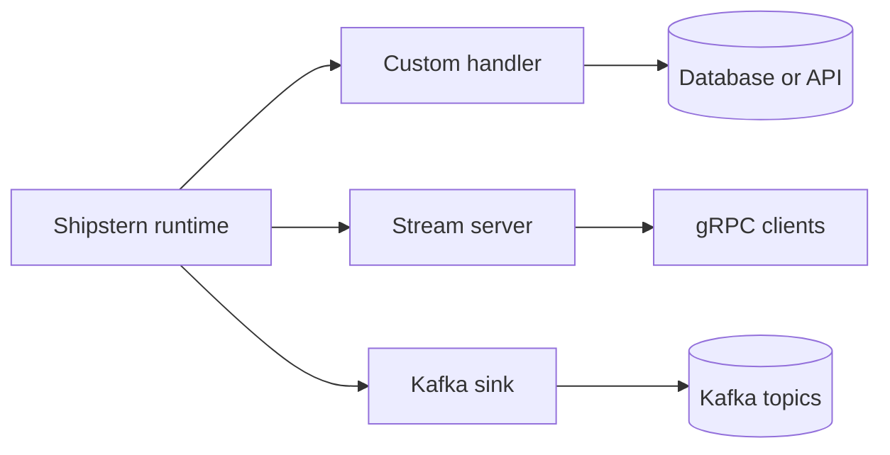

A Shipstern pipeline gets parsed data out through a handler. Write a custom handler for any destination, or use one of the two ready-made outputs: a gRPC stream server or a Kafka sink.

## Compare the options

| | Custom handler | Stream server | Kafka sink |
| --- | --- | --- | --- |
| Crate | none | `shipstern-stream` | `shipstern-kafka-sink` and `shipstern-block-coordinator` |
| On crates.io at 0.13.0 | not needed | yes | not `shipstern-kafka-sink`: use the git tag |
| Order of results | Not guaranteed: the worker pool finishes updates out of order | Not guaranteed | Slot by slot, in slot order |
| What it delivers | Application-defined records | Each parsed value, as it is parsed, to clients connected at that moment | Decoded instructions of successful transactions, one confirmed slot at a time. With `transactional_id` set, a slot's records and its marker go in one Kafka transaction. |
| Resume after a restart | The application stores a checkpoint | Clients reconnect. Nothing is replayed. | The application reads the last committed slot marker from Kafka and sets `from-slot` |
| Effort | Lowest | Low: requires a custom output message type | Highest: several components to wire |

## Choose

- **Write to a database or call an API:** a [handler](/docs/runtime/handlers). The [Postgres guide](/docs/guides/index-transfers-into-postgres) shows database writes. Add a durable processing checkpoint when the application must replay updates after a restart.
- **Let other services subscribe to parsed events:** the [stream server](/docs/outputs/stream-server).
- **Feed a data platform that needs every slot, complete and in order:** the [Kafka sink](/docs/outputs/kafka-sink), which uses the [block coordinator](/docs/outputs/block-coordinator).

## See also

- [Handlers](/docs/runtime/handlers): write to a custom destination.
- [Run in production](/docs/runtime/production): delivery guarantees and restarts.
