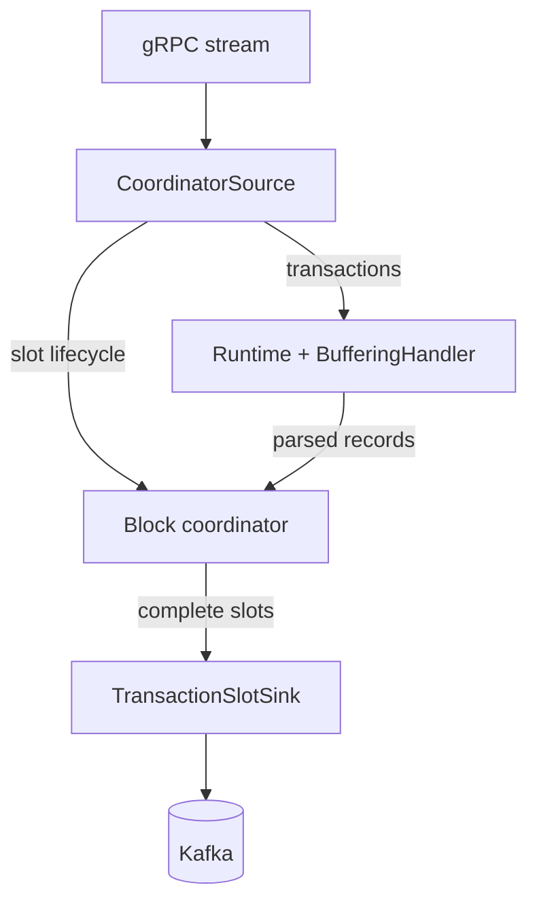

Write decoded SPL Token instructions to Kafka one complete, confirmed slot at a time, in slot order. With `transactional_id` set, a consumer that reads with `isolation.level=read_committed` never sees half a slot.

**Compiled against Shipstern 0.13.0.**

**Prerequisites:** a Yellowstone endpoint that sends bank IDs (yellowstone-grpc proto 13 or newer), a Kafka broker that supports transactions, a Rust toolchain, Kafka's administration scripts and `kcat` for verification.

The local commands below use a plaintext broker at `localhost:9092`. For a secured broker, give the sink and the verification clients matching authentication settings.

## How the pieces fit



| Component | Crate | Job |
| --- | --- | --- |
| `CoordinatorSource` | `shipstern-block-coordinator` | Connects to Yellowstone gRPC at `processed` commitment and sends slot lifecycle events to the coordinator and transactions to the runtime. It does not reconnect, so a stream loss ends the run. |
| `TransactionSubscription` + `BufferingHandler` | `shipstern-kafka-sink` | Receive every transaction, failed ones included, and report each to the coordinator with its `slot` and `bank_id`. Decode the instructions of successful transactions with the registered parsers and send the records to the coordinator. Failed transactions produce no records. An account update with no `bank_id` is skipped. |
| `BlockMachineCoordinator` | `shipstern-block-coordinator` | Holds records per bank and releases the confirmed bank of each slot once it is complete, in slot order. See [Block coordinator](/docs/outputs/block-coordinator). |
| `TransactionSlotSink` | `shipstern-kafka-sink` | Writes a released slot's records and a commit marker to Kafka. |

## Add the dependencies

`shipstern-kafka-sink` is not published on crates.io, so take every Shipstern crate from the `v0.13.0` tag. A mix of git and crates.io copies creates two incompatible versions of the shared types.

```toml title="Cargo.toml"
[dependencies]
rustls = "0.23"
serde = { version = "1", features = ["derive"] }
shipstern = { git = "https://github.com/solana-rpc/shipstern", tag = "v0.13.0" }
shipstern-block-coordinator = { git = "https://github.com/solana-rpc/shipstern", tag = "v0.13.0" }
shipstern-kafka-sink = { git = "https://github.com/solana-rpc/shipstern", tag = "v0.13.0" }
shipstern-spl-token-parser = { git = "https://github.com/solana-rpc/shipstern", tag = "v0.13.0", features = ["proto"] }
tokio = { version = "1", features = ["macros", "rt-multi-thread", "sync"] }
tokio-util = "0.7"
toml = "0.8"
tracing = "0.1"
tracing-subscriber = { version = "0.3", features = ["env-filter"] }
```

The sink encodes records as protobuf, so the parser needs its `proto` feature. The release enables librdkafka's CMake, SSL and Zstd features.

## Install the build dependencies

librdkafka compiles from source. Install a C and C++ compiler, CMake, `pkg-config`, and the OpenSSL and zlib headers:

<Tabs groupId="os" persist items={['macOS', 'Debian / Ubuntu', 'RHEL / Fedora', 'Arch']}>
<Tab value="macOS">

```bash
xcode-select --install
brew install cmake openssl@3
```

</Tab>
<Tab value="Debian / Ubuntu">

```bash
sudo apt-get update
sudo apt-get install -y build-essential pkg-config libssl-dev cmake zlib1g-dev
```

</Tab>
<Tab value="RHEL / Fedora">

```bash
sudo dnf install -y gcc gcc-c++ make pkgconf-pkg-config openssl-devel cmake zlib-devel
```

</Tab>
<Tab value="Arch">

```bash
sudo pacman -S --needed base-devel openssl cmake zlib
```

</Tab>
</Tabs>

## Prepare the broker and topics

For one local broker, set these [broker properties](https://kafka.apache.org/41/configuration/broker-configs/) before starting Kafka:

```properties title="server.properties"
transaction.state.log.replication.factor=1
transaction.state.log.min.isr=1
```

These values allow transactions in the local example. Kafka's defaults require three brokers for its transaction topic and two replicas to acknowledge its writes.

Start a broker using the [Apache Kafka quickstart](https://kafka.apache.org/41/getting-started/quickstart/), then check that the client can fetch metadata:

```bash
kcat -b localhost:9092 -L
```

The broker's advertised address must be reachable from the indexer. Fix a metadata timeout or an unreachable advertised address before running the pipeline.

From the Kafka installation directory, create both topics for this single-writer example:

```bash
bin/kafka-topics.sh --bootstrap-server localhost:9092 --create \
  --topic spl-token.instructions --partitions 1 --replication-factor 1
bin/kafka-topics.sh --bootstrap-server localhost:9092 --create \
  --topic transaction.slots --partitions 1 --replication-factor 1
```

These commands target a local, single-broker setup. Choose replication and partition counts for the deployment before using an existing cluster.

Confirm that both topics exist:

```bash
kcat -b localhost:9092 -L -t spl-token.instructions
kcat -b localhost:9092 -L -t transaction.slots
```

## Configure Kafka and the source

```toml title="Shipstern.toml"
[kafka]
brokers = "localhost:9092"
transactional_id = "shipstern-spl-token-1"   # one per running instance

[source]
endpoint = "https://yellowstone.example.com"
x-token = "<X-TOKEN>"
timeout = 60
```

`[kafka]` keys are snake_case. `[source]` keys are the [gRPC source's](/docs/sources/yellowstone-grpc) kebab-case keys.

Keep `transactional_id` stable across restarts of this writer. Give each concurrently running writer a different value.

The example publishes plain protobuf payloads. It does not register schemas, so a Schema Registry server is not needed for this run.

## Wire the pipeline

Save this complete program as `src/main.rs`:

<include cwd lang="rust" meta='title="src/main.rs"'>./examples/kafka-sink/src/main.rs</include>

The compiled sample also lives in the documentation repository at `examples/kafka-sink`. That path is not an upstream Shipstern example.

The program runs the source, coordinator and writer together. When any stage stops, the program exits. It exits with an error unless the runtime stopped cleanly on a signal.

The last argument of `BlockMachineCoordinator::run` is `DEFAULT_MAX_PENDING_BANKS` (64). If more banks than that wait behind a slot that never resolves, the coordinator stops with `TooManyPendingBanks` and the program exits. `CoordinatorSource` also ends the run on a stream loss. In both cases, restart the program: it resumes after the last committed marker.

## Run and check committed output

From the project directory containing `Cargo.toml` and `Shipstern.toml`, run:

```bash
RUST_LOG=info cargo run
```

Read slot markers from another terminal:

```bash
kcat -C -b localhost:9092 -t transaction.slots -o beginning \
  -X isolation.level=read_committed -c 5
```

Expect JSON records containing `slot`, `transaction_count` and decode counts. The consumer waits until five committed markers arrive. Stop it with `Ctrl+C` if needed.

Check decoded instruction keys without printing binary protobuf payloads:

```bash
kcat -C -b localhost:9092 -t spl-token.instructions -o beginning \
  -X isolation.level=read_committed -c 5 -f '%k\n'
```

Expect keys in the form `{slot}:{signature}:{ix_index}` when SPL Token instructions arrive. Decode values with the parser's protobuf schema in the downstream consumer.

## Resume after a restart

`TransactionSlotSink` writes a commit marker for every released slot to `transaction.slots`. The example's startup runs in this order:

| Step | Call | What it does |
| --- | --- | --- |
| 1 | `create_producer(&kafka)` | Builds the librdkafka producer with idempotence on. Panics if librdkafka rejects the configuration. |
| 2 | `initialize_transactional_producer(&kafka, &producer)` | With `transactional_id` set, fences any earlier producer with the same ID, so it can no longer commit. Without `transactional_id` it does nothing. |
| 3 | `read_last_committed_transaction_block(&kafka)` | Reads committed markers from the end of each partition (the last 256 offsets, for up to 5 seconds per partition) and returns the highest slot. Returns `None` when the topic is missing or empty, and an error when a non-empty partition's tail holds no readable marker. |
| 4 | `TransactionSlotSink::new_preinitialized(kafka, producer)` | Builds the writer without initialising transactions again. Use `TransactionSlotSink::new` for a producer that skipped step 2; its `run` then initialises transactions itself. |

Initialise transactions before reading the marker. The fence stops a previous writer from committing after the read, so the marker that step 3 reads is the last one. The example then sets `from-slot` to that slot plus one. If step 2 or 3 fails, startup stops instead of starting live and skipping retained history.

The gRPC server must still hold that slot for `from-slot` to work. With no marker, the run starts from the configured `from-slot`, or live when none is set. If marker retention deletes every marker, the stored recovery position is lost with them.

To check recovery, note the newest committed marker, stop the program with `Ctrl+C`, and restart it promptly with the same configuration. Expect `Resuming Kafka pipeline` with `from` one greater than the stored slot, and committed markers continuing to appear.

## What lands in Kafka

| Topic | Key | Value |
| --- | --- | --- |
| The topic passed to `instruction_parser` (`spl-token.instructions` above) | `{slot}:{signature}:{ix_index}` | The decoded instruction, protobuf-encoded. Headers carry `slot`, `signature`, `tx_index`, `ix_index` and `fee_payer`. |
| A fallback topic, with `instruction_parser_with_fallback` | same | `RawInstructionEvent` as JSON, for instructions the parser failed on |
| `transaction.slots` | | `TransactionSlotCommitEvent` as JSON: slot, blockhash, transaction count and decode counts |

`ix_index` is one-based. `3` is the third outer instruction, and its inner instructions use the flat form `3.1`, `3.2` and so on, not the tree path. See [tree paths and flat positions](/docs/runtime/handlers#distinguish-tree-paths-from-flat-positions). Each instruction goes to the first registered parser for its program.

Payloads are plain protobuf unless schemas are registered (`ensure_schemas_registered`, then `KafkaSink::set_schema_ids`). A topic with a schema under the subject `<topic>-value` gets payloads in the Confluent wire format.

## Know the delivery guarantees

| | With `transactional_id` | Without |
| --- | --- | --- |
| Slot write | Records and marker in one Kafka transaction | Records, then the marker, as separate writes |
| `read_committed` consumer | Sees a slot completely or not at all | Can see records whose marker never arrives |
| Retried slot write | The failed transaction is aborted first; `read_committed` consumers never see its records | Can write the same records again; deduplicate on the record key |

`TransactionSlotSink::run` tries each slot write up to `kafka_write_max_attempts` times, waiting `kafka_retry_backoff_ms` between attempts, then returns the error. The example exits with that error. Restart the program to resume after the last committed marker.

## Configuration reference

| Key | Default | Description |
| --- | --- | --- |
| `brokers` | required | Kafka bootstrap servers |
| `transactional_id` | none | Enables transactional writes. Use a different value per instance. |
| `transaction_timeout_ms` | `30000` | Broker-side transaction timeout |
| `transaction_slots_topic` | `transaction.slots` | Topic for slot commit markers |
| `account_slots_topic` | `account.slots` | Topic for account slot markers |
| `compression_type` | `zstd` | `none`, `gzip`, `snappy`, `lz4` or `zstd` |
| `message_timeout_ms` | `5000` | Producer message timeout |
| `queue_buffering_max_messages` | `100000` | Producer queue size |
| `batch_num_messages` | `1000` | Producer batch size |
| `kafka_write_max_attempts` | `3` | Attempts per slot write before failing |
| `kafka_transaction_op_max_attempts` | `2` | Attempts for transaction init, begin, commit and abort |
| `kafka_retry_backoff_ms` | `200` | Delay between retries |
| `buffer_size` | `100` | Read from the config but not used by the 0.13.0 sink |
| `schema_registry_url` | `http://localhost:8081` | Confluent schema registry, used by `ensure_schemas_registered` |
| `sasl_username`, `sasl_password` | none | Turns on SASL_SSL with SCRAM-SHA-256 |
| `schema_registry_username`, `schema_registry_password` | the SASL values | Schema registry credentials |
| `account_mode` | `FinalizedPassthrough` | How accounts are written. Account parsing needs the `experimental-account-parser` feature. |

## See also

- [Block coordinator](/docs/outputs/block-coordinator): when a slot is released and what is dropped.
- [Where parsed data goes](/docs/outputs): simpler options.
