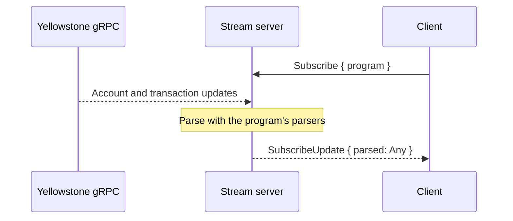

`shipstern-stream` runs a Shipstern runtime and a gRPC server in one process. Each parsed value is wrapped in `google.protobuf.Any` and sent to every client subscribed to that parser's program.



## Know the 0.13.0 limitation first

The server accepts only parsers whose output implements both `prost::Message` and `prost::Name`. Neither built-in nor IDL-generated output implements `prost::Name` automatically in 0.13.0.

Built-in output types belong to their parser crates. Rust's orphan rule prevents an application from adding `prost::Name` to those foreign types. Define an application-owned message and parser, as in the example below.

IDL macro output belongs to the crate that calls `include_shipstern_parser!`. Enable `proto`, then implement `prost::Name` there. With `program-events`, this fixture's `InstructionParser` returns `ProgramEventOutput`:

<include cwd lang="rust">./examples/advanced-parsers/src/lib.rs#generated-name</include>

Set `NAME` and `PACKAGE` to the message and package in the [exported schema](/docs/parsers/idl-codegen#export-the-protobuf-schema). This example yields the `Any` URL `/padded_envelope.ProgramEventOutput`. Without event output, implement `Name` on the generated `Instructions` wrapper instead, using its schema name.

Shipstern's own repository has no stream server example. The crate's documentation links to `examples/stream`, which does not exist.

## Define the message clients receive

<include cwd lang="rust">./examples/stream-server/src/main.rs#message</include>

`Name` sets the type URL that clients see in `Any`. Its default `type_url()` returns `/my_indexer.TokenAccountUpdate` for this message.

## Write a program parser for it

The server keys subscriptions by program ID, so the parser must implement `ProgramParser` as well as `Parser`:

<include cwd lang="rust">./examples/stream-server/src/main.rs#parser</include>

## Start the server

<include cwd lang="rust" meta='title="src/main.rs"'>./examples/stream-server/src/main.rs#server</include>

```toml title="Cargo.toml"
[dependencies]
clap = { version = "4.5", features = ["derive"] }
prost = { version = "0.14", features = ["derive"] }
rustls = "0.23"
shipstern-core = "0.13.0"
shipstern-stream = "0.13.0"
shipstern-yellowstone-grpc-source = "0.13.0"
toml = "0.8"
tracing-subscriber = { version = "0.3", features = ["env-filter"] }
```

```toml title="Shipstern.toml"
[grpc]
address = "[::]:3030"   # optional; this is the default

[source]
endpoint = "https://yellowstone.example.com"
x-token = "<X-TOKEN>"
timeout = 60
```

The `[source]` and `[buffer]` sections are the same as for a plain runtime.

Run it from the project root:

```bash
RUST_LOG=info cargo run -- --config ./Shipstern.toml
```

The server prints `gRPC server created address=[::]:3030` once, then nothing while it serves. Check it with a client.

## Subscribe from a client

The service is `shipstern.stream.ProgramStreams`:

| Method | Request | Streams |
| --- | --- | --- |
| `Subscribe` | `{ program: "<base58 program ID>" }` | Values from every parser registered for that program |
| `SubscribeMany` | `{ programs: ["<id>", ...] }` | Values from all listed programs, interleaved |

Each message is `SubscribeUpdate { parsed: google.protobuf.Any }`. Decode `parsed.value` with the same message definition:

```protobuf title="my_indexer.proto"
syntax = "proto3";
package my_indexer;

message TokenAccountUpdate {
  string pubkey = 1;
  uint64 slot = 2;
  uint64 lamports = 3;
  uint64 data_len = 4;
}
```

The server registers gRPC reflection (the `v1alpha` version) for the `shipstern.stream` service, so `grpcurl` can find and call it without local `.proto` files:

```bash
grpcurl -plaintext \
  -d '{"program": "TokenkegQfeZyiNwAJbNbGKPFXCWuBvf9Ss623VQ5DA"}' \
  localhost:3030 shipstern.stream.ProgramStreams/Subscribe
```

Each message then prints with `"@error": "my_indexer.TokenAccountUpdate is not recognized"` and the raw bytes in `"@value"`. The stream still works. Reflection describes the service, not the type inside `Any`. To print decoded values, pass the encoded file descriptor set for the application's message types to `.descriptor_set(..)` on the builder, or decode `parsed.value` in the client.

## Know how delivery behaves

| Situation | Behaviour |
| --- | --- |
| Program with no registered parser | The stream ends at once, without an error. |
| Program ID that is not valid base58 | The call fails with `InvalidArgument`. |
| No client subscribed to a program | Its parsed values are dropped. |
| Client slower than the stream | Each parser has a 64-message broadcast buffer. A client that falls behind skips the overwritten messages. If the client overruns the buffer 9 times without receiving a message in between, its stream panics with `gRPC channel lagged too many times!` and ends. |
| Client reconnects | Receives only new values. Nothing is replayed. |
| Ordering | Values arrive as parsing finishes, which is not slot order. |

A slow client does not apply backpressure to the runtime. The broadcast buffer drops older values for that client instead. The server has no durable delivery checkpoint, so a client that needs every value must use another output, such as the [Kafka sink](/docs/outputs/kafka-sink).

In 0.13.0, the server checks the gRPC task's result only after the runtime stops. If the listener fails to bind, the runtime keeps processing with no way for clients to connect. The `gRPC server created` log does not prove the listener started. Check that the configured address accepts connections.

## Builder methods

| Method | Registers |
| --- | --- |
| `.account(parser)` | A `ProgramParser<Input = AccountUpdate>` |
| `.instruction(parser)` | A `ProgramParser<Input = InstructionUpdate>` |
| `.transaction(parser)` | A `ProgramParser<Input = TransactionUpdate>` |
| `.block_meta(parser)` | A `ProgramParser<Input = BlockMetaUpdate>` |
| `.descriptor_set(bytes)` | An encoded protobuf file descriptor set for reflection |
| `.metrics(registry)` | A Prometheus registry (`prometheus` feature) |

Registering two parsers with the same program ID and parser ID fails with `BuilderError::DuplicateId`. Two account, transaction or block meta parsers with the same parser ID under different program IDs fail with `BuilderError::Runtime`, as in the [runtime builder](/docs/runtime#build-and-try_build).

`build`, `try_build`, `build_with`, `try_build_with`, `run`, `try_run`, `run_async` and `try_run_async` behave like the [runtime's](/docs/runtime). `build::<S>(config)` names the source with a turbofish. `build_with(source, grpc, buffer)` takes a source value, such as a `Box<dyn SourceTrait>` picked at startup, with a `GrpcConfig` and a `BufferConfig`.

## See also

- [Where parsed data goes](/docs/outputs): compare with handlers and Kafka.
- [Parsers](/docs/parsers#write-a-custom-parser): the `Parser` trait in full.
