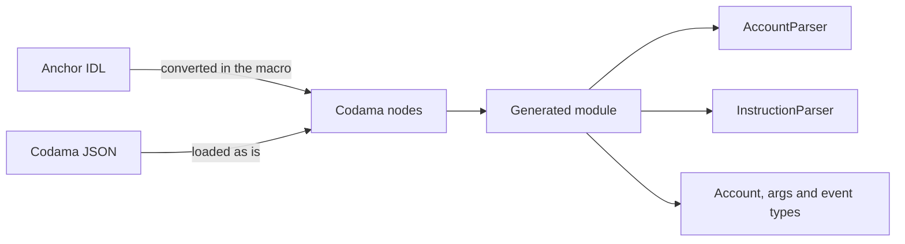

`include_shipstern_parser!` reads an IDL file during Cargo compilation and generates a Rust module with an `AccountParser`, an `InstructionParser` and typed account and instruction data. The module plugs into a [pipeline](/docs/get-started/core-concepts#pipelines) like a built-in parser.

The input is [Codama JSON](https://github.com/codama-idl/codama) or, since 0.12.0, an Anchor IDL. For Anchor input, `shipstern-codama-from-anchor` converts the file to Codama nodes inside the macro. No Node.js, `codama convert` step or build script is involved, and no converted file is written. See the [0.12.0 release notes](/docs/releases/v0-12-0).



| Support | Input | Preparation |
| --- | --- | --- |
| Added in 0.12.0 | Anchor 0.30+ IDL (`metadata.spec = "0.1.0"`) | Pass the file directly |
| Added in 0.12.0 | Legacy Anchor IDL | Set the program ID in `metadata.address`, then pass the file directly |
| Existing support | Codama JSON IDL | Pass the file directly |
| Not accepted | Shank or Steel IDL | Convert to Codama JSON first, as in [Get the IDL](#get-the-idl) |

The [pump.fun guide](/docs/guides/generate-a-parser-from-an-idl) builds a complete program from an Anchor IDL.

## Quick start

<Steps>
<Step>

### Get the IDL

An IDL written by Anchor 0.30 or later has `metadata.spec` set to `"0.1.0"` and works as it is. `anchor build` writes it to `target/idl/<program>.json`. For a deployed program, fetch the IDL its authority published, as in the [pump.fun guide](/docs/guides/generate-a-parser-from-an-idl).

```bash
jq .metadata.spec idl.json
# "0.1.0"
```

Legacy Anchor IDLs from Anchor 0.29 or earlier have no `metadata.spec`. A missing value alone does not identify the format, so first confirm that the file is an Anchor IDL. Legacy Anchor input needs the program ID in `metadata.address`. See [Older Anchor IDLs](#older-anchor-idls).

For a Shank or Steel IDL, convert it to Codama JSON and pass that file instead:

```bash
npx -p codama -p @codama/nodes-from-anchor codama convert idl.json codama.json
```

Keep both `-p` flags. Outside a Node project, `codama convert` cannot find `@codama/nodes-from-anchor` unless both packages are specified.

Check the converted account nodes before passing the file to the macro, because conversion does not add account discriminators. Add a `discriminators` array that matches the deployed layout to each account that needs parsing. `AccountParser` skips accounts without discriminators. For Steel, also remove `program.origin: "steel"`, as [What the macro generates](#what-the-macro-generates) explains. The [repository guide](https://github.com/solana-rpc/shipstern/blob/v0.13.0/docs/codama-parser-generation.md) describes discriminator nodes.

</Step>
<Step>

### Add the dependencies

```toml title="Cargo.toml"
[dependencies]
borsh = { version = "1", features = ["derive"] }
shipstern-core = "0.13.0"
shipstern-parser = "0.13.0"
shipstern-proc-macro = "0.13.0"
```

The generated code imports `shipstern_core` and derives `BorshDeserialize` and `BorshSerialize`, so both `shipstern-core` and Borsh's `derive` feature are required. The Anchor converter comes in with `shipstern-proc-macro`, so it needs no separate dependency.

Also add `prost = "0.14"` when any crate in the build turns on the `proto` feature, for example `shipstern-bpf-loader-parser` with its default features. The macro then emits prost code.

</Step>
<Step>

### Invoke the macro

The path is relative to the crate root:

```rust title="src/main.rs"
use shipstern_proc_macro::include_shipstern_parser;

include_shipstern_parser!("idl.json");
```

The macro loads a file with a top-level `kind` key or a top-level `program` object as Codama JSON. It reads any other file as an Anchor IDL.

</Step>
<Step>

### Use the generated module

The module is named after the program in snake_case: `metadata.name` in an Anchor IDL, `program.name` in Codama JSON. pump.fun's Anchor IDL is named `pump`, so its parsers are `pump::AccountParser` and `pump::InstructionParser`. Register them like any parser, with `.account(Pipeline::new(pump::AccountParser, handlers))` and `.instruction(..)`. The [pump.fun guide](/docs/guides/generate-a-parser-from-an-idl) shows the full program.

</Step>
</Steps>

## Check parser generation

Run Cargo from the application crate root after adding the IDL and macro call:

```bash
cargo check
```

The check compiles the generated module without connecting to a Solana endpoint. Invalid input or an unsupported layout can fail the build. See [Build errors name the item](#build-errors-name-the-item) for diagnostics.

Compilation checks the conversion and the generated Rust code. It does not prove that the IDL matches the deployed program. Use [parser fixtures](/docs/testing) to check decoding against account and instruction bytes.

## What the macro generates

The macro converts an Anchor IDL to Codama nodes first, so this table applies to both inputs.

| Codama node | Generated item |
| --- | --- |
| `program.name` | The module name, in snake_case |
| `program.publicKey` | `PROGRAM_ID` |
| `program.accounts[]` | Account types and `AccountParser` |
| `program.instructions[]` | `*Args` and `*Accounts` structs, the `Instructions` wrapper and `InstructionParser` |
| `program.definedTypes[]` | Shared types |
| `events[]` | Event types, only with the `program-events` feature. Without it, a payload that another type links to is still emitted as a shared type. |

A defined enum type reads and writes its variant tag at the width and byte order of its `EnumTypeNode.size`, such as the `u32` tags of the System nonce account. Before 0.13.0 every tag was one byte. A variant with an explicit `discriminator` other than its position fails the build.

A map field becomes a `Vec` of entry structs with `key` and `value` fields, named after the type and the field: a `scores` map in `PutArgs` is `Vec<PutArgsScoresEntry>`. A set field becomes a `Vec` of its item.

Each account type exposes `DISCRIMINATOR` and `DISCRIMINATOR_OFFSET` constants. The `Instructions` wrapper exposes one pair per instruction, such as `Instructions::SWAP_DISCRIMINATOR` and `Instructions::SWAP_DISCRIMINATOR_OFFSET`. Memcmp prefilters can use these constants without re-deriving the bytes. Pairs the parser cannot honour, such as size-only discriminators, get no constant, and neither do instructions whose names collide once uppercased.

The macro ignores `pdas` and `docs`. In Codama JSON, if `programNode.origin` is present, it must be `"anchor"` or `"shank"`. Any other value fails when the IDL loads. `codama convert` gives a Steel IDL the origin `"steel"`, so remove the field from its output.

## Anchor IDLs

### Build errors name the item

A problem in an Anchor IDL fails the build with a message that names the item:

```text
Failed to load/parse IDL from "/path/to/my_crate/idl.json": Failed to convert Anchor IDL: instruction `swap`: discriminator is empty
```

| Message contains | Cause | Fix |
| --- | --- | --- |
| `unsupported Anchor IDL spec` | The file is not Codama JSON, a spec `0.1.0` IDL or a legacy Anchor IDL | Regenerate it with Anchor 0.30 or later, or pass Codama JSON |
| `no program id in` | A legacy IDL has no program ID | Add `metadata.address` |
| `legacy IDL is not from Anchor` | The IDL is from Shank, Steel or another format | Convert it with `codama convert` |
| `discriminator` | A discriminator is empty, duplicated, or a prefix of another | Use the deployed program's discriminator bytes |
| `same Rust name` or `does not convert to a Rust identifier` | Two names collide in Rust, or a name is not a valid identifier | Rename the item |
| `layout cannot be computed` | The IDL cannot prove a zero-copy account's layout | Pass Codama JSON whose layout has been checked against live accounts |

The [Anchor IDL guide in the Shipstern repository](https://github.com/solana-rpc/shipstern/blob/v0.13.0/docs/anchor-idl-parser.md#4-fix-compile-errors) lists every message.

### Limits

- **Accounts are read by position.** An instruction that passes fewer accounts than the IDL lists fails with `Account does not exist at index N`. The exception is an instruction whose missing required accounts each have a fixed address: an IDL `address`, or a program or sysvar name such as `systemProgram`, `tokenProgram` or `rent`. The parser fills those in from the IDL, not from the transaction. It does not fill a list that looks shifted, or an instruction that shares its discriminator with another. The `tokenProgram` rule fills in the legacy Token program, also for programs that accept Token-2022. Codama JSON behaves the same for a required account with a `publicKeyValueNode` default.
- **Zero-copy layouts must be provable.** The converter inserts the implicit padding of a `repr(C)` `zero_copy(unsafe)` account. It rejects a `repr(Rust)` layout, which has no guaranteed field order, and an enum in a zero-copy account, whose size the IDL does not record. It reads `repr(C, packed)` as `packed(1)`, so `packed(N)` with `N` above 1 is misread.
- **An on-chain IDL can lag the program.** It is whatever the authority last uploaded. Validate decoding against known transactions before using the parser.
- **Codama JSON skips these checks.** An IDL that would fail them can compile into a parser that misreads data, so pass the Anchor IDL when one is available.

### Older Anchor IDLs

An IDL from Anchor 0.29 or earlier has no `metadata.spec`. The macro upgrades it with Anchor's own converter, the one `anchor idl convert` runs, and then reads the result like any other Anchor IDL. Check these first:

- **The program ID.** The upgrade needs it in `metadata.address`, and older IDLs often leave it out. Add it.
- **An Anchor program.** The upgrade gives every instruction, account and event Anchor's sha256 discriminator. A native program written in this format, such as the `spl-*` IDLs in Anchor's TypeScript packages, then matches nothing, with no error. Give it Codama JSON with its real instruction tags, or use the built-in parsers for SPL Token, Token-2022 and Stake Pool.
- **Instruction names like `buy_2`.** Anchor 0.29 wrote that name as `buy2`, so the parser never matches the instruction.
- **Padded `zero_copy` accounts.** The legacy format does not mark `zero_copy`, so every account is read as Borsh, and a padded `repr(C)` account is misread after its first gap.

The repository guide shows how to [fix an older IDL by hand](https://github.com/solana-rpc/shipstern/blob/v0.13.0/docs/anchor-idl-parser.md#fixing-an-older-idl-by-hand) for the last two.

## Feature flags

| Feature | Effect |
| --- | --- |
| `program-events` | Decodes events from `Program data:` log lines and self-CPI events from `emit_cpi!`. An event that a program emits both ways is returned once. For an IDL with events, changes `InstructionParser::Output` from `Instructions` to `ProgramEventOutput`. An IDL without events keeps `Instructions`. |
| `proto` | Generates protobuf-compatible types. Needed when any crate in the build enables `shipstern-core/proto`. In the schema, an instruction named like a type or account takes an `Ix` prefix, and an event named like another type takes an `Evt` prefix. |

<Warning>
`program-events` changes a public type, and Cargo unifies features across a workspace. Turning it on in one crate changes the output of every generated parser whose IDL declares events, in every crate that shares the dependency.
</Warning>

To get `Serialize` and `Deserialize` on generated types, including the account and instruction wrappers, add a `serde` feature to the crate that calls the macro:

```toml title="Cargo.toml"
[dependencies]
serde = { version = "1", features = ["derive"], optional = true }

[features]
serde = ["dep:serde"]
```

`ProgramEventOutput` from `program-events` gets no serde derive.

### Silence the `unexpected cfg` warning

Generated types carry `#[cfg_attr(feature = "serde", ...)]`. If the calling crate has no `serde` feature, rustc warns `unexpected cfg condition value: serde`. Declare the cfg instead of adding the feature:

```toml title="Cargo.toml"
[lints.rust]
unexpected_cfgs = { level = "warn", check-cfg = ['cfg(feature, values("serde"))'] }
```

## Discriminator collisions

When several instructions share a discriminator but take different numbers of accounts, the generated `InstructionParser` selects the variant with the largest declared account count that fits the supplied account list. No extra code is needed. If that variant fails to decode, the parser returns its error and does not retry a smaller variant.

When variants share both the discriminator and the account count, the default parser returns an error. For that case, implement `InstructionResolver` and use `CustomInstructionParser`.

The resolver receives the account keys, instruction data and instruction path. For each ambiguous discriminator, select the intended variant and return its generated `parse_<instruction_name>(accounts, data)` result. Delegate other instructions to `resolve_instruction_default(accounts, data, path)`.

```rust
let parser = my_program::CustomInstructionParser(MyResolver);
```

The repository's [Raydium resolver test](https://github.com/solana-rpc/shipstern/blob/v0.13.0/tests/proc-macro/tests/raydium_amm_v4_with_swapv2.rs) shows a complete implementation. Calling the default resolver for an ambiguous instruction returns the same error, so the custom branch must select a variant.

`CustomInstructionParser` returns `Instructions`, even with `program-events` enabled. It calls the custom resolver without the default `InstructionParser`'s log and self-CPI event extraction.

## Custom self-CPI envelopes

For a Codama event, two or more `constantDiscriminatorNode` entries declare a self-CPI envelope. The constant at offset 0 is the envelope tag, and the remaining constants identify the event. This padded example uses tag `fe`, three padding bytes and event discriminator `a1a2`:

```json
"discriminators": [
  {
    "kind": "constantDiscriminatorNode", "offset": 0,
    "constant": {
      "kind": "constantValueNode",
      "type": { "kind": "fixedSizeTypeNode", "size": 1, "type": { "kind": "bytesTypeNode" } },
      "value": { "kind": "bytesValueNode", "data": "fe", "encoding": "base16" }
    }
  },
  {
    "kind": "constantDiscriminatorNode", "offset": 4,
    "constant": {
      "kind": "constantValueNode",
      "type": { "kind": "fixedSizeTypeNode", "size": 2, "type": { "kind": "bytesTypeNode" } },
      "value": { "kind": "bytesValueNode", "data": "a1a2", "encoding": "base16" }
    }
  }
]
```

The self-CPI wire bytes are `fe 00 00 00 a1 a2 <Borsh payload>`. The payload offset is 4, taken from the next discriminator's offset, not the tag length. With the envelope and padding stripped, both the CPI decoder and the log decoder match `a1a2 <Borsh payload>`.

Every event that declares an envelope must agree on its tag and payload offset. An event with one discriminator declares no envelope and can still be decoded from logs. A tag that masks an instruction discriminator fails the build.

The macro uses this precedence:

1. The envelope declared in the IDL.
2. `cpi_event_discriminator` and `cpi_event_payload_offset` macro arguments, when the IDL declares none.
3. Anchor's default tag `e445a52e51cb9a1d` and offset 8.

When the IDL declares an envelope, the macro ignores the fallback arguments with a deprecation warning. No removal version is set. Prefer declaring the envelope in the IDL.

Save the full [padded-envelope fixture](https://github.com/solana-rpc/shipstern/blob/v0.13.0/tests/idls/padded_cpi_event_envelope.json) as `padded-envelope.json` in the application crate root. Its event uses the discriminator chain above and carries a `u64` amount.

The documentation's `advanced-parsers` crate compiles these examples with this manifest, in a separate workspace that isolates `program-events` and `proto` from the other examples. Adapt its package name for the application:

<include cwd lang="toml" meta='title="Cargo.toml"'>./examples/advanced-parsers/Cargo.toml</include>

<include cwd lang="rust">./examples/advanced-parsers/src/lib.rs#generate-events</include>

## Decode stored events directly

With `program-events`, the generated module exposes `resolve_events_from_logs(logs)` for stored transaction logs and `resolve_event_default(accounts, data)` for event bytes. Neither needs a runtime. The sample wraps them as `events_from_logs` and `event_from_bytes`:

<include cwd lang="rust">./examples/advanced-parsers/src/lib.rs#direct-events</include>

Pass the full invocation log sequence to `events_from_logs`. Keep the `Program <id> invoke [N]` and success or failure lines. The helper tracks the active program and skips data lines emitted by other programs. It also skips a lone `Program data:` line, which has no program context, and malformed or unmatched event lines.

For `event_from_bytes`, pass the event discriminator and Borsh payload, with any self-CPI tag and padding already removed. The padded fixture expects `a1 a2` followed by a little-endian `u64` amount. Unmatched bytes return `ParseError::Filtered`.

These helpers do not deduplicate a log event against a separate self-CPI copy. Use the generated `InstructionParser` for that combined path, or reconcile the two collections in the application.

## Export the protobuf schema

With `proto`, the generated module exposes `PROTOBUF_SCHEMA`, the `.proto` source matching its types. Export it for client generation or schema registration. Save this binary as `src/bin/export-schema.rs`, with `padded-envelope.json` and the dependencies above in the application crate:

<include cwd lang="rust" meta='title="src/bin/export-schema.rs"'>./examples/advanced-parsers/src/bin/export-schema.rs#export-schema</include>

```bash
cargo run --bin export-schema
```

Run the command from the application crate. It writes `padded_envelope.proto` in the current directory. The file is schema text, not an encoded `FileDescriptorSet`. Compile the schema with protobuf tooling before passing a descriptor set to the stream builder's `.descriptor_set(..)` method. To be served by [the stream server](/docs/outputs/stream-server#know-the-0130-limitation-first), generated output also needs `prost::Name`.

## Custom protobuf output

The separate `shipstern_proc_macro::shipstern` attribute infers prost annotations for custom parser output. Enable `shipstern-proc-macro/proto` and add `prost = "0.14"`, as in the manifest above:

<include cwd lang="rust">./examples/advanced-parsers/src/lib.rs#custom-output</include>

| Attribute | Generates with `proto` |
| --- | --- |
| `#[shipstern]` | `prost::Message` for a struct with named fields |
| `#[shipstern(oneof)]` | `prost::Oneof` for an enum with one value per tuple variant |
| `#[shipstern(enumeration)]` | `prost::Enumeration` for a `#[repr(i32)]` enum |
| `#[hint(..)]` | An explicit prost field annotation when inference needs an override |

Fields and oneof variants receive sequential tags starting at 1. In this example, `Update.action` uses oneof tag 1 and `Update.status` uses tag 2. Reordering fields or inserting a field before existing ones changes wire tags, so keep their order stable for stored messages and existing clients. Without `proto`, the attribute derives `Debug` instead of prost traits.

The attribute does not generate a `.proto` schema or implement `prost::Name`. Define the matching schema and implement `prost::Name` for application-owned output before serving it through the stream server.

## See also

- [Guide: generate a parser from an IDL](/docs/guides/generate-a-parser-from-an-idl): end-to-end walkthrough with the pump.fun Anchor IDL.
- [Guide: decode pump.fun trade events](/docs/guides/decode-pump-fun-trade-events): the `program-events` feature on a live program.
- [Anchor IDL guide in the repository](https://github.com/solana-rpc/shipstern/blob/v0.13.0/docs/anchor-idl-parser.md): every build error, and fixing an older IDL by hand.
- [Codama guide in the repository](https://github.com/solana-rpc/shipstern/blob/v0.13.0/docs/codama-parser-generation.md): self-CPI envelopes and every supported node.
