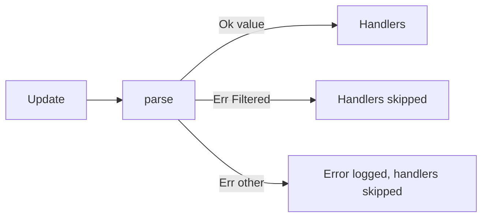

A parser turns one kind of raw update, such as an account update or an instruction, into a typed value. It also declares the [prefilter](/docs/filtering/prefilters) that asks the server for those updates. A [pipeline](/docs/get-started/core-concepts#pipelines) pairs one parser with handlers. The runtime calls `parse` on each matching update and passes a successful result to every handler.

## Built-in program parsers

Each crate exports an `AccountParser` and an `InstructionParser`. Each `InstructionParser` returns `Filtered` for instructions of other programs. Before 0.12.0, the Token Extensions parser also decoded SPL Token instructions as Token-2022 output.

| Program | Address | Crate | Account output | Instruction output |
| --- | --- | --- | --- | --- |
| Token Program | `TokenkegQfeZyiNwAJbNbGKPFXCWuBvf9Ss623VQ5DA` | `shipstern-spl-token-parser` | `TokenProgramState` | `TokenProgram` |
| Token Extensions (Token-2022) | `TokenzQdBNbLqP5VEhdkAS6EPFLC1PHnBqCXEpPxuEb` | `shipstern-spl-token-extensions-parser` | `TokenExtensionState` | `TokenExtensionProgram` |
| SPL Stake Pool | `SPoo1Ku8WFXoNDMHPsrGSTSG1Y47rzgn41SLUNakuHy` | `shipstern-stake-pool-parser` | `SplStakePoolProgramState` | `StakePoolProgram` |
| BPF Loader Upgradeable | `BPFLoaderUpgradeab1e11111111111111111111111` | `shipstern-bpf-loader-parser` | `BpfLoaderState` | `BpfLoaderProgram` |

Register an account parser with `.account(Pipeline::new(AccountParser, handlers))` and an instruction parser with `.instruction(..)` on the runtime builder. The [quickstart](/docs/get-started/quickstart) does this for the SPL Token parsers.

### Read Token-2022 mint extensions

`shipstern_spl_token_extensions_parser::AccountParser` returns `TokenExtensionState`. Match `ExtendedMint` to read the base mint and its extensions. `ExtendedTokenAccount` has the same `base_account` and `extensions` structure for token accounts.

Add `shipstern-spl-token-extensions-parser = "0.13.0"` and `spl-token-2022 = "11"` to the application. Each extension contains a numeric `extension_type` and raw `data`. `NativeExtensionData::try_from` decodes supported payloads, including transfer fees, metadata and transfer hooks:

<include cwd lang="rust">./examples/snippets/src/token_extensions.rs#mint-extensions</include>

Register the handler on the Token-2022 account parser:

<include cwd lang="rust">./examples/snippets/src/token_extensions.rs#register-extensions</include>

Pass `mint_pipeline()` to `.account(..)` on the runtime builder. The example prints the base supply and decimals, then each decoded extension. A `NativeExtensionData` payload error is logged, and the remaining extensions still run. An invalid `extension_type` conversion returns a handler error.

In 0.13.0, `NativeExtensionData` rejects `PermissionedBurn` and `Uninitialized`. Their bytes remain available in `ExtensionData`.

The SPL Token parser does not decode Token-2022 updates, so register the SPL Token and Token-2022 parsers separately when both programs are needed. Each built-in instruction parser names its program as a required transaction account, so two of them in one runtime receive only transactions that name both programs. [Index several programs](/docs/guides/index-several-programs) shows the fix.

## Block-level parsers

These parsers read block-level updates, not a program's data. Their `ProgramParser::program_id` returns a placeholder: `S111111111111111111111111111111111111111112` for slots and `B111111111111111111111111111111111111111112` for block metas.

| Parser | Crate | Register with |
| --- | --- | --- |
| `BlockMetaParser` | `shipstern-block-meta-parser` | `.block_meta(..)` |
| `SlotParser` | `shipstern-slot-parser` | `.slot(..)` |

## Generate a parser from an IDL

`include_shipstern_parser!` from `shipstern-proc-macro` generates an `AccountParser` and an `InstructionParser` from a program's IDL at compile time. It reads Codama JSON and, since 0.12.0, Anchor IDLs directly. See [IDL code generation](/docs/parsers/idl-codegen) for the input formats and the conversion a Shank or Steel IDL needs.

## Write a custom parser

Implement `shipstern_core::Parser`. This parser passes slot updates through unchanged, which is all `SlotParser` does:

<include cwd lang="rust">./examples/snippets/src/parsers.rs#custom-parser</include>

Rules for `id()` and `parse()`:

- Parsers whose prefilters differ must return different IDs. A parser with no configuration can use its type path.
- Return `Err(ParseError::Filtered)` for input the parser does not handle, such as an instruction for another program. The runtime skips handlers without counting an error. With metrics enabled, it still increments the successful counter.

<Note>
If any crate in the build turns on the `proto` feature of `shipstern-core`, every parser's `Output` must implement `prost::Message`. `shipstern-bpf-loader-parser` turns it on by default. Since 0.13.0 the block meta, SPL Token, Token-2022 and Stake Pool parser crates depend on `prost` directly, so they build next to `shipstern-bpf-loader-parser`.
</Note>

## See also

- [Custom protobuf output](/docs/parsers/idl-codegen#custom-protobuf-output): use the `#[shipstern]` attribute with custom parsers.
- [IDL code generation](/docs/parsers/idl-codegen): generate parsers from an Anchor or Codama IDL.
- [Test a parser](/docs/testing): replay devnet fixtures offline.
