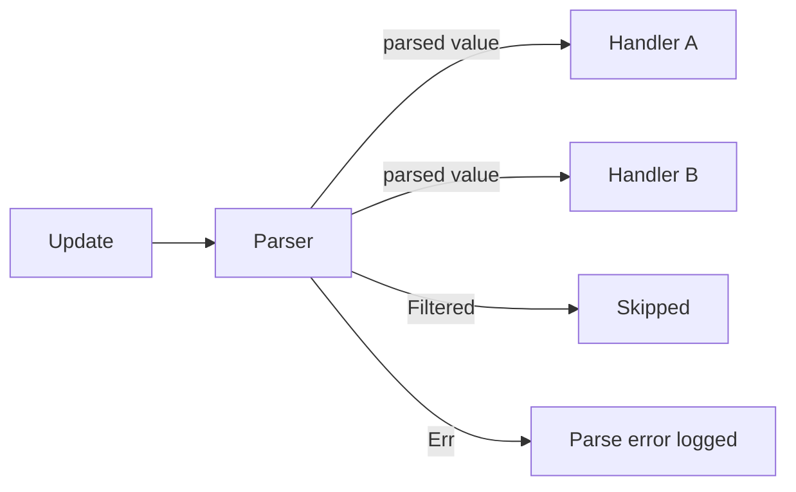

A handler receives each value a parser produces, together with the raw update it came from. Implement `shipstern::Handler<T, R>`, where `T` is the parser's output and `R` is its input. The trait is defined in [`crates/runtime/src/handler.rs`](https://github.com/solana-rpc/shipstern/blob/v0.13.0/crates/runtime/src/handler.rs):

```rust
pub type HandlerResult<T> = Result<T, Box<dyn std::error::Error + Send + Sync + 'static>>;

pub trait Handler<T, R>
where R: Sync
{
    fn handle(&self, value: &T, raw_event: &R) -> impl Future<Output = HandlerResult<()>> + Send;
}
```

Write the method as `async fn handle`. Every sample on this page compiles against Shipstern 0.13.0.

## How handlers run



The handlers in one pipeline run concurrently on the same parsed value. If a parser returns `ParseError::Filtered`, no handler runs and the runtime counts no error.

Those handlers run in no fixed order, so one handler must not depend on another completing first. Put dependent operations in one handler. Several updates also run at once, so state shared by a handler must support concurrent calls.

All handlers for one update share one Tokio task. A handler that blocks the thread, for example with synchronous I/O or long CPU work, also stalls the other handlers of that update. Move that work to `tokio::task::spawn_blocking` or to a [separate task](#forward-values-to-another-task). A handler that panics ends the job for that update, including its other handlers. The runtime keeps running, and no error counter records the panic.

## Log every value

A generic handler works with any parser whose output implements `Debug`:

<include cwd lang="rust">./examples/snippets/src/handlers.rs#logger</include>

## Match typed instructions

Name the parser's output type to work with its fields. `shipstern_spl_token_parser::InstructionParser` produces `TokenProgram`, which wraps an optional `Instruction`:

<include cwd lang="rust">./examples/snippets/src/handlers.rs#token-transfers</include>

Register it like any other handler:

```rust
.instruction(Pipeline::new(InstructionParser, [TokenTransfers]))
```

## Read the raw update

The second argument is the parser's input. For instruction parsers that is `InstructionUpdate`, whose `shared` field carries data common to the whole transaction:

<include cwd lang="rust">./examples/snippets/src/handlers.rs#instruction-context</include>

| `InstructionUpdate` field | Contains |
| --- | --- |
| `program` | Program ID of this instruction |
| `accounts` | Accounts passed to this instruction |
| `data` | Raw instruction data |
| `inner` | Inner instructions this instruction invoked |
| `path` | Position in the transaction, for example `[0]` or `[0, 2]` |
| `shared.slot`, `shared.signature` | Slot and signature of the transaction |
| `shared.bank_id` | Bank of the transaction, the same for its nested instructions. Bank IDs are local to one connection. Sources without banks set the slot (Jetstreamer) or `0` (preconf). |
| `shared.err`, `shared.fee`, `shared.log_messages` | Execution result, fee and logs |
| `shared.transaction_config` | Inline budget settings in a Transaction V1 message; `None` for legacy and V0 messages |
| `shared.compute_units_consumed` | Actual compute units used by the transaction, when the source supplies them |

Account parsers get an `AccountUpdate` instead:

<include cwd lang="rust">./examples/snippets/src/handlers.rs#account-context</include>

## Read instruction logs

An instruction can call another program. Solana calls this a cross-program invocation (CPI).

`shared.log_messages` holds the whole transaction's logs. Use these methods to select logs for one instruction:

| Method | Logs returned |
| --- | --- |
| `raw.log_messages()` | This instruction and its nested calls |
| `raw.direct_log_messages()` | This instruction only, including its invoke and success or failure lines |

<include cwd lang="rust">./examples/snippets/src/instruction_context.rs#instruction-logs</include>

The runtime splits the transaction's logs at each instruction's `invoke` and `success` or `failed` lines and stores the slice in `log_range`. A precompile, such as Ed25519 signature verification, writes no log lines, so both methods return nothing for it. Each later instruction keeps its own lines. Before 0.13.0 a top-level precompile took the next instruction's lines. When a source supplies no logs, both methods return nothing.

An `InstructionUpdate` built by hand needs a `log_range` inside `shared.log_messages`, or `log_messages()` panics on the out-of-range slice. Keep the invocation lines when saving logs for later decoding.

## Distinguish tree paths from flat positions

`path.as_slice()` returns zero-based indices through the instruction tree. Its `Debug` format adds one to each index and joins them with dots.

The [Kafka sink](/docs/outputs/kafka-sink) numbers inner instructions in one flat list per outer instruction, the order Solana's inner-instruction list uses. A tree path such as `3.2.1` can therefore have the flat position `3.3`. Store the transaction signature with either position, and use the flat position to match Kafka record keys and `ix_index` headers.

| Method | Use |
| --- | --- |
| `InstructionUpdate::build_from_txn(raw)` | Build outer instructions with nested calls and shared transaction data |
| `root.visit_all()` | Visit the root and its nested calls, with each parent before its children |
| `root.visit_all_with_flat_indices()` | Visit the same tree and return each instruction's flat position |

<include cwd lang="rust">./examples/snippets/src/instruction_context.rs#instruction-tree</include>

These traversal methods include the root. An instruction handler already runs for each decoded instruction, so traversing again can process nested calls twice.

## Read transaction budget fields

`shared.transaction_config` holds the inline budget from a [Transaction V1](/docs/reference/glossary#solana) message. Legacy and V0 messages have no inline config; their budget comes from Compute Budget instructions instead. Code that checks only those instructions misses V1 inline settings.

`shared.compute_units_consumed` reports actual use, not the requested limit. Both fields describe the whole transaction, not one instruction.

## Forward values to another task

Keep handlers fast. For slow work such as database writes, send values to a channel and do the work in a separate task:

<include cwd lang="rust">./examples/snippets/src/handlers.rs#forward</include>

A bounded channel applies backpressure. When the writer falls behind, `send` waits and the job holds its worker slot, so the runtime reads the stream more slowly instead of using unbounded memory.

A successful `send` means the value was queued, not that the writer persisted it. The runtime does not join tasks the application spawns, so the example awaits the writer after the run returns. Without that wait, values still in the channel are lost when the process exits. See [Delivery and ordering](/docs/runtime/delivery#drain-application-writers-on-shutdown).

## Return errors

Return `Err` from `handle` to report a failure. `?` converts any error that implements `std::error::Error + Send + Sync + 'static`.

| What happens | Where |
| --- | --- |
| A `Handler failed` event at `error` level, with the error chain and the pipeline's parser ID | The application's `tracing` subscriber |
| `shipstern_*_handler_errors` goes up by one per pipeline call, however many of its handlers failed | Prometheus, with the `prometheus` feature |
| Other handlers and later updates keep running | The runtime does not stop |

The runtime does not retry a failed handler or replay its update. When the destination must not miss data, add bounded retries in the handler or persist failed records for later replay. See [Delivery and ordering](/docs/runtime/delivery).

## See also

- [Runtime](/docs/runtime): how handlers are scheduled and shut down.
- [Parsers](/docs/parsers): output types of the built-in parsers.
