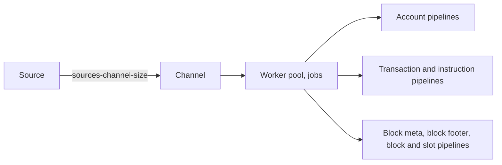
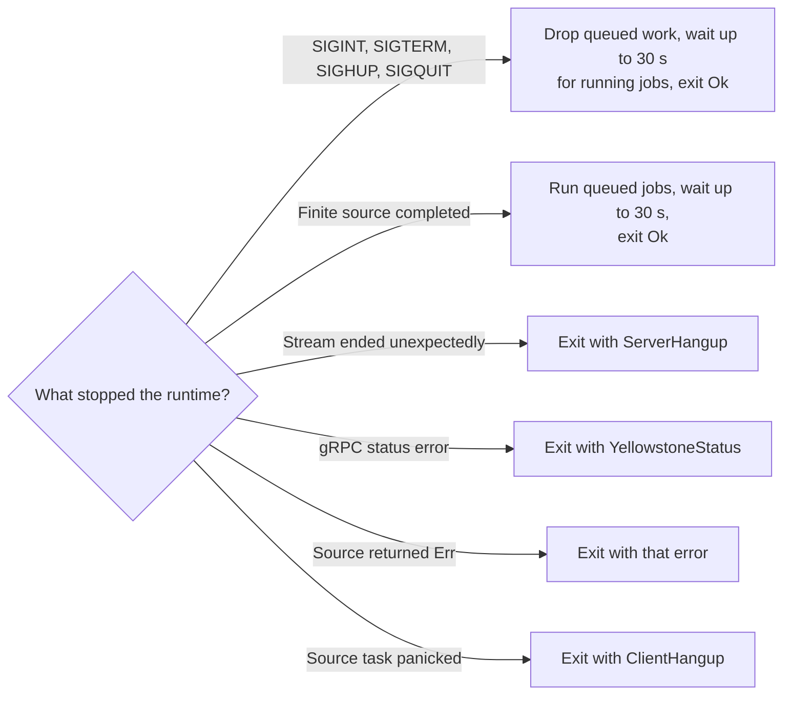

The runtime connects a source to the registered [pipelines](/docs/reference/glossary#shipstern) (a pipeline is one parser plus its handlers). It owns the subscription, the worker pool that runs parsers and handlers, signal handling and metrics.

## Build a runtime

<include cwd lang="rust">./examples/snippets/src/production.rs#build-runtime</include>

| Method | Registers |
| --- | --- |
| `.account(pipeline)` | A pipeline for `AccountUpdate` |
| `.transaction(pipeline)` | A pipeline for `TransactionUpdate` |
| `.instruction(pipeline)` | A pipeline for `InstructionUpdate`. All instruction pipelines are bundled into one. |
| `.block_meta(pipeline)` | A pipeline for `BlockMetaUpdate` |
| `.block_footer(pipeline)` | A pipeline for `BlockFooterUpdate`. See [Receive block footers](#receive-block-footers). |
| `.block(pipeline)` | A pipeline for `BlockUpdate` |
| `.slot(pipeline)` | A pipeline for `SlotUpdate` |
| `.metrics(registry)` | A `prometheus::Registry` for the runtime's counters. Needs the `prometheus` feature. |

### Name the source

The builder does not depend on a source, so one set of pipelines builds against any of them. Name the source in the build call:

| Call | Source | Requires |
| --- | --- | --- |
| `build::<S>(config)`, `try_build::<S>(config)` | Built from the `[source]` section of a `ShipsternConfig<S::Config>` | `S: FromConfig`, which every built-in source implements |
| `build_with(source, buffer)`, `try_build_with(source, buffer)` | A constructed source value; its type is inferred | `S: SourceTrait` |

`Runtime` with no type parameter is `Runtime<Box<dyn SourceTrait>>`. To pick the source at startup, box it as `Box<dyn SourceTrait>` and pass it to `build_with` with a `BufferConfig`. Box a `dyn FilterUpdateSource` instead to access [`handle()`](/docs/runtime#change-the-subscription-while-running).

### `build` and `try_build`

`build` and `build_with` log the error and exit the process if the builder refuses the pipelines. `try_build` and `try_build_with` return a `Result<Runtime<S>, BuilderError>` instead. The builder refuses two account, transaction, block meta, block footer, block or slot pipelines with the same parser ID (see [`BuilderError`](/docs/reference/errors#buildererror)). Two instruction pipelines with the same ID are allowed: the runtime logs a warning and runs both.

## Run the runtime

| Method | Tokio runtime | On a fatal error |
| --- | --- | --- |
| `run()` | Creates one and blocks | Exits the process |
| `try_run()` | Creates one and blocks | Returns `Err(Box<shipstern::Error>)` |
| `run_async().await` | Uses the current one | Exits the process |
| `try_run_async().await` | Uses the current one | Returns `Err(Box<shipstern::Error>)` |

Use `run()` from a plain `fn main`. Use `run_async()` inside `#[tokio::main]` when the application also spawns tasks, such as a metrics pusher.

## Size the worker pool

A job is the processing of one update: its parser runs, then its handlers. Updates go from the source into a channel (`sources-channel-size`, default `100`) and then into the worker pool. `jobs` caps the outstanding jobs, queued plus running, and defaults to the number of CPUs. The runtime treats `jobs = 0` as `1`.

Each job runs as one Tokio task, not on a dedicated thread. When all `jobs` slots are taken, the runtime waits for a free slot before it reads the next update, so the channel fills and the source waits. Increase `jobs` only after measuring whether parsing, I/O or the source limits throughput.

Updates can finish out of order, including updates for the same account or slot. `jobs = 1` serialises jobs, but the handlers inside one pipeline still run concurrently. See [Delivery and ordering](/docs/runtime/delivery).

## Shut down

The runtime stops when the first of these happens:

A source that returns `SourceExitStatus::Error` exits with `Other`. When a stream error stops the buffer, the run returns that error, also when the source then reports `ReceiverDropped`. Before 0.13.0 the run returned `Ok(())` in that case. See [Errors](/docs/reference/errors#shipsternerror) for what each variant means. On non-Unix platforms the runtime handles only Ctrl+C.

The 30-second ceiling applies to the final wait for running jobs. A drain timeout logs `Buffer drain timed out` and the run still returns `Ok(())`, so a successful exit does not prove that every handler finished. After the timeout, `run()` and `try_run()` drop their Tokio runtime, which cancels the abandoned jobs. With `run_async()`, the abandoned jobs keep running on the application's runtime until it shuts down.

A finite source has no overall deadline. Every queued update still runs, and if stuck jobs hold all `jobs` slots, the queue never drains. The runtime also stops acting on signals once the source has completed, so a signal during this drain does not shorten it. Use a supervisor timeout for finite runs that must end.

On a fatal source error, the run returns without the drain. See [Delivery and ordering](/docs/runtime/delivery#drain-application-writers-on-shutdown) for what this means for durable writes.

## Change the subscription while running

With the Yellowstone gRPC source, take a `RuntimeHandle` before starting the runtime to change filters without reconnecting:

<include cwd lang="rust">./examples/snippets/src/production.rs#runtime-handle</include>

With a handle, a processed stream (the default commitment) does not reconnect: a stream loss ends the run. A confirmed or finalized stream reconnects with the newest filter set. See [Reconnects](/docs/sources/yellowstone-grpc#reconnects) and [Live filter updates](/docs/filtering/live-filter-updates).

## Receive block footers

On an Alpenglow cluster, a footer pipeline gets one footer per block. A footer carries the bank hash, the producer's timestamp and user agent, and optionally the vote certificates. The pipeline takes `BlockFooterUpdate`, and its parser asks for footers with `PrefilterBuilder::block_footers`. This parser passes each footer on unchanged:

<include cwd lang="rust" meta='title="src/block_footers.rs"'>./examples/snippets/src/block_footers.rs#block-footer</include>

`block_footers(true)` also requests the vote certificates. Each certificate is for its own slot, not the footer slot. The final certificate is for the newest block that the producer knew as finalized, and the reward certificates are for the footer slot minus 8. Read the `slot` of each certificate. A filter with `false` can still get certificates, because Fumarole and some servers send them to every footer filter when one filter asks for them.

| Source | Delivers footers |
| --- | --- |
| Yellowstone gRPC | Yes, on an Alpenglow cluster, from a server on yellowstone-grpc proto 13 or newer. A proto 12.7 or older server ignores the footer filter. A proto 13 server sends the certificates at field numbers that proto 14 reserves, so they are dropped. |
| Fumarole | Yes: the source sends the footer filter and forwards the footers the service sends. |
| Jetstreamer | No. The source logs a warning for each footer prefilter. |
| `CoordinatorSource` | No. It removes the footer filter and logs one warning that lists the update kinds it does not forward, block footers among them. |
| Solana RPC, snapshot, preconf | No. They send only account, slot or transaction updates. |

Footer and block meta handlers run as separate jobs, in no fixed order. To use a footer with other updates of its block, join them on (`slot`, `bank_id`) in the application's state. This join works on the gRPC source. On Fumarole, slot statuses have no `bank_id`, so a slot status cannot join a footer there. Footers have their own `shipstern_block_footers_*` [counters](/docs/observability/metrics#counters) and `shipstern.process.block_footer` [span](/docs/observability/tracing#spans).

## See also

- [Configuration](/docs/get-started/configuration): the `[buffer]` section and its defaults.
- [Metrics](/docs/observability/metrics): counters the runtime registers.
- [Delivery and ordering](/docs/runtime/delivery): retries, checkpoints and shutdown limits.
- [Guide: pick a source at startup](/docs/guides/pick-a-source-at-startup): `build_with` and `Box<dyn SourceTrait>` in a full program.
