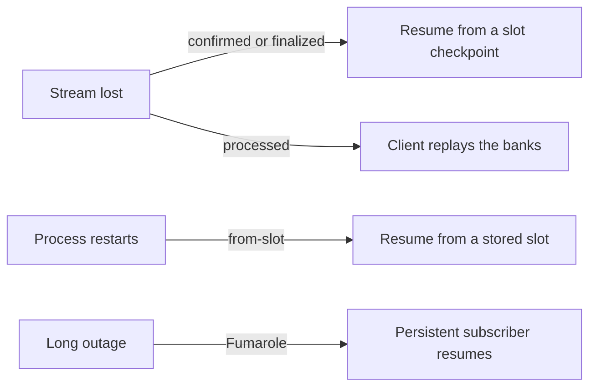

Check these points before a Shipstern pipeline runs unattended: recovery after failures, idempotent writes, shutdown timing, secrets and alerts.

## Know what reconnects cover

The Yellowstone gRPC source picks its [reconnect mode](/docs/sources/yellowstone-grpc#reconnects) from the commitment. Both modes need a server that stores slots. Bank replay at `processed` also needs bank IDs (yellowstone-grpc proto 13 or newer). On an older server at `processed`, set `auto-reconnect = false` and rely on a supervisor.

| Failure | Covered by | Notes |
| --- | --- | --- |
| Stream lost at `confirmed` or `finalized` | `auto-reconnect` (on by default) | The source resumes from a slot checkpoint, also with a `from-slot` or a `RuntimeHandle`. 10 retries, waiting 0.5 s and doubling to a cap of 10 s: about 65 s. The missed slots must still be on the server. A clean close by the server, with no error status, also resumes. |
| Stream lost at `processed` | `auto-reconnect`, only with no `from-slot` and no `RuntimeHandle` | The client replays the banks that the loss cut off. 10 retries with no wait cap: about 8.5 minutes. A clean close by the server also reconnects. With a `from-slot` or a `RuntimeHandle`, the run ends at the first loss. |
| Reconnect is off, or the retries run out | Nothing automatic | The run ends with `ServerHangup` after a clean close, or with `YellowstoneStatus` after an error status. The process supervisor (for example a Kubernetes restart policy) must restart it, resuming from the last checkpoint with `from-slot`. |
| Initial connection fails, or a terminal status such as `Unauthenticated` | Nothing automatic | The run ends with the error. |
| Process restarts | Nothing automatic | Store the last completed slot and pass it as `from-slot` on start. The server must still hold that slot. |
| Outage longer than the server's replay window | Fumarole | A named subscriber resumes where it stopped. |

## Make handlers idempotent

After a reconnect or a restart with `from-slot`, some updates can arrive again. Write handlers so that processing an update twice has the same effect as processing it once:

- Key instruction rows by transaction signature plus instruction `path`. For live account writes, include pubkey, slot and `write_version`, because an account can change several times in one slot. RPC and snapshot updates set `write_version` to zero.
- Use upserts (`INSERT ... ON CONFLICT DO NOTHING` or equivalent) rather than plain inserts.
- Persist the checkpoint with the data only after all required work through that slot completes. Jobs finish out of order, so the highest slot one handler has written is not a safe checkpoint. See [Delivery and ordering](/docs/runtime/delivery#store-a-processing-checkpoint).

## Choose a commitment level

| Level | Latency | Can be rolled back |
| --- | --- | --- |
| `processed` | Lowest | Yes. Use for dashboards and alerts that tolerate reverts. |
| `confirmed` | Slightly higher | Very rarely |
| `finalized` | About 32 slots more | No. Use for balances, accounting and irreversible operations. |

## Keep secrets out of the config file

Read the rest of the config from the TOML file, then fill the token from the environment:

<include cwd lang="rust" meta='title="src/main.rs"'>./examples/snippets/src/production.rs#secrets-from-env</include>

## Size the worker pool

- Start with the defaults: `jobs` equal to the CPU count, `sources-channel-size = 100`.
- If handlers fall behind the stream, raise `jobs` only when they wait on I/O. More jobs do not help CPU-bound handlers.
- For slow writes, prefer a bounded channel to a separate writer task over a large `jobs` value. See [Handlers](/docs/runtime/handlers#forward-values-to-another-task).

## Shut down cleanly

On `SIGTERM` (also `SIGINT`, `SIGHUP` and `SIGQUIT`) the runtime drops queued updates, waits up to 30 seconds for jobs that already started, then returns `Ok(())`. A drain timeout logs a warning but does not turn the run into an error. Because of these dropped updates, handlers must be idempotent and the pipeline needs a stored slot. Drain any application-owned writer task after the run returns.

- **Kubernetes:** set `terminationGracePeriodSeconds` above 30 plus the writer's drain time (for example 45). The default is exactly 30, which kills the process before the runtime's window ends.
- **systemd / Docker:** make the stop timeout longer than 30 seconds for the same reason.

## Pin dependencies

- Commit `Cargo.lock` for the binary, so a rebuild cannot pick up a different transitive version.
- Upgrade all `shipstern*` crates together, reading each release's [upgrade impact table](/docs/releases).
- Build with Rust 1.97.1 or later. The Agave 4.3.2 crates under the mock, RPC, snapshot and Jetstream crates need it.

## Alert on these metrics

| Alert | Query | Means |
| --- | --- | --- |
| Stream stalled | `rate(shipstern_transactions_received[5m]) == 0` | No input. Check the source and the provider. |
| Handlers failing | `rate(shipstern_instructions_handler_errors[5m]) > 0` | The handler or database is failing. |
| Parser drift | `rate(shipstern_instructions_parsing_errors[15m]) > 0` | Usually a program upgrade the IDL does not describe. |

Use the counters for the registered update kinds. [Metrics](/docs/observability/metrics) has the full list. The runtime serves no HTTP endpoint, so push the registry or serve it from the application. A handler panic increments no counter. With the default panic hook it appears only on stderr, so collect stderr as well.

## Log at `info`

Run with `RUST_LOG=info`. The `shipstern.parse` and `shipstern.handle` spans are `debug` because they fire for every parser and handler call. Turn them on only while investigating.

## See also

- [Delivery and ordering](/docs/runtime/delivery): the boundary between transport recovery and durable processing.
- [Yellowstone gRPC](/docs/sources/yellowstone-grpc): reconnect settings and replay requirements.
- [Metrics](/docs/observability/metrics): counter semantics and monitoring limits.
