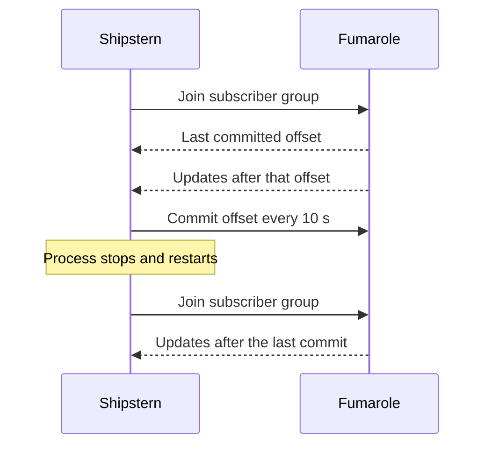

`YellowstoneFumaroleSource` streams Yellowstone updates from [Yellowstone Fumarole](https://github.com/rpcpool/yellowstone-fumarole), a persistent stream service from Triton. Fumarole stores the stream position of a named subscriber (a consumer group) on the server, so a restarted process continues from the last committed position instead of the live tip. The Shipstern README describes Fumarole as merging data from several nodes and lists it as a limited beta. Contact Triton for access.

## Choose Fumarole or Yellowstone gRPC

| Requirement | Source |
| --- | --- |
| Resume after a restart or a long outage without storing a slot in the application | Fumarole |
| Change the subscription while running | [Yellowstone gRPC](/docs/sources/yellowstone-grpc) |
| Full block updates, account data slices or a start slot in the config | [Yellowstone gRPC](/docs/sources/yellowstone-grpc) |
| A self-hosted endpoint, or no Triton beta access | [Yellowstone gRPC](/docs/sources/yellowstone-grpc) |

The pipelines are the same for both sources. Only the source type and the `[source]` section change.

## Create the subscriber first

The source joins an existing subscriber and does not create one. Create it once with the Fumarole CLI, as the [released Fumarole example](https://github.com/solana-rpc/shipstern/tree/v0.13.0/examples/fumarole) describes. Install the CLI and write its config file:

```sh
cargo install yellowstone-fumarole-cli
```

```yaml title="~/.fumarole/config.yaml"
endpoint: https://fumarole.example.com
x-token: <X-TOKEN>
```

Test the connection, then create the subscriber at the tip of the log:

```sh
fume test-config
fume create --name my_subscriber_group
```

Use the same name as `subscriber-name` in `Shipstern.toml`. The start position is fixed when the subscriber is created, and the source has no key to move it.

## Quick start

```toml title="Cargo.toml"
[dependencies]
rustls = "0.23"
shipstern = "0.13.0"
shipstern-spl-token-parser = "0.13.0"
shipstern-yellowstone-fumarole-source = "0.13.0"
tokio = { version = "1", features = ["macros", "rt-multi-thread"] }
toml = "0.8"
tracing-subscriber = { version = "0.3", features = ["env-filter"] }
```

```toml title="Shipstern.toml"
[source]
endpoint = "https://fumarole.example.com"
x-token = "<X-TOKEN>"
subscriber-name = "my_subscriber_group"
accept-compression = "zstd"
```

<include cwd lang="rust" meta='title="src/main.rs"'>./examples/sources/src/bin/fumarole.rs</include>

`sources::Logger` prints each parsed value. [Log every value](/docs/runtime/handlers#log-every-value) shows the same handler. The released example is this program with a `--config` flag.

## Configure the source

All keys go in the `[source]` section and are written in kebab-case. `endpoint` and `subscriber-name` are required. The [configuration reference](/docs/reference/configuration#fumarole-source) lists every key with its type and default.

Several keys differ from the Yellowstone gRPC source:

| Key | Fumarole behaviour |
| --- | --- |
| `subscriber-name` | Fumarole only. Names the subscriber created with `fume create`. |
| `accept-compression` | Same values, `gzip` or `zstd`, but no default. Without the key, the client neither compresses requests nor accepts compressed responses. The Fumarole client documentation recommends `zstd` for high-traffic streams. |
| `max-decoding-message-size` | Unset means no limit. |
| `timeout` | No such key. The Fumarole client sets a fixed 5-second connect timeout and no request timeout. |
| `from-slot` | No such key. The subscriber holds the start position. |
| `auto-reconnect`, `reconnect-*` | No such keys. See [Handle errors and stops](#handle-errors-and-stops). |
| `accounts-data-slice` | No such key. The source requests no data slices. |

`FumaroleConfig` does not reject unknown keys, so a `timeout` or `from-slot` line copied from a gRPC config parses and has no effect. The source always opens four data connections and commits its position every 10 seconds. Neither setting is configurable in 0.13.0.

## Resume after a restart



When the source subscribes, Fumarole returns the subscriber's last committed offset and the client continues from it. The client commits once when the session starts, then every 10 seconds. It does not commit when the process stops.

<Warning>
The committed offset covers updates the client has passed to the source, not updates the handlers have finished. After a restart, every update after the last commit arrives again. Updates that were committed but still queued in the runtime when the process stopped are not delivered again. Make handlers idempotent, and keep an application checkpoint where a lost update matters. See [Delivery and ordering](/docs/runtime/delivery#store-a-processing-checkpoint).
</Warning>

## Know which prefilters reach Fumarole

The source turns the pipelines' [prefilters](/docs/filtering/prefilters) into one Yellowstone `SubscribeRequest`, sets `commitment-level` on it, and passes it to the Fumarole client. The client sends the service a filter with only account, transaction, transaction status, entry, block meta and block footer maps. It builds slot updates itself from the subscriber's history.

| Prefilter part | Result |
| --- | --- |
| Account options, including data filters and cuckoo sets | Sent to Fumarole |
| Transaction options | Sent to Fumarole |
| `block_metas()` | Sent to Fumarole |
| `slots()` | Built by the client, with no `bank_id`. By default the client delivers only slots at the subscription's commitment. `slot_interslot_updates(true)` adds the processed, confirmed and finalized statuses, but no `CreatedBank` or `Dead`. A dead slot arrives as one of these statuses with `dead_error` set. |
| `block_footers(..)` | Sent to Fumarole. When any footer prefilter asks for certificates, every footer pipeline receives them. |
| Block options (`block_accounts_include`, `block_include_*`) | Not sent. The Fumarole filter has no block field, so a block pipeline receives nothing. |

The crate's only test covers a failed connection, so nothing in the release checks which filter fields the service applies. Keep [handler checks](/docs/filtering/prefilters#keep-handler-checks-for-exact-selection) for exact selection.

## Handle errors and stops

| Event | Run result |
| --- | --- |
| The client cannot connect: bad URL, TLS setup or unreachable host | `shipstern::Error::Other` wrapping `yellowstone_fumarole_client::ConnectError` |
| The service version request fails | `shipstern::Error::YellowstoneStatus(status)` |
| The service version is below minor version 39 or does not parse | `shipstern::Error::Other`, with the message `Fumarole service version <version> is not supported` |
| Fumarole refuses the subscription | `shipstern::Error::YellowstoneStatus(status)` |
| The client reports an error during the stream | `YellowstoneStatus(status)` |
| The client's update stream ends without an error | `ServerHangup` |
| The client panics while joining | `ClientHangup` |
| `SIGINT` or `SIGTERM` | `Ok(())` |

Inside a session, the Fumarole client tries a slot download up to 3 times after a transient status such as `Unavailable` or `Internal`. It also rejoins the control plane up to 3 times after such a status or a transport error. Failures it does not recover reach the runtime as a status and end the run. The source has no retry loop of its own, and `run()` and `run_async()` exit the process with status 1 on any error. Restart the process from a supervisor, and the subscriber continues from its last committed offset.

On a signal, the runtime drops queued updates and gives running jobs up to 30 seconds, as it does for every source. The source stops at its next failed send, and dropping the client's receiver stops the Fumarole session. See [Drain application writers on shutdown](/docs/runtime/delivery#drain-application-writers-on-shutdown).

## Live filter updates

`YellowstoneFumaroleSource` does not implement `FilterUpdateSource`, so `runtime.handle()` is a compile error. The source ignores the filter update slot in `SourceContext` and never sends a new request to the client. To change the subscription, change the prefilters and restart the process. See [Live filter updates](/docs/filtering/live-filter-updates).

## Know the limits

- The source needs a Fumarole service at minor version 39 or newer. It checks the version at connect and ends the run on an older or unparsable one.
- The client does not retry a slot download that the service answers with `NotFound`. The session ends, and the run ends with `YellowstoneStatus`.
- The 0.9.0 Fumarole client used by 0.13.0 supports a subscriber with one shard only and asserts this when it joins. The release has no test or example of two processes sharing one `subscriber-name`, so do not assume a second process splits the stream.
- The Fumarole example README in the release lists `metrics-endpoint`, `metrics-job-name` and `metrics-interval` keys, and gives `zstd` as the `accept-compression` default. `FumaroleConfig` in 0.13.0 has neither. The metrics keys are ignored, and compression is off unless set. Export runtime metrics with [Prometheus](/docs/observability/metrics) instead.

## See also

- [Sources overview](/docs/sources): compare every source.
- [Yellowstone gRPC source](/docs/sources/yellowstone-grpc): live filter updates, data slices and in-process reconnects.
- [Configuration reference](/docs/reference/configuration#fumarole-source): every Fumarole key with type and default.
- [Run in production](/docs/runtime/production): idempotent handlers and recovery after downtime.
- [Errors](/docs/reference/errors#shipsternerror): every `shipstern::Error` variant.
