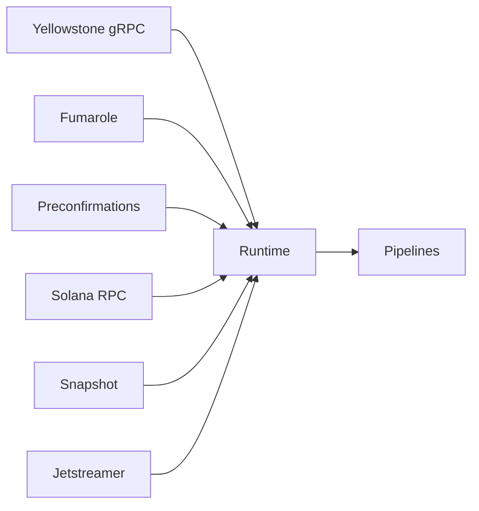

A [source](/docs/reference/glossary#shipstern) connects to a data provider and sends Yellowstone `SubscribeUpdate` messages to the runtime, which routes each one to the matching [pipelines](/docs/get-started/core-concepts#pipelines). The runtime gives the source a filter set built from the pipelines' [prefilters](/docs/filtering/prefilters), and the source turns it into its request.

The last call on the runtime builder names the source type, for example `.build::<YellowstoneGrpcSource>(config)`. `config` is a `ShipsternConfig` whose `source` field holds the source's settings, usually read from the `[source]` section of a TOML file. The pipelines do not depend on the source, so the same builder works with any of them. To pick the source at startup, see [Name the source](/docs/runtime#name-the-source).

## Compare sources

| Source | Crate | Data | Runs | Live filter updates |
| --- | --- | --- | --- | --- |
| [Yellowstone gRPC](/docs/sources/yellowstone-grpc) | `shipstern-yellowstone-grpc-source` | Live accounts, transactions, blocks, slots | Until stopped | Yes |
| [Fumarole](/docs/sources/fumarole) | `shipstern-yellowstone-fumarole-source` | Live, persistent streams with consumer groups | Until stopped | No |
| [Preconfirmations](/docs/sources/preconf) | `shipstern-preconf-source` | Transactions that Triton's Harmonic and BAM feeds report during the slot | Until stopped | No |
| [Solana RPC](/docs/sources/solana-rpc) | `shipstern-solana-rpc-source` | Current program accounts via `getProgramAccounts` | Finishes | No |
| [Snapshot](/docs/sources/solana-snapshot) | `shipstern-solana-snapshot-source` | Accounts from a local ledger snapshot | Finishes | No |
| [Jetstreamer](/docs/sources/jetstreamer) | `shipstern-jetstream-source` | Historical blocks from Old Faithful archives | Finishes | No |



## Code for each source

The pipelines stay the same. Only the source type and the `[source]` section change.

<Tabs items={['Yellowstone gRPC', 'Fumarole', 'Preconfirmations', 'Solana RPC', 'Snapshot', 'Jetstreamer']}>
<Tab value="Yellowstone gRPC">

```toml title="Shipstern.toml"
[source]
endpoint = "https://yellowstone.example.com"
x-token = "<X-TOKEN>"
timeout = 60
```

Select it with `.build::<YellowstoneGrpcSource>(config)`. The [quickstart](/docs/get-started/quickstart) has the complete program.

</Tab>
<Tab value="Fumarole">

```toml title="Shipstern.toml"
[source]
endpoint = "https://fumarole.example.com"
x-token = "<X-TOKEN>"
subscriber-name = "my_subscriber_group"
```

The subscriber named by `subscriber-name` must already exist. Create it with the Fumarole CLI (`cargo install yellowstone-fumarole-cli`), for example `fume create --name my_subscriber_group`, as the [released Fumarole example](https://github.com/solana-rpc/shipstern/tree/v0.13.0/examples/fumarole) shows.

<include cwd lang="rust" meta='title="src/main.rs"'>./examples/sources/src/bin/fumarole.rs</include>

</Tab>
<Tab value="Preconfirmations">

```toml title="Shipstern.toml"
[source]
x-token = "<X-TOKEN>"
harmonic-regions = ["fra"]
```

Select it with `.build::<PreconfSource>(config)`. Triton enables each feed on the token separately. The [preconfirmation source page](/docs/sources/preconf) has the complete program, every key and the prefilter limits.

</Tab>
<Tab value="Solana RPC">

```toml title="Shipstern.toml"
[source]
endpoint = "https://api.mainnet-beta.solana.com"
timeout = 60
commitment_level = "confirmed"
```

<include cwd lang="rust" meta='title="src/main.rs"'>./examples/sources/src/bin/rpc-backfill.rs#rpc-backfill</include>

</Tab>
<Tab value="Snapshot">

```toml title="Shipstern.toml"
[source]
ledger_path = "/path/to/ledger"
channel_size = 1000
```

<include cwd lang="rust" meta='title="src/main.rs"'>./examples/all-sources/src/bin/snapshot.rs</include>

The ledger directory must already hold the genesis file and the snapshot archives. See [Prepare the ledger directory](/docs/sources/solana-snapshot#prepare-the-ledger-directory).

</Tab>
<Tab value="Jetstreamer">

```toml title="Shipstern.toml"
[source]
archive-url = "https://api.old-faithful.net"
threads = 4
network = "mainnet"
compact-index-base-url = "https://files.old-faithful.net"
network-capacity-mb = 1000

[source.range]
slot-start = 382320000
slot-end = 382320003
```

<include cwd lang="rust" meta='title="src/main.rs"'>./examples/all-sources/src/bin/jetstreamer.rs</include>

`init_process_env` sets process-wide environment variables, so the program calls it from a plain `fn main` before `run()` starts Tokio. See [Initialise the environment before Tokio starts](/docs/sources/jetstreamer#initialise-the-environment-before-tokio-starts).

`shipstern-jetstream-source` is on crates.io only up to 0.9.0. Take it, and every other Shipstern crate, from the `v0.13.0` git tag, as [Add the crate](/docs/sources/jetstreamer#add-the-crate) shows.

</Tab>
</Tabs>

## Run any source from one binary

This program builds five sources into one binary, every source except the preconfirmation source, and the `kind` key in `[source]` picks the source when it starts. [Pick a source at startup](/docs/guides/pick-a-source-at-startup) does the same for three of them.

```toml title="Cargo.toml"
[dependencies]
clap = { version = "4.5", features = ["derive"] }
rustls = "0.23"
serde = { version = "1", features = ["derive"] }
shipstern = { git = "https://github.com/solana-rpc/shipstern", tag = "v0.13.0" }
shipstern-jetstream-source = { git = "https://github.com/solana-rpc/shipstern", tag = "v0.13.0" }
shipstern-solana-rpc-source = { git = "https://github.com/solana-rpc/shipstern", tag = "v0.13.0" }
shipstern-solana-snapshot-source = { git = "https://github.com/solana-rpc/shipstern", tag = "v0.13.0" }
shipstern-spl-token-parser = { git = "https://github.com/solana-rpc/shipstern", tag = "v0.13.0" }
shipstern-stake-pool-parser = { git = "https://github.com/solana-rpc/shipstern", tag = "v0.13.0" }
shipstern-yellowstone-fumarole-source = { git = "https://github.com/solana-rpc/shipstern", tag = "v0.13.0" }
shipstern-yellowstone-grpc-source = { git = "https://github.com/solana-rpc/shipstern", tag = "v0.13.0" }
toml = "0.8"
tracing = "0.1"
tracing-subscriber = { version = "0.3", features = ["env-filter"] }
```

Every Shipstern crate comes from the `v0.13.0` git tag, because `shipstern-jetstream-source` 0.13.0 is not on crates.io. Cargo treats a crates.io `shipstern` and a git `shipstern` as two crates. A mix builds two copies of `SourceTrait`, `Pipeline` and the other shared types, and the program does not compile.

<include cwd lang="rust" meta='title="src/main.rs"'>./examples/all-sources/src/main.rs</include>

| Part | What it does |
| --- | --- |
| `SourceConfig` | One variant per source. `kind` selects it, and the other keys in `[source]` go to that source's config type. |
| `Box<dyn SourceTrait>` | Gives the five match arms one type, which `build_with(source, buffer)` takes. |
| `init_process_env` | Runs only in the `jetstreamer` arm, before `run()` starts Tokio. The other sources read no environment variables. |
| `StakePoolParser` | The account pipeline. The streaming, RPC and snapshot sources deliver stake pool accounts. |
| `TokenInstructions` | The instruction pipeline. The streaming sources and Jetstreamer deliver transactions. |

Each kind takes the keys of its source. These configs use placeholder values:

<Tabs items={['yellowstone-grpc', 'fumarole', 'solana-rpc', 'solana-snapshot', 'jetstreamer']}>
<Tab value="yellowstone-grpc">

```toml title="Shipstern.toml"
[source]
kind = "yellowstone-grpc"
endpoint = "https://yellowstone.example.com"
x-token = "<X-TOKEN>"
timeout = 60
```

</Tab>
<Tab value="fumarole">

```toml title="Shipstern.toml"
[source]
kind = "fumarole"
endpoint = "https://fumarole.example.com"
x-token = "<X-TOKEN>"
subscriber-name = "my_subscriber_group"
```

</Tab>
<Tab value="solana-rpc">

```toml title="Shipstern.toml"
[source]
kind = "solana-rpc"
endpoint = "https://rpc.example.com"
timeout = 60
commitment_level = "confirmed"
```

</Tab>
<Tab value="solana-snapshot">

```toml title="Shipstern.toml"
[source]
kind = "solana-snapshot"
ledger_path = "/path/to/ledger"
channel_size = 1000
```

</Tab>
<Tab value="jetstreamer">

```toml title="Shipstern.toml"
[source]
kind = "jetstreamer"
archive-url = "https://api.old-faithful.net"
threads = 4
network = "mainnet"
compact-index-base-url = "https://files.old-faithful.net"
network-capacity-mb = 1000

[source.range]
slot-start = 382320000
slot-end = 382320003
```

</Tab>
</Tabs>

Run it with `RUST_LOG=info cargo run -- --config Shipstern.toml`. The live sources run until stopped, and the other three exit when they finish.

## Choose a source

- **Index live activity**: Yellowstone gRPC. It is the only source that can change its subscription without reconnecting.
- **Resume after downtime**: Fumarole. It merges data from several nodes and resumes a named subscriber where it stopped. The 0.9.0 client stops on a subscriber group with more than one shard. The source needs a Fumarole service at minor version 39 or newer. Fumarole is in limited beta from Triton, so contact Triton for access.
- **See transactions before the block settles**: Preconfirmations. The feed is the block producer's statement, not the cluster's, so check settlement with another source.
- **Backfill current account state**: Solana RPC for a program's accounts today, or a snapshot for a full offline load.
- **Replay history**: Jetstreamer, over a slot range or an epoch.

## Know the limits

<Warning>
The Solana RPC and snapshot sources select accounts by owner only. They do not apply the `accounts` set or the data comparisons in a prefilter (memcmp, data size and the rest), so a prefilter that narrows on them still loads every account the owner holds.
</Warning>

- Jetstreamer replays finalized history only, so every replayed slot reports `SLOT_FINALIZED`.
- Jetstreamer does not emit account updates. It does not apply the include, required, exclude or status conditions of a transaction prefilter, so any transaction prefilter receives every transaction in the selected history. Parsers must reject unrelated instructions locally.
- The preconfirmation source sends transaction updates only, with no slot or account updates. Its meta carries only the outcome, and its prefilters match only static account keys. See [prefilter limits](/docs/sources/preconf#know-which-prefilters-reach-the-feed).
- RPC and snapshot account subscriptions need at least one owner. A key-only or `accounts_include_all()` prefilter with no owners loads no accounts. Both sources emit account states with `write_version = 0` and no transaction signature.
- The RPC source runs one `getProgramAccounts` request per owner in each prefilter, each after its own `getSlot` call. The slot on each update comes from that `getSlot` call, not from the response context. The result is therefore a current-state backfill, not one atomic snapshot across programs.
- Live filter updates through `RuntimeHandle` exist only for sources that implement `FilterUpdateSource`, and today only Yellowstone gRPC does. Calling `runtime.handle()` on another source, or on a `Box<dyn SourceTrait>`, is a compile error.

## Write a custom source

A source is any `Debug + Send + Sync + 'static` value that implements `shipstern::sources::SourceTrait`. The trait uses `#[async_trait]` and has one method:

```rust
async fn connect(&self, ctx: SourceContext) -> Result<SourceExitStatus, shipstern::Error>;
```

| Part | What to do |
| --- | --- |
| `SourceContext` | Read `filters` (the set built from the pipelines' prefilters) and send updates to `tx`. It is `#[non_exhaustive]`, so destructure it with `let SourceContext { filters, tx, .. } = ctx;`. In tests, build one with `SourceContext::new(filters, tx)`. |
| Return value | Return `Ok(SourceExitStatus::Completed)` when a finite source has sent everything, and `ReceiverDropped` when a send fails because the runtime stopped. Return `Err` when the source fails, and the run ends with that error. |
| `FromConfig` | Optional. Set `type Config` and `from_config` to build the source from `[source]` with `build::<S>(config)`. Without it, pass a value to `build_with(source, buffer)`. |
| `FilterUpdateSource` | Optional marker that enables `runtime.handle()`. Implement it only if `connect` reads `ctx.filter_updates` and applies each set. Nothing checks this. If `connect` ignores the slot, `update_filters` returns `Ok` and the update is never applied. |

The doc comments in the released [`sources.rs`](https://github.com/solana-rpc/shipstern/blob/v0.13.0/crates/runtime/src/sources.rs) give the full contract for each field and exit status.

## See also

- [Yellowstone gRPC source](/docs/sources/yellowstone-grpc): configuration, reconnects and data slices.
- [Fumarole source](/docs/sources/fumarole): persistent streams with subscriber groups.
- [Preconfirmation source](/docs/sources/preconf): Triton Harmonic and BAM preconfirmations.
- [Solana RPC source](/docs/sources/solana-rpc): load current program accounts, then finish.
- [Solana snapshot source](/docs/sources/solana-snapshot): read accounts from a local snapshot.
- [Jetstreamer source](/docs/sources/jetstreamer): replay history from Old Faithful.
- [Configuration reference](/docs/reference/configuration): every key for every source.
- [Guide: pick a source at startup](/docs/guides/pick-a-source-at-startup): one binary, the source chosen by the config file.
