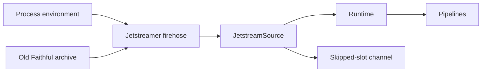

`JetstreamSource` replays finalized Solana history from [Old Faithful](https://github.com/rpcpool/yellowstone-faithful) archives through the [Jetstreamer](https://github.com/anza-xyz/jetstreamer) firehose. It converts each block and transaction into a Yellowstone `SubscribeUpdate`, the same message a live source sends, and finishes after the last slot of the range. [Initialise the environment before Tokio starts](#initialise-the-environment-before-tokio-starts) has a complete program that reads `Shipstern.toml`. The released [Jetstreamer example](https://github.com/solana-rpc/shipstern/tree/v0.13.0/examples/jetstreamer) builds the same config from command-line flags.



## Add the crate

crates.io has `shipstern-jetstream-source` only up to 0.9.0, because the crate depends on Jetstreamer from git. Take it, and every other Shipstern crate, from the `v0.13.0` tag so that only one copy of the shared types is built:

```toml title="Cargo.toml"
[dependencies]
clap = { version = "4.5", features = ["derive"] }
shipstern = { git = "https://github.com/solana-rpc/shipstern", tag = "v0.13.0" }
shipstern-jetstream-source = { git = "https://github.com/solana-rpc/shipstern", tag = "v0.13.0" }
shipstern-spl-token-parser = { git = "https://github.com/solana-rpc/shipstern", tag = "v0.13.0" }
toml = "0.8"
tracing = "0.1"
tracing-subscriber = { version = "0.3", features = ["env-filter"] }
```

The crate takes `jetstreamer-firehose` from git, pinned to commit `e522a67e` of `vaultic-win/jetstreamer`, so Cargo resolves the same commit in every project. That commit decodes the `VATDebit` rewards in the first block of each epoch from epoch 1064. Before 0.13.0, those rewards stalled a replay with no error. The source maps them to `RewardType::VatDebit`.

In 0.13.0 the build compiles no RocksDB and needs no clang or libclang. See [System packages](/docs/get-started/installation#system-packages) for the packages every build needs.

## Configure the source

`JetstreamSource` implements `FromConfig` with `JetstreamSourceConfig` as its config, so the runtime builds it from the `source` field of a `ShipsternConfig`. `JetstreamSourceConfig` derives Serde `Deserialize` and clap `Args`, so the config can come from a TOML file, from command-line flags or from a struct literal. Keys are kebab-case, and the range is a nested table:

```toml title="Shipstern.toml"
[source]
archive-url = "https://api.old-faithful.net"
threads = 4
network = "mainnet"
compact-index-base-url = "https://files.old-faithful.net"
network-capacity-mb = 1000

[source.range]
epoch = 885
```

| Key | Type | Default | Description |
| --- | --- | --- | --- |
| `archive-url` | string | required | Old Faithful archive URL. In 0.13.0 the source only logs it at startup and does not pass it to the firehose, which reads its settings from the environment. |
| `range` | table | required | The slots to replay. See [Select the slot range](#select-the-slot-range). |
| `threads` | integer | required | Parallel firehose workers, or download concurrency in sequential mode. The `4` default applies only to the `--threads` flag. |
| `network` | string | required | Archive network: `mainnet`, `testnet` or `devnet`. The `mainnet` default applies only to the `--network` flag. |
| `compact-index-base-url` | string | required | Compact index service. The `https://files.old-faithful.net` default applies only to the command-line flag. |
| `network-capacity-mb` | integer (MB) | required | Upstream network capacity setting. The `1000` default applies only to the command-line flag. |
| `sequential` | boolean | `false` | Run one firehose worker with parallel range downloads. |
| `reverse` | boolean | `false` | Replay epochs from highest to lowest. Turns on sequential mode. |
| `buffer-window-bytes` | integer (bytes) | 256 MiB in sequential or reverse mode | Download window. The firehose ignores it, and the source logs a warning, when neither mode is on. |
| `stats-interval-slots` | integer | `10000` | Slots between progress log lines. `0` turns them off. |

A Rust struct literal must set every field, because `JetstreamSourceConfig` has no `Default`. Two fields exist only in code, because Serde and clap skip them:

| Field | Type | Description |
| --- | --- | --- |
| `possible_leader_skipped_tx` | `Option<tokio::sync::mpsc::Sender<PossibleLeaderSkippedEvent>>` | Receives each slot that the firehose reports as possibly skipped by its leader. Such a slot produces no slot or block update, so without this channel the source drops it. |
| `shutdown_signal_tx` | `Option<tokio::sync::broadcast::Sender<()>>` | Sending `()` stops the firehose at the next slot boundary. `connect` subscribes when it starts, so a signal sent before that is lost. |

### Select the slot range

`[source.range]` takes one of two forms:

| Form | Keys | Slots replayed |
| --- | --- | --- |
| Slot range | `slot-start`, `slot-end` | From `slot-start` up to, but not including, `slot-end`. `100` and `200` replay slots 100 to 199. |
| Epoch | `epoch` | From `epoch * 432000` up to, but not including, `(epoch + 1) * 432000`. |

`slot-start` must be less than `slot-end`. A table with both forms, a single slot bound or no keys fails when the run starts. The epoch form assumes a fixed length of 432,000 slots, so set the slot bounds for any other range.

## Initialise the environment before Tokio starts

The firehose reads its configuration from three environment variables: `JETSTREAMER_NETWORK`, `JETSTREAMER_COMPACT_INDEX_BASE_URL` and `JETSTREAMER_NETWORK_CAPACITY_MB`. `init_process_env` writes them from `network`, `compact-index-base-url` and `network-capacity-mb`. The function is `unsafe`, because writing the process environment is unsound once other threads exist.

This program reads `Shipstern.toml`, sets the environment, and replays the range through the SPL Token instruction parser:

<include cwd lang="rust" meta='title="src/main.rs"'>./examples/all-sources/src/bin/jetstreamer.rs</include>

| Part | What it does |
| --- | --- |
| `fn main` | A plain function, not `#[tokio::main]`, so no Tokio thread exists when the environment is written. |
| `ShipsternConfig<JetstreamSourceConfig>` | Reads `[source]`, `[source.range]` and an optional `[buffer]` section. |
| `init_process_env(&config.source)` | Writes the three variables from the `source` field, before anything starts a thread. |
| `.instruction(...)` | The only pipeline, since the source sends no account updates. The parser skips instructions from other programs. |
| `.run()` | Creates the Tokio runtime, replays the range and returns once the runtime has drained its queue. On an error it logs the error and exits with status 1. |

Run it with `RUST_LOG=info cargo run -- --config Shipstern.toml`. The released example creates its own Tokio runtime instead, with `tokio::runtime::Runtime::new()?.block_on(run(config))`.

`connect` compares the three variables with the config before it streams, and fails with `EnvMismatch` if any differ. Exporting the same three values before the process starts also passes this check.

<Warning>
Call `init_process_env` before anything starts a thread, including a Tokio runtime. Its safety contract requires that no other threads exist.
</Warning>

## Know what the replay emits

The source checks only which kinds of update each prefilter asks for. It does not apply the conditions inside a prefilter.

| Update | Sent to | Contents |
| --- | --- | --- |
| Transaction | Every prefilter with a transaction part, as instruction parsers usually have | Every transaction in the range, vote transactions included. The source ignores every transaction field: account lists, `token_accounts`, `signature`, `vote`, `failed` and cuckoo filters. |
| Block meta | Every prefilter with a block meta part | Slot, blockhash, parent, rewards, block time, block height and counts. |
| Slot | Every prefilter with a slot part | One update per block, always `SLOT_FINALIZED`. The commitment and interslot options have no effect. |
| Block | Block prefilters that set `include_transactions`, `include_accounts` or `include_entries` | Header, rewards and entry count. `transactions` and `accounts` are always empty, and `entries` is filled only when a block prefilter sets `include_entries`. `accounts_include` is not applied. |
| Account | Nothing | The source sends no account updates. |
| Block footer | Nothing | The source sends no block footers, and logs a warning for each prefilter that asks for them. |

<Note>
An instruction parser with a transaction prefilter receives every transaction in the range, so it must ignore instructions from other programs itself. An account pipeline receives nothing from this source.
</Note>

## Tune throughput and ordering

With `sequential = false`, `threads` sets the number of parallel firehose workers, and updates from different workers are not ordered against each other. With `sequential = true`, one worker streams the range and `threads` sets how many download ranges run in parallel. The crate documents sequential mode as the path upstream requires for 150,000 transactions per second and more.

`reverse = true` replays epochs from highest to lowest and turns on sequential mode. Slots inside each epoch still arrive in ascending order, because an archive file streams only forward.

Every `stats-interval-slots` slots, each worker logs a `Firehose progress` line with its `thread_id`, slot, block, transaction, entry and leader-skipped counts and `tps`. Each send to the runtime waits for space in the update channel, whose capacity is `sources-channel-size` in `[buffer]` (default `100`).

## Bound memory and network use

In sequential or reverse mode the firehose downloads a whole window before the first block. It must fill that window within upstream's 180-second header timeout. Upstream's own default, derived from RAM and up to 4 GiB, can fail to fill in time, so the source uses 256 MiB when `buffer-window-bytes` is not set. The crate's measurements against `files.old-faithful.net`, at about 7 MiB/s, filled 64 MiB in 9.5 s, 256 MiB in 33.6 s and 1 GiB in 145.6 s. Raise the window only on a faster link.

When a block prefilter sets `include_entries`, the source holds each slot's entries in memory until that slot's block arrives. Without it, the firehose does not decode entries.

A replay downloads archive data while it runs, so the host needs outbound access to the Old Faithful services for the whole run.

## Handle errors

The source reports errors from `connect`, after the run starts, and `build` does not check the config. Each error is a `shipstern_jetstream_source::Error`, returned as `shipstern::Error::Io`. The original error stays as the inner error, so it can be downcast. A range that completes returns `Ok(())` after the runtime drains its queue.

| Variant | Cause |
| --- | --- |
| `EnvMismatch` | The `JETSTREAMER_*` variables do not match the config, usually because `init_process_env` was not called. The message names each variable that differs. |
| `SlotRangeResolution` | The range is invalid. The message contains the range and the `InvalidConfig` reason. |
| `Jetstreamer` | The firehose failed at a slot. An `incomplete frame` error is reported as corrupted data at that slot, with a suggestion to try a different epoch or slot range. |
| `ChannelSend` | The runtime closed the update channel, for example during shutdown. |

## See also

- [Sources overview](/docs/sources): compare Jetstreamer with the live and backfill sources.
- [Configuration reference](/docs/reference/configuration#jetstreamer-source): every `JetstreamSourceConfig` field in one table.
- [Prefilters](/docs/filtering/prefilters): what a prefilter selects on sources that apply it.
- [Crates](/docs/reference/crates#availability-on-cratesio): which crates need the git tag.
- [Errors](/docs/reference/errors): how `shipstern::Error` ends a run.
