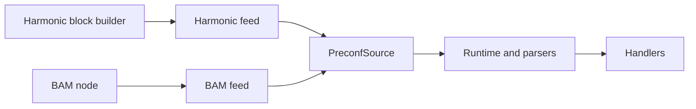

`PreconfSource` streams Triton preconfirmations (preconfs): the transactions that a block producer reports during the slot, before the block settles. It reads two feeds, Harmonic and BAM. Each preconfirmed transaction reaches the runtime as the same `SubscribeUpdateTransaction` that the other sources send, so existing transaction and instruction parsers read it with no change. The source is new in 0.13.0. See the [release notes](/docs/releases/v0-13-0).

## Know what a preconfirmation is

A preconf is the block producer's statement that a transaction went into the slot under construction. It is not the cluster's statement. The slot can be skipped, the block can land on an abandoned fork, and the leader can restart the slot. Treat a preconf as an early signal, and check settlement with another source, for example the [Yellowstone gRPC source](/docs/sources/yellowstone-grpc) at `confirmed`. Triton states that a preconf usually arrives ahead of Geyser when the application runs near the feed region.



A restarted slot delivers its transactions again. The new frame can also leave out a transaction that the first frame carried. That transaction stays delivered, and the source cannot retract it. On Harmonic, the source logs a restart at `warn` and counts it in `restarts`. BAM has no slot framing, so the source cannot see a BAM restart.

<Warning>
Make handlers idempotent per signature, and key stored records on the signature. A restarted slot delivers its transactions again, and a preconf can belong to a slot that never settles.
</Warning>

## Choose the feeds and regions

| Feed | When it reports a transaction | Regions |
| --- | --- | --- |
| Harmonic | The block builder selects the transaction for the slot under construction and executes it against its own state, before the leader executes it and before any shred exists. | `ams`, `ewr`, `fra`, `lon`, `tyo`, `sgp`, `slc` |
| BAM | A Jito BAM node reports the transaction after the leader executed and committed it, so the result is the leader's result. | `ams`, `dfw`, `dub`, `ewr`, `fra`, `hkg`, `iad`, `lax`, `lon`, `pit`, `sea`, `sin`, `slc`, `sqq`, `tyo` |

The source opens one stream for each region in `harmonic-regions` and each region in `bam-regions`, all on one gRPC channel. A region named twice in one list opens one stream. The same region in both lists opens one stream per feed. Each regional stream carries the slots of the leaders that the region serves, so a far region adds slots, but they arrive late.

Each feed covers only the slots whose leader runs that client, so both feeds together give the most coverage. Triton enables each feed on the token separately, and preconfs are not self-serve. A configured feed that the token lacks fails at subscribe with `UNAUTHENTICATED`, which stops the run.

## Quick start

```toml title="Cargo.toml"
[dependencies]
rustls = "0.23"
shipstern = "0.13.0"
shipstern-core = "0.13.0"
shipstern-preconf-source = "0.13.0"
shipstern-spl-token-parser = "0.13.0"
tokio = { version = "1", features = ["macros", "rt-multi-thread"] }
toml = "0.8"
tracing-subscriber = { version = "0.3", features = ["env-filter"] }
```

```toml title="Shipstern.toml"
[source]
x-token = "<X-TOKEN>"
# A BAM-only token: bam-regions = ["fra"] in place of harmonic-regions.
harmonic-regions = ["fra"]
```

<include cwd lang="rust" meta='title="src/main.rs"'>./examples/sources/src/bin/preconf.rs</include>

| Part | What it does |
| --- | --- |
| `transaction_accounts([whirlpool])` | Adds the Orca Whirlpool program as a required account. The SPL Token parser's own prefilter requires the Token program, so the feed sends only transactions that name both programs. The narrow filter keeps the stream under the [coverage share](#billing-and-the-coverage-share). |
| `FilterPipeline` | Merges the extra prefilter into the parser's prefilter. See [Build filters at runtime](/docs/filtering/prefilters#build-filters-at-runtime-with-filterpipeline). |
| `PreconfLogger` | Prints the slot, the arrival index (`txn_index`) and the signature of each SPL Token instruction, then the parsed instruction. |
| `toml::from_str(..).unwrap_or_else(..)` | Prints only the message of a parse error. The error's `Debug` output holds the whole file, `x-token` included. |
| `.build::<PreconfSource>(config)` | Selects the source. |

The program is based on the [released preconf example](https://github.com/solana-rpc/shipstern/tree/v0.13.0/examples/preconf), which takes the config path from a `--config` flag and logs with `tracing`.

## Configure the source

All keys go in the `[source]` section and are written in kebab-case. Set `x-token` and at least one region.

| Key | Type | Default | Description |
| --- | --- | --- | --- |
| `endpoint` | string | `https://preconfs.rpcpool.com` | The Triton preconfs endpoint. The source dials `https` with TLS and `http` in clear text, and refuses any other scheme. It sends an `x-token` over `http` only to `127.0.0.1`, `localhost` or `[::1]`. |
| `x-token` | string | unset | The Triton token. Triton enables each feed on it separately. |
| `harmonic-regions` | array of strings | `[]` | Harmonic regions, one stream each. |
| `bam-regions` | array of strings | `[]` | BAM regions, one stream each. At least one of the two lists needs a region. |
| `timeout` | integer (seconds) | `10` | A separate bound for the TCP connect, the TLS handshake and each subscribe. |
| `auto-reconnect` | bool | `true` | Subscribe a stream again after it ends or fails with a retryable code. See [Reconnect after a stream drops](#reconnect-after-a-stream-drops). |
| `reconnect-max-retries` | integer | unset | Resubscribes in a row before the source stops. Unset never gives up. `0` never resubscribes, the same as `auto-reconnect = false`. |

`PreconfConfig` does not reject unknown keys, so a misspelt key parses and has no effect. Its `Debug` output prints `x_token` as `<redacted>`.

## How a preconf becomes a transaction update

| `SubscribeUpdateTransaction` field | Value |
| --- | --- |
| `filters` | The filter names the feed matched: the ID of each transaction parser, and `InstructionPipeline` for all instruction parsers together. |
| `slot` | The slot the feed names. |
| `bank_id` | `0`. The feed has no bank. |
| `transaction` | Decoded from the bytes the block will carry. Legacy, v0 and v1 messages decode. |
| `is_vote` | Computed from the message. The feed has no vote flag. |
| `index` | Arrival order inside the slot, from 0, counted per stream. It is not the position in the block. |
| `meta.err` | `None` for a success. `Some` with empty bytes for a failure: the cause is unknown, so only `is_some()` has meaning. |
| Other `meta` fields | Absent: no fee, balances, logs, inner instructions or loaded addresses. |
| `created_at` | Unset. The feed sends no time. |

The mapping has these effects on parsers and handlers:

- Two streams number their transactions independently, and a reconnect does not reset the count. Key records on the signature, not on `slot` and `index`.
- Log events and self-CPI events never fire, because the meta has no logs and no inner instructions. Top-level instructions parse.
- The source drops a transaction whose result the feed does not know, because `err: None` would read as a success. With the default `failed: Some(false)` on `TransactionPrefilter`, the feed does not send such transactions. With `failed: None`, the source drops each one, warns at the first drop on each stream, and counts it in `unknown_result`.
- The source skips a transaction that does not decode, with a warning, and counts it in `undecodable`. The skip does not stop the source.
- The source sends no slot updates. Harmonic slot starts and ends only set the `out_of_frame` and `restarts` counts, and the index keeps counting across a restart. A handler cannot know when a slot is complete.

## Know which prefilters reach the feed

The source reads only the transaction part of each entry in the runtime's filter set and sends it as one feed filter with the same name. A transaction parser has its own entry under its parser ID. All instruction parsers share one entry, `InstructionPipeline`, whose [prefilter](/docs/filtering/prefilters) is the union of theirs. Every stream gets the same filters.

| Prefilter part | Feed filter |
| --- | --- |
| `transaction_accounts_include` and `transaction_cuckoo_accounts_include` | `account_include`. The keys of the cuckoo set go in the plain list. |
| `transaction_accounts` | `account_required` |
| `transaction_accounts_exclude` | `account_exclude` |
| `transaction_signature` | `signature` |
| `failed: Some(false)`, the default | `execution_results = [SUCCESS]` |
| `failed: Some(true)` | `execution_results = [EXECUTION_FAILURE, FEES_ONLY]` |
| `failed: None` | No result filter. The source drops unknown results. |
| `transaction_vote` | Applied by the source for each filter name, after decoding. |
| `transaction_token_accounts` | Refused with `FilterError::TokenAccounts`. The feed matches account keys only. |

The source checks these limits before it dials, and the error names the parser or the count:

- Only transaction prefilters reach the feed. Account, slot, block meta, block and block footer prefilters do not, and the source sends only transaction updates. An entry with no transaction prefilter, for example an account parser, gets nothing, and the source logs a warning that names it at connect. With no transaction prefilter at all, connect fails with `FilterError::NoTransactionFilters`.
- Each filter needs an include, required or signature list. A filter with only `transaction_vote` or an exclude list fails with `FilterError::NoPositiveSelector`, so a client cannot subscribe to the full feed.
- At most 64 filters per stream, 64 bytes per filter name (a transaction parser ID, or `InstructionPipeline`), and 10000 accounts per list.

<Note>
The feed matches only the static account keys of a transaction. A key that a v0 transaction loads from an address lookup table never matches a prefilter, unlike on Yellowstone gRPC. The feed does not resolve lookup tables either, so a transaction whose instructions use such an account fails every instruction parser: the runtime logs one `Handler failed` error for it, with `Invalid account key index` in `err`.
</Note>

## Reconnect after a stream drops

With `auto-reconnect` on (the default), the source subscribes a stream again on the same channel when the stream ends or fails with one of these codes: `UNAVAILABLE`, `DATA_LOSS`, `RESOURCE_EXHAUSTED`, `INTERNAL`, `UNKNOWN`, `ABORTED`, `CANCELLED` or `DEADLINE_EXCEEDED`. Any other code stops the source. With `auto-reconnect` off, every code stops it. The first subscribe at connect is never retried.

- The wait before an attempt starts at 100 ms and doubles with each attempt, up to 10 s.
- A transaction or a Harmonic slot start sets the wait and the attempt count back to the start. So does a drop after a stream that stayed up for 60 s. A ping, a clip or a slot end does not.
- A subscribe that does not answer within `timeout` seconds fails with `DEADLINE_EXCEEDED`.
- `reconnect-max-retries` bounds the resubscribes in a row. A resubscribe that works also counts until one of the resets above. The waits before 11 attempts add up to 52.7 s, inside Triton's 60 s coverage cooloff. A bound under 12 therefore cannot outlast a cooloff.

The feed has no `from_slot`, so a reconnect cannot resume. It loses the transactions between the drop and the new stream. On Harmonic, framing starts again at the next slot start. Indexes keep counting on both feeds. While one stream reconnects, the other streams keep delivering, so the run is partial until that stream returns. Triton states that a feed that is down keeps the stream open with no transactions and no error, so the source does not reconnect.

## Handle errors and stops

| Event | Run result |
| --- | --- |
| No region in either list | `shipstern::Error::Other` with `ConnectError::NoRegion`, before the dial |
| No transaction prefilter, or one the feed cannot take | `Error::Other` with a `FilterError`, before the dial |
| An endpoint scheme other than `https` or `http`, a token on a non-loopback `http` endpoint, or a token that is not a valid header | `Error::Other` with `ConnectError::Scheme`, `PlainTextToken` or `Token`, before the dial |
| A bad endpoint, or a TCP or TLS failure | `Error::Other` with `ConnectError::Transport` |
| The first subscribe of a stream fails | `Error::YellowstoneStatus` with the code, never retried |
| A live stream fails with a code that stops, or the retries run out | `Error::YellowstoneStatus` with the code |
| A live stream ends and is not subscribed again | `Error::ServerHangup` |

At exit, the source logs one `Preconf stream stopped` line for each stream, with the feed and the counts `delivered`, `unknown_result`, `vote_rule_dropped`, `undecodable`, `out_of_frame`, `clipped`, `restarts`, `unknown_payload` and `reconnects`. The source has no metrics of its own.

## Billing and the coverage share

Triton counts messages and stream slots per subscription and feed, prices both, and bills the greater amount. Each open stream adds every slot its region produces, matched or empty, so a region that matches nothing still costs stream slots.

Triton gives each account at most 33% of what a feed publishes in a region, counted over a sliding 60 s window. Over that share, the feed withholds transactions and sends a clip count, which the source logs at `warn` and adds to `clipped`. After 30 s over the share, the feed ends the stream with `RESOURCE_EXHAUSTED` and refuses each subscribe to that region for a 60 s cooloff. The source retries through the cooloff. A whole-program filter such as SPL Token reaches the share within a minute. The quick start adds a required program for this reason.

## Live filter updates

`PreconfSource` does not implement `FilterUpdateSource`, so `runtime.handle()` is not available. The feed cannot change the filters of an open stream. To change the subscription, change the prefilters and restart the process. See [Live filter updates](/docs/filtering/live-filter-updates).

## See also

- [Sources overview](/docs/sources): compare every source.
- [Yellowstone gRPC source](/docs/sources/yellowstone-grpc): check settlement at `confirmed` or `finalized`.
- [Prefilters](/docs/filtering/prefilters#transaction-options): the transaction options this source maps to the feed filter.
- [Run in production](/docs/runtime/production#make-handlers-idempotent): idempotent handlers.
- [Errors](/docs/reference/errors#shipsternerror): every `shipstern::Error` variant.
- [Release notes 0.13.0](/docs/releases/v0-13-0): the other changes in this release.
