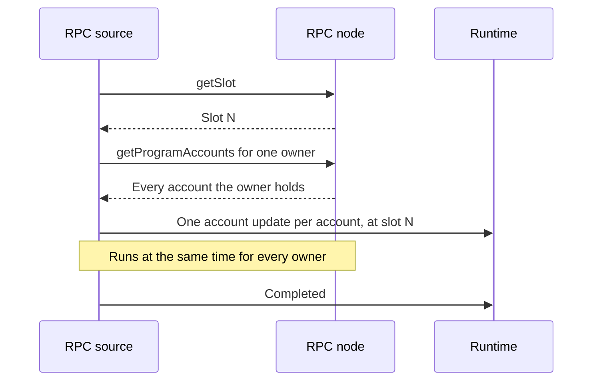

`SolanaAccountsRpcSource` loads the accounts that the owners in each pipeline's [prefilter](/docs/filtering/prefilters) hold, sends them to the runtime, and finishes. It makes one `getProgramAccounts` request per owner. Use it to backfill the current state of a program before a live stream takes over. It works with any Solana JSON-RPC endpoint that serves `getProgramAccounts` for the programs involved.

## Quick start

```toml title="Cargo.toml"
[dependencies]
shipstern = "0.13.0"
shipstern-solana-rpc-source = "0.13.0"
shipstern-stake-pool-parser = "0.13.0"
toml = "0.8"
tracing-subscriber = { version = "0.3", features = ["env-filter"] }
```

```toml title="Shipstern.toml"
[source]
endpoint = "https://rpc.example.com"
timeout = 60
commitment_level = "confirmed"
```

Select the source with `.build::<SolanaAccountsRpcSource>(config)`. This program loads every account the SPL Stake Pool program owns, prints each parsed account and exits:

<include cwd lang="rust">./examples/sources/src/bin/rpc-backfill.rs#rpc-backfill</include>

| Part | What it does |
| --- | --- |
| `shipstern_stake_pool_parser::AccountParser` | The Stake Pool account parser. Its prefilter names the Stake Pool program as the only owner. |
| `Logger` | Prints each parsed value with `{:?}`. |
| `.run()` | Returns once the source has completed and every queued account has been handled, so `main` ends and the process exits with status 0. |

The public `https://api.mainnet-beta.solana.com` endpoint serves this program. In a test on 2026-10-12, the binary printed 478 parsed accounts and exited after about 2 seconds.

## Configuration

All keys go in the `[source]` section and are written in snake_case, unlike the gRPC and Fumarole sources. The [configuration reference](/docs/reference/configuration#solana-rpc-source) has the key table.

- `endpoint` (required) is the JSON-RPC URL.
- `timeout` (required, in seconds) bounds each request, including reading the whole response. A `getProgramAccounts` response is not paginated, so set it to cover the largest program's full download.
- `commitment_level` is `processed`, `confirmed` or `finalized`, and `confirmed` when absent. It applies to both the `getSlot` and the `getProgramAccounts` request.

Unknown keys are ignored without an error, so `commitment-level = "finalized"`, with a hyphen, leaves the commitment at `confirmed`.

## How a load runs



The source starts one task for each owner in each prefilter, all at once and with no concurrency limit. Each task builds its own RPC client, calls `getSlot`, then makes one `getProgramAccounts` request for its owner. The request asks for full account data in base64, with no server-side filters and no data slice. The task reads the whole response before it sends the first account from it.

Two account pipelines whose prefilters name the same owner fetch that program twice. Each update goes only to the pipeline whose prefilter named the owner.

### Prefilter fields the source applies

| Prefilter part | Applied |
| --- | --- |
| `account_owners` | Yes: one request per owner. |
| `accounts`, `account_cuckoo` | No. |
| `account_filters` (memcmp, data size, token account state, lamports) | No: neither sent to the node nor checked by the source. |
| `account_nonempty_txn_signature` | No. |
| `accounts_include_all()` | Sets no owners, so it loads nothing. |
| Transaction, slot, block meta and block prefilters | No: the source sends account updates only. |

A prefilter that narrows on keys or data still loads every account the owner holds. Filter on keys or data in the parser or handler. A set of pipelines with no account owners sends nothing, and the run ends at once.

### Plan for data volume and provider limits

All requests run together, so peak memory is roughly the size of every response at once, plus decoded account data. Sends wait when the runtime channel (`sources-channel-size`) is full, so slow handlers keep each response in memory for longer. Load only the programs a pipeline needs.

<Warning>
Many RPC providers restrict `getProgramAccounts` for programs with many accounts. During testing, `api.mainnet-beta.solana.com` answered it for the Token Program with `403 Forbidden`, which ends the run with exit status 1. Use an endpoint that serves the call for every owner in the prefilters, and check its response size and rate limits.
</Warning>

## Read the account fields

Each account arrives as an `AccountUpdate`, the raw input a handler receives alongside the parsed value.

| Field | Value |
| --- | --- |
| `slot` | The result of the `getSlot` call made before this owner's request, so the data can be from a later slot. Owners fetched by different tasks can report different slots. |
| `is_startup` | Always `true`. |
| `account.write_version` | Always `0`. |
| `account.txn_signature` | Always `None`. |
| `account.data` | The full account data, decoded from base64. |

Each update is a state load, not one write in a sequence. See [Delivery and ordering](/docs/runtime/delivery#choose-stable-record-keys) for record keys that suit it.

## Backfill before a live stream

The RPC source loads current state, and the [Yellowstone gRPC source](/docs/sources/yellowstone-grpc) streams the changes that follow. Start the stream before the backfill:

1. Read a confirmed slot with `getSlot`, and start the gRPC runtime with `from-slot` set to that slot.
2. Run the RPC runtime with the same account pipelines while the stream runs.
3. Keep the newest version of each account by slot in one store that both runtimes write to.

A backfill that runs first and then subscribes from its slot can fail. A load that takes longer than the server's replay window, 150 slots by default, ends the stream with `OutOfRange`. [Backfill, then stream live](/docs/guides/backfill-then-stream-live) has the complete program and the checks that prove no change is missed.

## End the run

When every request has finished and every account has been sent, the source returns `SourceExitStatus::Completed`. The runtime logs `Source completed successfully; draining runtime buffer`, runs every queued update, waits up to 30 seconds for running handlers, and returns `Ok(())`. Signals stop the run while requests are in flight, but not during that drain. See [Shut down](/docs/runtime#shut-down).

The source does not retry, and a failed request does not cancel the others. The source logs `Solana RPC source task failed` for each failure, waits for every request to finish, then returns the first failure as `shipstern::Error::Other`. The runtime returns that error at once without running the queued updates, and `run()` exits the process with status 1. Handlers may already have processed accounts from other owners, so treat a failed run as a partial load and run it again.

| Error message starts with | Cause |
| --- | --- |
| `Failed to get slot for source: solana-rpc` | The `getSlot` call failed: the endpoint is unreachable or wrong, refused the request, or exceeded `timeout`. |
| `Failed to get program accounts for source: solana-rpc` | The node refused `getProgramAccounts` for an owner, for example with `403 Forbidden`, or the response took longer than `timeout`. |
| `Failed to decode account data` | The node returned account data that the client could not decode, such as JSON instead of the requested base64. |

Each message goes on to name the prefilter (`filter: <parser id>`) and the underlying error. The `rpc-backfill` example installs a `tracing` subscriber whose filter shows `error` events when `RUST_LOG` is unset, so a failed run prints these messages and exits with status 1.

## Live filter updates

This source reads the owners once, when it connects. It does not implement `FilterUpdateSource`, so `runtime.handle()` does not compile for it. To load another program, run the source again with that program's pipeline.

## See also

- [Sources overview](/docs/sources): compare every source and its limits.
- [Configuration reference](/docs/reference/configuration#solana-rpc-source): the key table for this source.
- [Solana snapshot source](/docs/sources/solana-snapshot): load the same account state offline from a ledger snapshot.
- [Guide: pick a source at startup](/docs/guides/pick-a-source-at-startup): one binary that runs this source or a live one.
- [Shut down](/docs/runtime#shut-down): how the runtime drains after a finite source completes.
