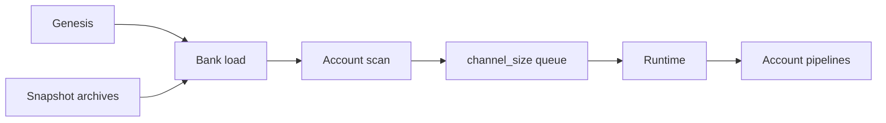

`SolanaSnapshotSource` loads a Solana snapshot from a local ledger directory with the Agave bank loader. It sends the accounts whose owner appears in the pipelines' [prefilters](/docs/filtering/prefilters), and finishes. It reads files only, and does not download archives or connect to a node.

## Quick start

```toml title="Cargo.toml"
[dependencies]
clap = { version = "4.5", features = ["derive"] }
shipstern = "0.13.0"
shipstern-solana-snapshot-source = "0.13.0"
shipstern-spl-token-parser = "0.13.0"
toml = "0.8"
tracing = "0.1"
tracing-subscriber = { version = "0.3", features = ["env-filter"] }
```

```toml title="Shipstern.toml"
[source]
ledger_path = "/path/to/ledger"
channel_size = 1000
```

<include cwd lang="rust" meta='title="src/main.rs"'>./examples/all-sources/src/bin/snapshot.rs</include>

The program selects the source with `.build::<SolanaSnapshotSource>(config)` and registers only an account pipeline, because this source sends no transactions. The SPL Token `AccountParser` selects the Token Program as owner, so the run logs every token account in the snapshot. To load another program, register its parser in place of this one. Run the program with `RUST_LOG=info cargo run -- --config Shipstern.toml`. It exits after the last account.

In 0.13.0 the crate does not depend on `solana-ledger`, so the build compiles no RocksDB and needs no clang or libclang. See [System packages](/docs/get-started/installation#system-packages).

## Prepare the ledger directory

```text
/path/to/ledger
├── genesis.bin                   (or genesis.tar.bz2)
└── snapshots
    ├── snapshot-<slot>-<hash>.tar.zst
    └── incremental-snapshot-<base-slot>-<slot>-<hash>.tar.zst
```

- **Genesis.** The source loads `genesis.bin`. If that fails, it unpacks `genesis.tar.bz2` into the ledger directory, up to 10 MiB unpacked, and tries again. Use the genesis of the cluster the snapshot comes from.
- **Archives.** Agave accepts `.tar.zst` and `.tar.lz4` archives named as above. It loads the full snapshot with the highest slot, plus the highest incremental snapshot built on that full snapshot. The incremental archive is optional.
- **Location.** The archives must already be on local disk. `ledger_path` is a filesystem path, not a URL.

## Configuration

All keys go in the `[source]` section and are written in snake_case. Both keys are required.

| Key | Type | Default | Description |
| --- | --- | --- | --- |
| `ledger_path` | path | required | Ledger directory with the genesis file and a `snapshots/` folder, laid out as above. |
| `channel_size` | integer | required | Capacity of the queue between the account scan and the runtime channel. When it is full, the scan waits. Must be greater than zero. A zero value panics when the source starts. |

`sources-channel-size` in `[buffer]` sizes the next queue, between the source and the runtime. See the [configuration reference](/docs/reference/configuration#buffer).

## How a load runs



1. The source opens the genesis config and loads the bank from the archives. If `snapshots/` holds a bank snapshot at the newest archive's slot or newer, the source loads it in place of the archives. Agave unpacks the account files into `accounts/` under `ledger_path` and builds its accounts index in memory.
2. The source sends one slot update for the bank's slot, with status `SLOT_FINALIZED` and no parent. Only pipelines with a slot prefilter receive it.
3. It scans every account the bank can load, on one blocking thread, and skips zero-lamport accounts. Each account whose owner appears in a prefilter's `account_owners` goes to the pipelines with that owner.
4. After the scan, `connect` returns `SourceExitStatus::Completed`. The runtime runs every queued update and returns `Ok(())`.

The bank's slot is the incremental snapshot's slot when one was loaded, and the full snapshot's slot otherwise.

### Read the account fields

| Field | Value |
| --- | --- |
| `slot` | The bank's slot, the same on every update |
| `is_startup` | `true` |
| `write_version` | `0` |
| `txn_signature` | none |
| `pubkey`, `owner`, `lamports`, `executable`, `rent_epoch`, `data` | From the snapshot, with the full account data |

Accounts arrive in no particular order. Each update is the state of an account at one slot, not one write in a sequence. [Choose stable record keys](/docs/runtime/delivery#choose-stable-record-keys) covers idempotency keys for this data.

## Choose snapshot or RPC

Both sources backfill account state and select by owner. They differ in where the data comes from and what it costs.

| | Snapshot | Solana RPC |
| --- | --- | --- |
| Data from | Local archive files | `getProgramAccounts` on an RPC node |
| Slot | One bank slot for every account | One `getSlot` call per owner |
| Provider limits | None | Whatever the provider applies to `getProgramAccounts` |
| Freshness | As old as the archive | Current at request time |
| Setup | Archive download, disk, memory, longer build | An endpoint that serves `getProgramAccounts` |

Use the snapshot for programs whose `getProgramAccounts` response is too large or too slow for a provider, for the state of several programs at one slot, and for repeated offline loads of the same state. Use RPC for the current state of a small program without a snapshot download.

The snapshot's costs come from loading the whole bank:

- **Disk.** Room for the archives plus the unpacked account files under `accounts/`.
- **Memory.** The source uses the default Agave accounts-db config, which keeps the index for every account in the snapshot in memory, whatever the prefilters select.
- **Build.** The crate compiles the Agave runtime and accounts-db crates.

## Know the limits

<Warning>
Selection is by owner only. The source does not apply the `accounts` keys or the data comparisons in a prefilter, so a prefilter on the Token Program receives every token account in the snapshot. A prefilter with no owners selects no accounts, but the source still loads and scans the whole snapshot. See [Know the limits](/docs/sources#know-the-limits).
</Warning>

- The source emits one slot update and account updates. Transaction, instruction, block meta and block pipelines receive nothing.
- It does not implement `FilterUpdateSource`, so `runtime.handle()` does not compile with it.
- The bank load runs synchronously inside the source task and holds a Tokio worker thread until it ends. `run()` and `try_run()` create a multi-threaded runtime. With `run_async()` on a current-thread runtime, signals are not handled until the load finishes.

<Note>
The source has no cleanup step, and the unpacked files stay under `ledger_path`. A load from the archives first deletes every bank snapshot under `snapshots/` and the contents of `accounts/`, so do not point `ledger_path` at the directory of a running validator.
</Note>

## Handle errors

A failed load or scan ends the run with `shipstern::Error::Io`, wrapping one of these messages:

| Message starts with | Cause |
| --- | --- |
| `Failed to open genesis config` | Neither `genesis.bin` nor `genesis.tar.bz2` loads. |
| `Failed to create account paths` | `accounts/run` or `accounts/snapshot` cannot be created under `ledger_path`. |
| `No loadable snapshot found under` | `snapshots/` is missing or holds no full snapshot archive with a matching name. |
| `Failed to load bank from snapshot archives` | Agave could not unpack or load the archives. The message includes the Agave error and the archive paths. |
| `Failed to load bank from snapshot dir` | Agave could not load the bank snapshot that the source chose in place of the archives. |
| `Scan failed` | The account scan returned an error. |
| `Scan thread panicked`, `Scan task panicked` | The scan panicked. |

The full list of runtime errors is in the [errors reference](/docs/reference/errors).

## See also

- [Solana RPC source](/docs/sources/solana-rpc): the same accounts from an RPC node, with no snapshot file.
- [Sources overview](/docs/sources): compare every source.
- [Configuration reference](/docs/reference/configuration#snapshot-source): the snapshot keys next to every other source's keys.
- [Delivery and ordering](/docs/runtime/delivery): how a finite source drains on completion and how to key state loads.
- [Prefilters](/docs/filtering/prefilters): set the account owners the source loads.
