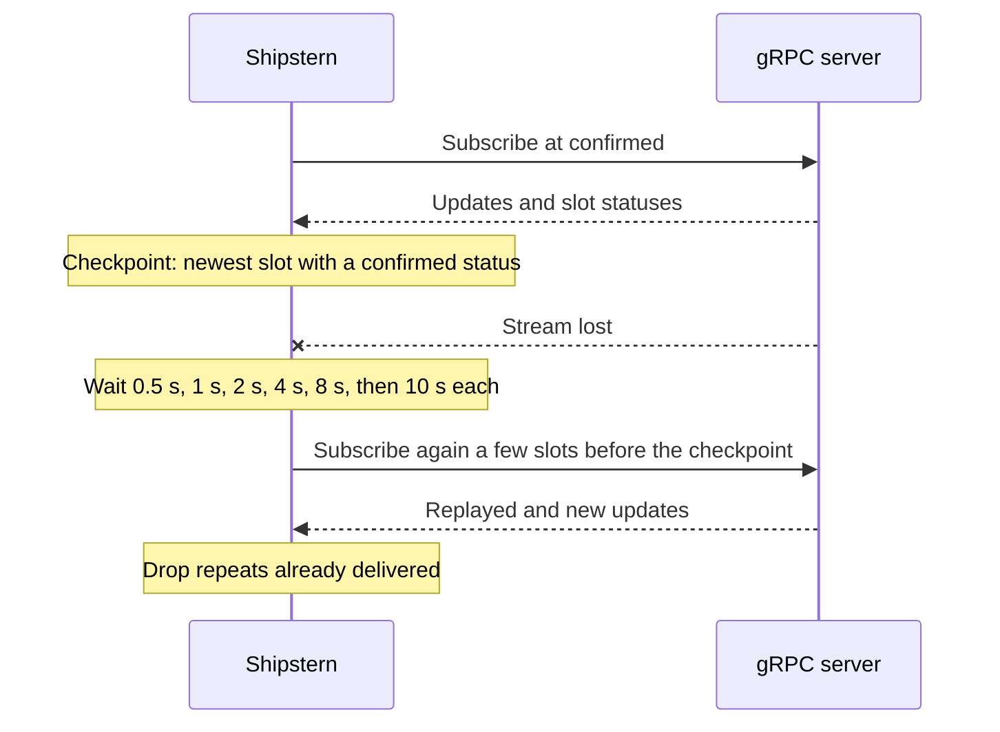

`YellowstoneGrpcSource` subscribes to a Yellowstone gRPC (Dragon's Mouth) endpoint and streams live updates. Self-host the [Yellowstone gRPC Geyser plugin](https://github.com/rpcpool/yellowstone-grpc) or use a provider.

## Quick start

```toml title="Cargo.toml"
[dependencies]
shipstern = "0.13.0"
shipstern-yellowstone-grpc-source = "0.13.0"
```

```toml title="Shipstern.toml"
[source]
endpoint = "https://yellowstone.example.com"
x-token = "<X-TOKEN>"
timeout = 60
```

Select the source with `.build::<YellowstoneGrpcSource>(config)` on the runtime builder. The [quickstart](/docs/get-started/quickstart) has the complete program.

## Configuration

All keys go in the `[source]` section and are written in kebab-case.

| Key | Type | Default | Description |
| --- | --- | --- | --- |
| `endpoint` | string | required | URL of the Yellowstone gRPC server. |
| `x-token` | string | none | Authentication token, if the server needs one. |
| `timeout` | integer (seconds) | required | Connect and request timeout. The `120` default applies only to the `--timeout` command-line flag. |
| `commitment-level` | `processed`, `confirmed`, `finalized` | server default, `processed` | Commitment level for the subscription. It also picks the [reconnect mode](#reconnects). |
| `from-slot` | integer | none | Start the stream from this slot, if the server still has it. |
| `max-decoding-message-size` | integer (bytes) | unlimited | Largest message the client will decode. |
| `accept-compression` | `gzip`, `zstd` | `zstd` | Compression to accept from the server. |
| `auto-reconnect` | boolean | `true` | Recover a lost stream. At `processed`, set it to `false` for a server on yellowstone-grpc proto 12.7 or older. |
| `reconnect-max-retries` | integer | `10` | Reconnect attempts in a row before the run ends. `0` turns recovery off. |
| `accounts-data-slice` | array of `{ offset, length }` | full data | Windows of account data to receive instead of the whole account. |

The `reconnect-slot-retention` key of 0.12.0 no longer exists. A config file that still sets it loads, and the key has no effect.

## Reconnects

With `auto-reconnect` on, the source recovers a lost stream in one of two modes, and the commitment level picks the mode:

| Commitment | `from-slot` or `RuntimeHandle` | Mode | Recovery |
| --- | --- | --- | --- |
| `confirmed` or `finalized` | Allowed | `SlotResume` | The source subscribes again from a slot checkpoint and drops the repeats it has a record of. |
| `processed`, or not set | Neither | `BankReplay` | The client replays the banks that the loss cut off. |
| `processed`, or not set | Either one | Off | A stream loss ends the run. |

Both modes need a server that stores slots. Bank replay also needs bank IDs (yellowstone-grpc proto 13 or newer). Slot resume does not use bank IDs to find its checkpoint.

To read the mode in code, call `YellowstoneGrpcConfig::reconnect_mode`, which returns the `ReconnectMode` that applies. It is a method, not a configuration key.

### Resume from a slot checkpoint

At `confirmed` or `finalized`, the source keeps a slot checkpoint. After a loss, it subscribes again a few slots before the checkpoint, with the newest filter set, and drops each repeat for the filters that already received it.



The source adds its own `slots` filter, so it has a slot on record before the first matching update arrives. A server that allows only one `slots` filter therefore refuses a run that also has a slot pipeline. Set `auto-reconnect = false` for such a server.

The source retries `Unavailable`, `Internal`, `Unknown`, `DeadlineExceeded`, `Cancelled`, `Aborted` and `ResourceExhausted`. Every other status, such as `Unauthenticated`, `PermissionDenied` or `InvalidArgument`, ends the run. A stream that the server closes with no error status also counts as a loss, and the source resumes.

Each wait doubles from 500 ms and is capped at 10 s, so the default 10 retries span about 65 s. The count starts again once the new stream delivers an update. The server keeps a number of slots, 150 by default on yellowstone-grpc, not a length of time. An outage of W seconds needs at least (W + 34.5) / 10 retries. Raise `reconnect-max-retries` to cover a longer outage.

The run also ends in these cases:

- With no `from-slot`, a loss before the first checkpoint ends the run, because a subscription from the tip would skip updates.
- A server that no longer holds the resume slot ends the run with `OutOfRange`.
- A server with `replay_stored_slots` set to 0 answers `from_slot is not supported`, and the run ends at once.
- A richat server refuses a confirmed or finalized resume with `InvalidArgument`, so the run ends at the first loss.

A yellowstone-grpc server replays only the processed, confirmed and finalized statuses. A `FirstShredReceived`, `Completed` or `Dead` status sent during the outage is lost. Repeats can still arrive, so handlers must accept them.

### Replay banks at processed

At `processed`, a slot can have more than one bank, and a bank is one execution of the slot by the node. Only the client's bank replay can retract the bank that the loss cut off, so a processed stream uses it. A config with no `commitment-level` uses this mode too.

The mode has these limits:

- It needs no `from-slot` and no `RuntimeHandle`, because the client cannot replay a changed request. A processed stream with either one ends the run on a stream loss, so run it under a supervisor that restarts it.
- It needs bank IDs. On a server with yellowstone-grpc proto 12.7 or older, the run ends with `FailedPrecondition` at the first account update or reconnect. Set `auto-reconnect = false` for such a server.
- The client adds its own `blocks_meta` and `slots` filters. A server that allows one filter of each kind refuses a run that also has a block meta or slot pipeline. Set `auto-reconnect = false` for such a server.

A stream that the server closes with no error status also counts as a loss, and the client reconnects it. Each wait doubles from 500 ms with no cap, so the default 10 retries span about 8.5 minutes. When the retries run out, the run ends with `shipstern::Error::YellowstoneStatus` (`Unavailable`, "subscription closed and reconnect retries are exhausted or disabled").

The replay repeats the bank that the loss cut off, so handlers can see its updates twice. On a yellowstone-grpc server older than 16.1.2, the bank in progress at the new subscription can also lose its first updates, with no error ([rpcpool/yellowstone-grpc#915](https://github.com/rpcpool/yellowstone-grpc/pull/915)).

### Failures that reconnect does not cover

In every mode, a failure to connect or subscribe at startup ends the run. A failed connect during a reconnect counts as one more loss. `auto-reconnect = false` or `reconnect-max-retries = 0` turns recovery off, and then the first stream error ends the run.

| How the run ends | Error |
| --- | --- |
| The stream ends with no error status and reconnect is off, or the slot resume retries run out on such a close | `shipstern::Error::ServerHangup` |
| An error status that is not retried, or the retries run out | `shipstern::Error::YellowstoneStatus` with the last status |

Either error means the stream is gone. Run the process under a supervisor that restarts it, and resume from a stored slot with `from-slot`.

<Note>
Recovery needs the server to still hold every missed slot, and its replay window does not cover a longer outage. The source's stream position does not track completed handlers. See [Delivery and ordering](/docs/runtime/delivery).
</Note>

## Banks at processed

At `processed`, each bank-scoped update carries its `bank_id`, and a slot can have more than one bank. Keep only the bank that reaches confirmed. A `bank_id` is local to one server, so do not match the updates of two streams on it.

`BlockMetaUpdate` from the [block meta parser](/docs/parsers) carries the same `bank_id`. A block meta therefore joins the slot and footer updates of its bank on (`slot`, `bank_id`).

## Account data slices

`accounts-data-slice` trims every account update to the configured windows. It applies to the whole subscription, so every account pipeline sees the same truncated data.

```toml title="Shipstern.toml"
[[source.accounts-data-slice]]
offset = 0
length = 8
```

Windows must ascend by offset, must not overlap and must not be empty. The source checks this before it connects, so a bad window fails at startup, not when the server refuses the subscription. The run ends with `shipstern::Error::Other` wrapping a `PrefilterError` that names the window.

Built-in and IDL-generated account parsers usually need the complete account layout. A slice that holds only a discriminator can pass the server filter and still fail deserialisation. Use sliced data only with a parser written for those returned windows.

## Live filter updates

Yellowstone gRPC is the only source that can change its subscription while it runs, through `RuntimeHandle`. See [Live filter updates](/docs/filtering/live-filter-updates).

## See also

- [Prefilters](/docs/filtering/prefilters): choose exactly what the server sends.
- [Run in production](/docs/runtime/production): what each reconnect mode covers, and what needs a supervisor.
- [Sources overview](/docs/sources): compare every source.
