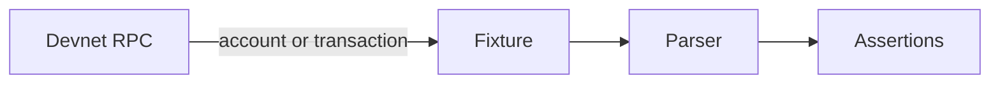

`shipstern-mock` runs parsers against real Solana data without a stream. It fetches missing fixtures from an RPC endpoint, which defaults to devnet, and reuses cached JSON on later runs inside an ordinary `#[tokio::test]`.



## Add the crate

```toml title="Cargo.toml"
[dev-dependencies]
shipstern-core = "0.13.0"
shipstern-mock = "0.13.0"
tokio = { version = "1", features = ["macros", "rt-multi-thread"] }
```

The macros call `Parser::parse` and name `shipstern_core::ParseError`, so add `shipstern-core` and bring `shipstern_core::Parser` into scope in each test module.

## Test an account parser

`account_fixture!` takes a devnet account address and a parser, and returns the parsed value. Any parse error, `ParseError::Filtered` included, panics and fails the test:

<include cwd lang="rust">./examples/snippets/src/fixture_tests.rs#account-fixture</include>

## Test an instruction parser

`tx_fixture!` takes a transaction signature and selects the outer and inner instructions for the parser's program. It returns one `Option` per selected instruction: `Some(parsed)` when the parser decoded the instruction and `None` when it filtered the instruction out. Any other parse error panics, which fails the test.

<include cwd lang="rust">./examples/snippets/src/fixture_tests.rs#tx-fixture</include>

## Cache fixtures for offline runs

On the first run, the macros fetch missing data and save it under `./fixtures` relative to the test process's working directory. The macros read existing files without RPC access. Keep the fixture JSON with the tests for repeatable offline runs.

Account files are `<address>_account.json`; transaction files are `<signature>_tx.json`. The cache key contains neither the RPC endpoint nor the parser's program ID. Remove the relevant file to refresh account state, switch clusters or fetch the same transaction for another program parser. Changing `RPC_ENDPOINT` alone does not refresh cached data.

The fixture loader requires `ProgramParser`, and the transaction macro clones the supplied parser value for each instruction. Fixtures test decoding: they do not apply the subscription prefilter or run handlers. Transaction fixtures do not retain full transaction context. The shared slot, signature and token balances use defaults, and inner instructions are stored as a flat list. Use raw stream fixtures for tests that depend on that context.

## Choose the RPC endpoint

Missing fixtures are fetched from the RPC node in `RPC_ENDPOINT`, defaulting to `https://api.devnet.solana.com`. The public endpoint is rate-limited, so point tests at a dedicated node:

<Tabs items={['One run', 'Every run']}>
<Tab value="One run">

```bash
RPC_ENDPOINT=https://my-rpc.example.com cargo test
```

</Tab>
<Tab value="Every run">

```toml title=".cargo/config.toml"
[env]
RPC_ENDPOINT = "https://my-rpc.example.com"
```

</Tab>
</Tabs>

## Preserve full stream context

`shipstern-block-coordinator` exports `FixtureWriter` and `FixtureReader`. They store and load complete Yellowstone `SubscribeUpdate` messages, including transaction metadata, subscription filter names and slot lifecycle updates.

The capture and replay excerpts below use this manifest. All Shipstern dependencies come from the same release tag:

<include cwd lang="toml" meta='title="Cargo.toml"'>./examples/stream-replay/Cargo.toml</include>

Each record in the file is a four-byte, big-endian message length followed by the protobuf message. `FixtureWriter::write` returns `false` after writing the target number of `BlockMeta` messages. Stop writing at that point, and call `finish()` to report any final flush error:

<include cwd lang="rust">./examples/stream-replay/src/lib.rs#fixture-io</include>

Reading the file returns raw messages and runs no pipelines. Pass transactions to `InstructionUpdate::build_from_txn` for instruction-context tests. Feed messages to the coordinator or a custom source to test processing. Keep the fixture's filter names consistent with the registered parser IDs when replaying through a runtime.

The offline test uses two helpers omitted from this excerpt. `fixture_path()` chooses a temporary filename. `synthetic_updates()` constructs a slot update, a transaction with signature, fee, balances and logs, two `BlockMeta` messages, and a trailing update.

Both `BlockMeta` messages report the same slot. The test checks full message equality and confirms the trailing update was not written. The excerpt needs those helpers to run:

<include cwd lang="rust">./examples/stream-replay/src/lib.rs#round-trip</include>

The complete example lives in the Shipstern documentation repository, under `examples/stream-replay`. That directory is not part of the upstream Shipstern repository.

From the documentation repository root, run the offline tests:

```bash
cargo test --manifest-path examples/stream-replay/Cargo.toml --all-targets --locked
```

The example uses its own Cargo workspace. Its manifest does not change the other documentation examples' features.

## Capture messages through CoordinatorSource

Set both `fixture_path` and `fixture_slots` on `CoordinatorSourceConfig` before building `CoordinatorSource`. The channel must have an active coordinator receiver, as in the [block coordinator setup](/docs/outputs/block-coordinator#run-the-coordinator):

<include cwd lang="rust">./examples/stream-replay/src/lib.rs#capture-config</include>

The source opens the file with `File::create`, replacing an existing file. It adds entry, block-meta and slot-lifecycle subscriptions and sets commitment to processed. It records successful stream messages before routing them to the coordinator or runtime.

| Boundary | Behaviour in 0.13.0 |
| --- | --- |
| Capture limit | Counts `BlockMeta` messages, including repeated messages for one slot. It does not count unique or completed slots. Use a positive limit. |
| Final `BlockMeta` | Written to the file, then capture finishes. This message is not forwarded to the coordinator or runtime. Later messages for that slot can be missing. |
| Capture finishes | The source returns `Completed`, so the runtime runs its queued updates and the run returns. |
| Stream ends early | The source calls `finish()`. A final flush failure is logged rather than returned as a source error. |
| Message with no bank ID | An account update that is not a startup update, or a `CreatedBank`, processed, confirmed or finalized slot status, with no bank ID stops the source with an error before it is written. Capture needs a server on yellowstone-grpc proto 13 or newer. A slot status that the proto does not define is skipped and not written. |
| Truncated or invalid file | `FixtureReader` yields the decodable prefix and then ends. Its iterator does not return an error; a partial length prefix also looks like end-of-file. Check expected message counts and boundaries in tests. |

A capture is a prefix of the stream and does not guarantee complete slots. The reader trusts each length prefix when allocating a message buffer, so use local test fixtures with known provenance. See the released [fixture implementation](https://github.com/solana-rpc/shipstern/blob/v0.13.0/crates/block-coordinator/src/fixtures.rs) and [capture source](https://github.com/solana-rpc/shipstern/blob/v0.13.0/crates/block-coordinator/src/source.rs).

## Run the Shipstern test suite

For contributions to Shipstern itself, a bare `cargo test` covers only part of what CI runs. CI runs this full set:

```bash
cargo test --workspace --lib --tests
cargo test -p shipstern-proto --lib --features parser,stream
cargo test -p shipstern-proc-macro --lib --features program-events anchor_parity
cargo test -p shipstern-kafka-sink --features experimental-account-parser --lib --tests
cargo test --tests --manifest-path tests/proc-macro-events/Cargo.toml
```

## See also

- [Parsers](/docs/parsers): built-in parsers and writing custom parsers.
- [Block coordinator](/docs/outputs/block-coordinator): connect captured updates to slot processing.
- [Contributing guide](https://github.com/solana-rpc/shipstern/blob/v0.13.0/CONTRIBUTING.md): formatting, Clippy and the toolchain.
