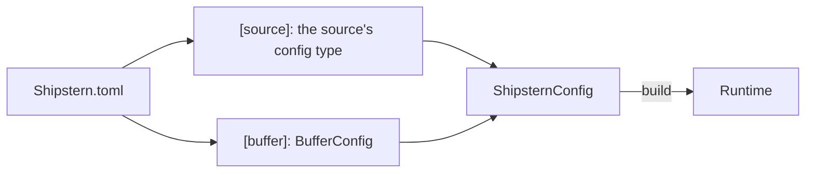

A Shipstern binary reads its settings from a TOML file, usually `Shipstern.toml`. The file deserialises into `ShipsternConfig`, which the application passes to the runtime builder's `build` method.



## Example

```toml title="Shipstern.toml"
# Required. The keys depend on the source type; these are for Yellowstone gRPC.
[source]
endpoint = "https://yellowstone.example.com"
x-token = "<X-TOKEN>"
timeout = 60
commitment-level = "confirmed"

# Optional. Omit the section to use the defaults.
[buffer]
jobs = 8
sources-channel-size = 100
```

## Load the file

```rust
let config = std::fs::read_to_string("Shipstern.toml").expect("Error reading config file");
let config = toml::from_str(&config)
    .unwrap_or_else(|e| panic!("Error parsing config: {}", e.message()));
```

Print only `e.message()` for a parse error. The `Debug` form of `toml::de::Error`, which `.expect(..)` prints, holds the whole file, `x-token` included. The `Display` form shows the line that failed, which can be the `x-token` line.

Pass `config` to `.build::<YellowstoneGrpcSource>(config)`, as the [quickstart](/docs/get-started/quickstart) does. The source named in `build::<S>` decides how `[source]` is parsed. Rust infers the type `ShipsternConfig<S::Config>` for `toml::from_str` from that call. `toml::from_str` fails on a missing `[source]` section or a missing required key, before the runtime is built.

## Source section

`[source]` is required. Its keys belong to the selected source:

| Source | Required keys | Common optional keys | Reference |
| --- | --- | --- | --- |
| Yellowstone gRPC | `endpoint`, `timeout` | `x-token`, `commitment-level`, `auto-reconnect` | [Yellowstone gRPC](/docs/sources/yellowstone-grpc) |
| Fumarole | `endpoint`, `subscriber-name` | `x-token`, `commitment-level` | [Fumarole](/docs/sources/fumarole) |
| Preconfirmations | `x-token`, and `harmonic-regions` or `bam-regions` | `endpoint`, `timeout`, `auto-reconnect` | [Preconfirmations](/docs/sources/preconf) |
| Solana RPC | `endpoint`, `timeout` | `commitment_level` | [Solana RPC](/docs/sources/solana-rpc) |
| Snapshot | `ledger_path`, `channel_size` | none | [Solana snapshot](/docs/sources/solana-snapshot) |
| Jetstreamer | `archive-url`, `threads`, `network`, `compact-index-base-url`, `network-capacity-mb` and a `[source.range]` table | | [Jetstreamer](/docs/sources/jetstreamer) |

The commitment level sets how settled data must be before the source sends it: `processed`, `confirmed` or `finalized`. See [Glossary](/docs/reference/glossary#solana) for what each level means.

## Buffer section

`[buffer]` is optional and controls the worker pool that runs parsers and handlers.

| Key | Type | Default | Description |
| --- | --- | --- | --- |
| `jobs` | integer | number of CPUs | Maximum outstanding work, queued plus in flight. |
| `sources-channel-size` | integer | `100` | Capacity of the channel between the source and the runtime. |

Raise `jobs` only when handlers are the bottleneck. With cheap handlers the source is the limit, and more jobs do not add throughput.

## Metrics are configured in code

Metrics have no section in the file. Enable the `prometheus` feature of `shipstern` and pass a `prometheus::Registry` to the builder with `.metrics(registry)`. See [Metrics](/docs/observability/metrics).

## See also

- [Configuration reference](/docs/reference/configuration): every key for every source, with types and defaults.
- [Runtime](/docs/runtime): how the worker pool and shutdown behave.
