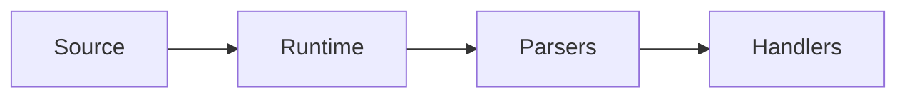

Shipstern moves Solana updates through four stages. A source produces them, the runtime routes them by kind, a parser decodes them, and handlers act on the result.



## Sources

A source connects to a data provider and streams updates into the runtime. An update is one Yellowstone `SubscribeUpdate` message: an account write, a transaction, a slot, a block, a block meta or a block footer. Select the source on the runtime builder, for example `.build::<YellowstoneGrpcSource>(config)`, and configure it in the `[source]` section of `Shipstern.toml`.

Live sources (Yellowstone gRPC, Fumarole, preconfirmations) stream until the process stops or the stream fails. Finite sources (Solana RPC, snapshot, Jetstreamer) finish, and the runtime drains its queue before it exits. See [Sources](/docs/sources).

## Parsers

A parser implements the `Parser` trait from `shipstern-core`:

```rust
pub trait Parser {
    type Input;
    type Output;

    fn id(&self) -> Cow<'static, str>;
    fn prefilter(&self) -> Prefilter;
    fn parse(&self, value: &Self::Input) -> impl Future<Output = ParseResult<Self::Output>> + Send;
}
```

| Item | Meaning |
| --- | --- |
| `Input` | The update kind the parser reads, such as `AccountUpdate` or `InstructionUpdate`. |
| `Output` | The decoded value passed to handlers. |
| `id()` | A unique ID. The runtime keys the parser's prefilter by it. |
| `prefilter()` | What the parser wants the server to send. |
| `parse()` | Decodes one update. |

Use a [built-in parser](/docs/parsers) or [generate one from an Anchor or Codama IDL](/docs/parsers/idl-codegen).

## Handlers

A handler receives each parsed value together with the raw update it came from:

```rust
pub trait Handler<T, R: Sync> {
    fn handle(&self, value: &T, raw_event: &R) -> impl Future<Output = HandlerResult<()>> + Send;
}
```

Write handlers with `async fn handle`. `HandlerResult<()>` is a `Result` whose error is `Box<dyn Error + Send + Sync>`, so `?` works on most error types. The handlers in a pipeline run concurrently on the same parsed value. If one returns an error, the runtime logs it at `error` level. With the `prometheus` feature on, the runtime also counts it in the `*_handler_errors` metric. The error does not affect the other handlers.

## Pipelines

A pipeline joins one parser to one or more handlers:

```rust
Pipeline::new(InstructionParser, [Logger])
```

The handler array has one element type. Several values of the same handler type can share a pipeline. Handlers of different types need a common wrapper type.

Register pipelines on the runtime builder by update kind:

| Builder method | Parser input | Example parser |
| --- | --- | --- |
| `.account(..)` | `AccountUpdate` | `shipstern_spl_token_parser::AccountParser` |
| `.instruction(..)` | `InstructionUpdate` | `shipstern_spl_token_parser::InstructionParser` |
| `.transaction(..)` | `TransactionUpdate` | Custom parser |
| `.block_meta(..)` | `BlockMetaUpdate` | `shipstern_block_meta_parser::BlockMetaParser` |
| `.block(..)` | `BlockUpdate` | Custom parser |
| `.block_footer(..)` | `BlockFooterUpdate` | Custom parser. See [Receive block footers](/docs/runtime#receive-block-footers). |
| `.slot(..)` | `SlotUpdate` | `shipstern_slot_parser::SlotParser` |

The runtime decodes each transaction into instructions once and bundles every instruction pipeline behind a single instruction pipeline.

`FilterPipeline` is a pipeline that adds conditions to its parser's prefilter, such as account keys loaded from configuration. See [Runtime filters](/docs/filtering/prefilters#build-filters-at-runtime-with-filterpipeline) for the merge rules.

## Prefilters

A prefilter describes the data a parser needs: account owners, specific accounts, transactions that include or require accounts, memcmp and data-size comparisons, and more. The runtime combines registered prefilters into one subscription request. A Yellowstone gRPC server then sends the updates that match the subscription. Other sources support a subset of these filters. See [Sources](/docs/sources).

For a program ID stored in `token_program`:

```rust
Prefilter::builder()
    .account_owners([token_program])
    .build()?
```

See [Prefilters](/docs/filtering/prefilters).

## Runtime

`Runtime::builder()` collects pipelines and an optional Prometheus registry. `build::<S>(config)` adds the source and its configuration, and `run()` or `run_async()` starts the runtime. The runtime owns the metrics and the worker pool that runs parsers and handlers. On Unix it stops on `SIGINT`, `SIGTERM`, `SIGHUP` or `SIGQUIT`, and on other systems on `Ctrl+C`. See [Runtime](/docs/runtime).

## See also

- [Runtime](/docs/runtime): builder, run modes, concurrency and shutdown.
- [Prefilters](/docs/filtering/prefilters): every prefilter option and its server-side limits.
- [Glossary](/docs/reference/glossary): short definitions of these terms and the Solana terms around them.
