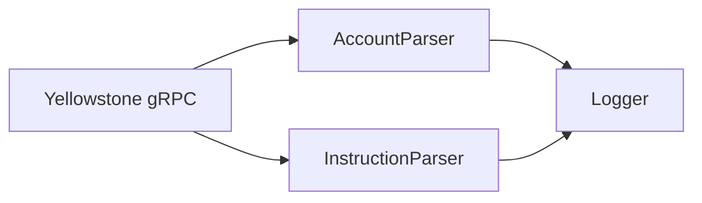

Build a binary that streams SPL Token accounts and instructions from Yellowstone gRPC and logs each decoded value. Two parsers decode the updates and one handler, `Logger`, prints them.



<Note title="Prerequisites">
Rust 1.97.1 or newer, the system packages from [Installation](/docs/get-started/installation#system-packages), and a Yellowstone gRPC endpoint for the target cluster. Get an `x-token` if the provider requires one. A Solana JSON-RPC URL does not provide this stream.

The config below sets no `commitment-level`, so the source reconnects through bank replay. Bank replay needs a server on yellowstone-grpc proto 13 or newer. On an older server, set `auto-reconnect = false` ([details](/docs/get-started/troubleshooting#failedprecondition-ends-the-run-on-an-older-server)).
</Note>

<Steps>
<Step>

### Create the project

```bash
cargo new token-stream
cd token-stream
```

</Step>
<Step>

### Add dependencies

Replace the `[dependencies]` table in `Cargo.toml`:

```toml title="Cargo.toml"
[dependencies]
clap = { version = "4.5", features = ["derive"] }
rustls = "0.23"
shipstern = "0.13.0"
shipstern-spl-token-parser = "0.13.0"
shipstern-yellowstone-grpc-source = "0.13.0"
toml = "0.8"
tracing = "0.1"
tracing-subscriber = { version = "0.3", features = ["env-filter"] }
```

`shipstern` is the runtime, `shipstern-yellowstone-grpc-source` connects to Yellowstone gRPC, and `shipstern-spl-token-parser` decodes the Token Program (`TokenkegQfeZyiNwAJbNbGKPFXCWuBvf9Ss623VQ5DA`). `clap` reads the command line, `toml` reads the config file, `rustls` provides TLS, and `tracing` with `tracing-subscriber` prints the logs.

</Step>
<Step>

### Configure the source

Create `Shipstern.toml` in the project root:

```toml title="Shipstern.toml"
[source]
endpoint = "https://yellowstone.example.com"
x-token = "<X-TOKEN>"
timeout = 60
```

Replace both placeholders with the gRPC provider's values. Remove `x-token` if the endpoint needs no authentication. `timeout` is required. It sets the connection and request timeout in seconds. Every other key has a default. See [Configuration](/docs/get-started/configuration).

</Step>
<Step>

### Write the pipeline

Replace `src/main.rs`. This is the [Quick Start](https://github.com/solana-rpc/shipstern#quick-start) from the Shipstern README, compiled against Shipstern 0.13.0.

<include cwd lang="rust" meta='title="src/main.rs"'>./examples/quickstart/src/main.rs</include>

What each part does:

| Part | Role |
| --- | --- |
| `Opts` | Reads the `--config` path from the command line. |
| `Logger` | A [handler](/docs/get-started/core-concepts#handlers). It receives the parsed value and the raw update, and logs the value at `info` level. |
| `install_default()` | Installs the TLS crypto provider the gRPC client needs. |
| `tracing_subscriber::registry()` | Prints log lines, filtered by `RUST_LOG`. Without it, neither `Logger` output nor runtime errors appear. |
| `toml::from_str(&config)` | Parses `Shipstern.toml`. Its type, `ShipsternConfig<YellowstoneGrpcConfig>`, is inferred from the `build` call. |
| `Pipeline::new(AccountParser, [Logger])` | Sends Token Program account updates through `AccountParser`, then to `Logger`. |
| `Pipeline::new(InstructionParser, [Logger])` | Does the same for Token Program instructions. |
| `.build::<YellowstoneGrpcSource>(config)` | Names the source and builds it from the config. The `[source]` section must hold that source's keys. |
| `.run()` | Creates a Tokio runtime and blocks. On a fatal error it logs the error and exits with status 1. |

</Step>
<Step>

### Run it

```bash
RUST_LOG=info cargo run -- --config ./Shipstern.toml
```

Shipstern subscribes to accounts owned by the Token Program and to transactions that include it. `Logger` prints a line for each decoded value as matching updates arrive.

Lines with `value=TokenProgramState { ... }` are decoded accounts. Lines with `value=TokenProgram { ... }` are decoded instructions. The binary streams until it is stopped. On mainnet it prints thousands of lines per second. To see a sample, add `| head -n 20` to the command.

If no values appear, follow [the no-data checklist](/docs/get-started/troubleshooting#the-runtime-starts-but-no-data-arrives). Check the endpoint, logging and subscription before changing the handler.

Stop the binary with `Ctrl+C`. The runtime waits up to 30 seconds for handlers that already started, then exits with status 0. The line `WARN ... SignalKind(2) received, shutting down...` is the normal shutdown message, not an error.

</Step>
</Steps>

## See also

- [Core concepts](/docs/get-started/core-concepts): how sources, parsers, handlers and prefilters fit together.
- [Track a single mint](/docs/guides/track-a-single-mint): narrow the instruction stream to one token with `FilterPipeline`.
- [Watch a wallet's token moves](/docs/guides/watch-a-wallets-token-moves): match token-balance owners alongside transaction accounts.
- [Generate a parser from an IDL](/docs/guides/generate-a-parser-from-an-idl): parse an Anchor program from its IDL, or a Shank program from a Codama IDL.
- [Decode pump.fun trade events](/docs/guides/decode-pump-fun-trade-events): handle events generated from an Anchor IDL.
- [Push metrics to Prometheus](/docs/guides/push-metrics-to-prometheus): count received, parsed and failed updates.
