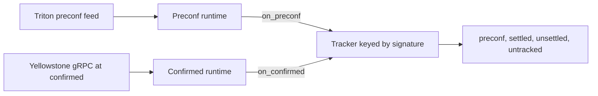

Print each Triton preconfirmation (preconf) for one program when it arrives, then watch a Yellowstone gRPC stream at `confirmed` for the same signature. A match prints that the transaction settled and how many milliseconds earlier the preconf came. A signature with no confirmed copy within 150 confirmed slots prints as unsettled.

**Based on:** no upstream example. The preconf filter follows the [released preconf example](https://github.com/solana-rpc/shipstern/tree/v0.13.0/examples/preconf). Compiled against Shipstern 0.13.0; not run against a live endpoint.



**Prerequisites:**

- A Triton token with the Harmonic feed, the BAM feed or both. Preconfs are not self-serve. See [Choose the feeds and regions](/docs/sources/preconf#choose-the-feeds-and-regions).
- A Yellowstone gRPC endpoint and token. The server must store slots, because a confirmed stream resumes from a slot checkpoint. See [Reconnects](/docs/sources/yellowstone-grpc#reconnects).
- The toolchain from [Installation](/docs/get-started/installation#requirements).

## Facts the design depends on

1. **A preconf is not settlement.** The slot can be skipped, the block can land on an abandoned fork, and the leader can restart the slot. See [Know what a preconfirmation is](/docs/sources/preconf#know-what-a-preconfirmation-is).
2. **Copies repeat.** A restarted slot delivers its transactions again, and a resumed gRPC stream can send a confirmed transaction again. The program records each signature once and ignores later copies.
3. **The slots can differ.** After a restart, the preconf `slot` and the slot the transaction lands in are not always equal. The program matches on the signature and never on the slot. On both sources, the signature is the transaction's first signature.
4. **The results can differ.** Harmonic reports the block builder's result, not the leader's, so a successful preconf can land as a failed transaction. The confirmed side asks for failed transactions too.
5. **The filters differ.** The preconf feed matches only static account keys. Yellowstone gRPC also matches keys loaded from address lookup tables, so the confirmed side receives every transaction that the preconf side can receive for the program, and more.

<Steps>
<Step>

### Create the project

```bash
cargo new preconf-settlement
cd preconf-settlement
```

</Step>
<Step>

### Add dependencies

Replace the `[dependencies]` table in `Cargo.toml`:

```toml title="Cargo.toml"
[dependencies]
rustls = "0.23"
serde = { version = "1", features = ["derive"] }
shipstern = "0.13.0"
shipstern-core = "0.13.0"
shipstern-preconf-source = "0.13.0"
shipstern-yellowstone-grpc-source = "0.13.0"
tokio = { version = "1", features = ["macros", "rt-multi-thread"] }
toml = "0.8"
tracing = "0.1"
tracing-subscriber = { version = "0.3", features = ["env-filter"] }
```

</Step>
<Step>

### Write the config

Save this file as `Shipstern.toml` in the project root. The program reads it from the working directory and takes no `--config` flag.

```toml title="Shipstern.toml"
# Holds two tokens. Do not commit it.
[preconf.source]
x-token = "<TRITON-PRECONF-TOKEN>"
# A BAM-only token: bam-regions = ["fra"] in place of harmonic-regions.
harmonic-regions = ["fra"]

[confirmed.source]
endpoint = "https://<yellowstone-endpoint>"
x-token = "<X-TOKEN>"
timeout = 60
```

Each table configures one runtime and takes the keys of its source. See [Configure the source](/docs/sources/preconf#configure-the-source) and the [Yellowstone gRPC configuration](/docs/sources/yellowstone-grpc#configuration). `timeout` has no default in the gRPC table. The program sets the gRPC commitment to `confirmed`, so a `commitment-level` key in the file has no effect. Optional `[preconf.buffer]` and `[confirmed.buffer]` tables size each worker pool.

</Step>
<Step>

### Write the program

Replace `src/main.rs`:

<include cwd lang="rust" meta='title="src/main.rs"'>./examples/preconf-settlement/src/main.rs</include>

| Part | What it does |
| --- | --- |
| `PROGRAM` | The Orca Whirlpool program. The whole SPL Token program reaches the [coverage share](/docs/sources/preconf#billing-and-the-coverage-share) within a minute. The released preconf example stays under it by requiring this key together with the Token program. This filter is the Whirlpool program alone, so it can carry a few more transactions. |
| `Signatures` | A custom transaction [parser](/docs/parsers#write-a-custom-parser). Its prefilter includes `PROGRAM`, and it emits the signature, slot and result of each transaction. The preconf feed needs an include, required or signature list, and this include list satisfies it. |
| `failed: Some(false)` | The preconf side receives successes only. The feed filter gets `execution_results = [SUCCESS]`. |
| `failed: None` | The confirmed side receives failed transactions too, so a preconf that lands as a failure still settles, with `result=failed`. `PrefilterBuilder` always sets `Some(false)`, so the program builds the prefilter as a struct. |
| `Entry::Pending` and `Entry::Done` | One entry per signature. A pending entry holds the preconf's arrival time and slot. A done entry is settled, or confirmed with no preconf. Once an entry is done, later copies of either kind change nothing. |
| `Tracker::on_preconf` | The place to act on the early signal. Here it prints a `preconf` line. It skips a signature it holds, a preconf for a slot at or before the first confirmed transaction, and a preconf whose window already passed. |
| `Tracker::on_confirmed` | Settles a pending signature and prints the lead time. Records a confirmed-only signature as done. Moves the slot clock, which is the highest slot of a confirmed transaction. |
| `expire` | Removes each slot group once the clock is 150 slots past it, and prints `unsettled` for a pending entry there. Over 100,000 entries, it removes the oldest slot group and prints `untracked` for its pending entries. |
| `Track` | The handler of both runtimes. It locks the shared `Tracker` and calls one method. No `.await` runs while the lock is held. |
| `commitment_level = Some(CommitmentLevel::Confirmed)` | Settlement means `confirmed` here, whatever the file says. At `confirmed` the gRPC source reconnects with slot resume. |
| `toml::from_str(..).unwrap_or_else(..)` | Prints only the message of a parse error. The error's `Debug` output holds the whole file, both tokens included. |
| `tokio::select!` over two `run_async()` calls | Runs both runtimes on the Tokio runtime of `main`, and ends the program when the first one stops. `error_span!` names the runtime on a fatal error line. |

</Step>
<Step>

### Run it

From the project root:

```bash
RUST_LOG=warn cargo run
```

The program prints nothing until the confirmed stream delivers its first program transaction. After that, each line starts with its kind:

```text
preconf   slot=<slot> <signature>
settled   slot=<slot> preconf_slot=<slot> lead_ms=<ms> result=ok <signature>
unsettled preconf_slot=<slot> <signature>
untracked preconf_slot=<slot> <signature>
```

`RUST_LOG=warn` also shows the source warnings for a restarted slot and for transactions withheld over the coverage share. The program runs until `Ctrl+C`.

</Step>
</Steps>

## Read the output

| Line | Printed when | What it shows |
| --- | --- | --- |
| `preconf` | The first preconf of a signature arrives, for a slot after the first confirmed transaction. | The block producer reported the transaction in that slot. |
| `settled` | A confirmed copy of a pending signature arrives. | A confirmed block holds the transaction. `slot` is where it landed, `result` is the confirmed outcome, and `lead_ms` is the time from the preconf handler to the confirmed handler. |
| `unsettled` | The clock passes the preconf slot by 150 slots, and no confirmed copy arrived. | No confirmed copy reached the handler in the window. See the next section. |
| `untracked` | The cap removes a pending signature. | Nothing about the transaction. The program stopped watching it. |

## Know what an unsettled line proves

An `unsettled` line means that no confirmed copy reached the confirmed handler within 150 confirmed slots of the preconf slot. The usual cause is a skipped, forked or restarted slot that did not keep the transaction. The line does not prove that the transaction never lands:

- **It can land later.** A client can send the same signed transaction again until its blockhash expires, and a durable nonce transaction has no such limit. A copy that lands after the window prints nothing, because the signature is no longer pending.
- **The confirmed side can miss it.** The worker pool runs updates concurrently, so a copy that lands near the end of the window can reach its handler after a later slot moved the clock past it. A handler that fails drops its update. The runtime logs the error and does not retry.

The gRPC filter in this program does not miss a copy. A copy carries the same signed message, so it has the same static keys, and the confirmed side asks for both results. A change that narrows only the confirmed filter breaks this, and then the gRPC filter can miss a copy.

A gRPC stream loss does not cause false `unsettled` lines. The clock is the confirmed stream's own progress, so it stops while the stream is down, and a resumed stream sends the missed slots. A server that no longer holds the resume slot ends the run with `OutOfRange`, which ends the program.

<Warning>
Treat `unsettled` as a reason to check the signature with another source, not as proof of a dropped transaction. Treat `settled` as confirmed, not finalized.
</Warning>

## Run two runtimes in one process

Each `Runtime` owns its source, its worker pool and its filters. `run_async()` runs on the current Tokio runtime. It spawns the source as a task and starts a worker pool with its own bridge thread. The two runtimes share the Tokio runtime and, through the handlers, the `Tracker`. The only Shipstern state they share is the Prometheus counters.

- **Signals.** Each run listens for `SIGINT`, `SIGTERM`, `SIGHUP` and `SIGQUIT`. Tokio delivers a signal to every listener, so `Ctrl+C` stops both runtimes.
- **Fatal errors.** `run_async()` logs a fatal error and exits the process with status 1, so a failure that stops either runtime ends both. A stream that stays open with no data does not stop its runtime. See the limits below.
- **The first stop ends the program.** `tokio::select!` returns when the first runtime stops. `main` then returns, and the Tokio runtime drops the other runtime's tasks, so that runtime does not drain. The handlers here only print, so this loses nothing. A program that writes to a store needs both drains to finish. See [Shut down](/docs/runtime#shut-down).
- **Metrics.** With the `prometheus` feature, the `shipstern_*` counters are process-wide, so both runtimes add to the same counters. See [Counters](/docs/observability/metrics#counters).
- **Worker pools.** Each runtime has its own pool, and `jobs` defaults to the number of CPUs for each. Set `jobs` in each `buffer` table to cap them.

## Common failures

| Symptom | Cause |
| --- | --- |
| Panic with `Error reading Shipstern.toml` | `Shipstern.toml` is not in the working directory. |
| Panic with `Error parsing config` that names the missing field `preconf` | The file still has the quickstart layout with one `[source]` table. Use the two tables above. |
| Panic with `Error parsing config` that names the missing field `timeout` | `[confirmed.source]` has no `timeout`. |
| An `ERROR` line under the `preconf` span with `Unauthenticated` | The token lacks a feed that the config names. See [Choose the feeds and regions](/docs/sources/preconf#choose-the-feeds-and-regions). |
| `WARN` with `The feed withheld transactions: the account is over its coverage share` | The program is too busy for the share in that region. Narrow the filter, for example with a required pool account. Withheld preconfs never arrive, so they cause gaps, not false `unsettled` lines. |
| An `ERROR` line under the `confirmed` span with `OutOfRange` or `from_slot is not supported` | The gRPC server cannot resume the stream. See [Reconnects](/docs/sources/yellowstone-grpc#reconnects). |
| The program prints nothing | No program transaction arrived on the confirmed stream yet, or the regions carry no slot of a leader that runs the feed's client. Each feed covers only those slots. |

## Limits of this design

- **State is in memory.** A restart loses every pending signature, and the program skips preconfs until the new confirmed stream delivers its first transaction.
- **The clock is the program's own traffic.** Between confirmed transactions the clock stops, so on a quiet program an `unsettled` line comes late, never early.
- **`lead_ms` is handler time.** It includes the time each update waited in its worker pool, and both pools share one Tokio runtime. It is not the gap between the two messages on the wire.
- **The cap removes a whole slot.** The 100,000 entries include settled and confirmed-only signatures. Every confirmed transaction from a slot that no configured feed covers is a confirmed-only entry. The cap also removes done entries, so a later copy of an evicted signature counts as new. Idempotency and the `unsettled` report hold only under the cap.
- **A silent confirmed stream is not detected.** A gRPC stream that stays open with no data stops the clock with no error. Preconf lines keep coming, and no `unsettled` line appears until the stream delivers again.
- **The coverage share is not measured here.** The released example relies on the Whirlpool key to stay under the share. Watch for the withheld warning.
- **Confirmed is not finalized.** On Alpenglow, confirmed arrives together with finalized, so `lead_ms` includes finalization there. For finality, set `CommitmentLevel::Finalized` in place of `Confirmed`.

## See also

- [Triton preconfirmation source](/docs/sources/preconf): feeds, regions, prefilter limits and the coverage share.
- [Yellowstone gRPC source](/docs/sources/yellowstone-grpc#resume-from-a-slot-checkpoint): how a confirmed stream resumes after a loss.
- [Run in production](/docs/runtime/production#make-handlers-idempotent): more on idempotent handlers.
- [Delivery and ordering](/docs/runtime/delivery): why updates finish out of order.
