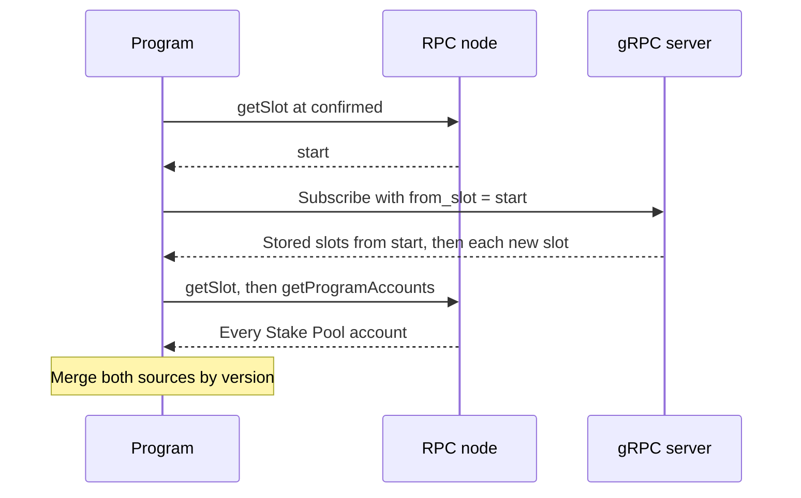

Load every account that the SPL Stake Pool program owns with the [Solana RPC source](/docs/sources/solana-rpc), then keep each account current from a [Yellowstone gRPC](/docs/sources/yellowstone-grpc) stream. The stream starts first, at a slot read from the RPC node, so no change falls between the load and the stream.

**Based on:** no upstream example. Compiled against Shipstern 0.13.0; not run against a live endpoint.



**Prerequisites:**

- A Cargo binary project with `Shipstern.toml` in its root, as in the [quickstart](/docs/get-started/quickstart#configure-the-source).
- Rust 1.97.1 or newer. `shipstern-solana-rpc-source` 0.13.0 uses Agave 4.3.2, which needs it.
- A gRPC server that stores slots for replay.
- A Solana JSON-RPC endpoint that serves `getProgramAccounts` for the SPL Stake Pool program.

## Start the stream before the load

The RPC source is finite. For each owner in a prefilter it calls `getSlot`, makes one `getProgramAccounts` request, sends one update per account and completes. Every update carries the `getSlot` result, so an account's data can be from a later slot than the one it reports. See [Read the account fields](/docs/sources/solana-rpc#read-the-account-fields).

| Order | How the switch works | What can fail |
| --- | --- | --- |
| Load, then stream with `from-slot` set to the load's slot | The gRPC server replays the changes made during the load. | The server must still hold that slot when the load ends. yellowstone-grpc keeps 150 slots for replay by default, so a slower load ends the stream with `OutOfRange`. |
| Read a slot, stream from it, then load | The stream covers every slot from the start slot while the load runs. | The server must hold the start slot only until the subscription arrives, one connect later. The two sources overlap, so the store must choose between two states of one account. |

This guide uses the second order. The store keeps one state per account. A new state replaces the stored one only when its version is higher. The version is `(slot, live, write_version)`: the slot first, then a live state over an RPC state at the same slot, then the server's write number. The RPC source sets `write_version` to 0 on every account. The result does not depend on arrival order, and a repeated update changes nothing.

### The switch loses no change

`start` is the slot that the first `getSlot` call returns. The design rests on three premises:

1. **The stream delivers every write in every confirmed slot from `start` on.** With `from_slot`, yellowstone-grpc first replays every slot it stores from `start`, then sends each new slot. A server that no longer holds `start` ends the stream with `OutOfRange`. A server with replay off answers `from_slot is not supported`. Both errors end the program. [Slot resume](/docs/sources/yellowstone-grpc#resume-from-a-slot-checkpoint) covers a later stream loss, or the run ends with an error.
2. **The RPC slot is not below `start`.** The load calls `getSlot` again, after the first call, on the same endpoint. Step 4 of the program checks the lowest slot of the load and stops with an error if it is below `start`.
3. **The RPC data is not older than its slot.** The source calls `getSlot` before `getProgramAccounts` on the same endpoint.

For each account, one of two cases applies:

- **It changed after the RPC slot.** The stream delivered that change (premises 1 and 2). Its slot is higher, so the live state wins.
- **It did not change after the RPC slot.** The RPC state is current (premise 3) and beats every live state from an older slot. A live state from the RPC slot itself wins the tie. That state is the last write of the slot, and the stream delivered that slot in full because it is not below `start`.

The stream delivers slot `start` in full, so an RPC slot equal to `start` passes the check. The two `getSlot` calls run moments apart, so equal slots are common.

<Steps>
<Step>

### Add dependencies

Replace the `[dependencies]` table in `Cargo.toml`:

```toml title="Cargo.toml"
[dependencies]
rustls = "0.23"
serde = { version = "1", features = ["derive"] }
shipstern = "0.13.0"
shipstern-solana-rpc-source = "0.13.0"
shipstern-stake-pool-parser = "0.13.0"
shipstern-yellowstone-grpc-source = "0.13.0"
solana-client = "~4.3.2"
solana-commitment-config = "3"
tokio = { version = "1", features = ["macros", "rt-multi-thread", "sync", "time"] }
toml = "0.8"
tracing-subscriber = { version = "0.3", features = ["env-filter"] }
```

`solana-client` is the RPC client that the RPC source uses. `~4.3.2` keeps it on Agave 4.3, the line that `shipstern-solana-rpc-source` 0.13.0 uses.

</Step>
<Step>

### Configure both sources

Keep the quickstart's `[source]` section for the gRPC stream and add an `[rpc]` section for the load:

```toml title="Shipstern.toml"
[source]
endpoint = "https://yellowstone.example.com"
x-token = "<X-TOKEN>"
timeout = 60

[rpc]
endpoint = "https://rpc.example.com"
timeout = 60
```

`[source]` takes the [Yellowstone gRPC keys](/docs/reference/configuration#yellowstone-grpc-source) in kebab-case. `[rpc]` takes the [Solana RPC keys](/docs/reference/configuration#solana-rpc-source) in snake_case. Its `timeout` must cover the whole `getProgramAccounts` response. The program sets `confirmed` commitment on both sources and sets `from-slot` itself, so those keys in this file have no effect.

</Step>
<Step>

### Write the program

Replace `src/main.rs`:

<include cwd lang="rust" meta='title="src/main.rs"'>./examples/backfill-then-live/src/main.rs</include>

| Part | What it does |
| --- | --- |
| `Config` | Reads `[source]`, `[rpc]` and an optional `[buffer]` from one file. Both runtimes use the same `[buffer]` settings. |
| `e.message()` | A TOML error's `Debug` form holds the whole input, `x-token` included. The program prints only the message, such as ``missing field `rpc` ``. |
| `commitment_level = Some(CommitmentLevel::Confirmed)` | Both sources read confirmed state, so their slots compare. With the default `auto-reconnect`, the gRPC source then recovers a lost stream with slot resume, which accepts a `from-slot`. |
| `RpcClient::new_with_timeout_and_commitment(...).get_slot()` | Reads the RPC node's newest confirmed slot. The program builds the client the way the RPC source builds its own, with the same endpoint, timeout and commitment. |
| `config.source.from_slot = Some(start)` | The stream starts at `start`. Only the first subscription sends it. A resume starts from the source's own checkpoint. |
| `Version` | The order of two states of one account. Rust compares tuples field by field: the slot first, then the `live` flag (`false` is lower), then `write_version`. |
| `Merge` | One handler type for both runtimes. Under the lock it records the lowest RPC slot, then replaces the stored state only when the new version is higher. It prints a line for each state it keeps. |
| `merge(&store, live)` | Builds an account pipeline with the Stake Pool parser. Each runtime gets its own pipeline; both write to one `Arc<Mutex<Store>>`. |
| `tokio::spawn(live.try_run_async())` | Runs the gRPC runtime as a task on the same Tokio runtime as `main`. |
| `tokio::select!` with `biased` | Runs the load while it watches the stream. A stream that fails, for example with `OutOfRange`, ends `main` before the load finishes. An `Ok` from the stream means that it stopped without an error, as after a signal. |
| `load.try_run_async()` | Returns `Ok(())` after the load completes and its queued updates run, and also after a signal. A failed RPC request returns `Err`, which ends `main`. |
| Step 4 `match lowest` | The check from premise 2. A load that stored no account cannot be checked, so it is an error too. |
| `live.await??` | The stream keeps the store current until a signal or a stream error ends the gRPC runtime. |

On Unix, both runtimes listen for `SIGINT`, `SIGTERM`, `SIGHUP` and `SIGQUIT`. Tokio delivers a signal to every listener, so `Ctrl+C` stops both.

</Step>
<Step>

### Run it

From the project root:

```bash
RUST_LOG=info cargo run
```

The program reads `Shipstern.toml` from the working directory. It prints the start slot, one line per stored account state and a summary:

```text
stream starts at slot <start>
rpc <pubkey> slot=<rpc slot> stake pool
rpc <pubkey> slot=<rpc slot> validator list
backfill ended: <count> accounts stored, RPC slot <rpc slot>, start <start>
live <pubkey> slot=<slot> stake pool
```

`live` lines can also come before the summary, because the stream runs during the load. An account that the stream already updated at a higher slot gets no `rpc` line. An `rpc` line can replace a state that the replay stored at a lower slot. Accounts that the parser cannot decode, such as uninitialised ones, log `Handler failed` with `Error parsing input value` and are not stored. The runtimes' own log lines, such as `Source completed successfully; draining runtime buffer`, appear between these lines.

The program runs until `Ctrl+C` or a stream error.

</Step>
</Steps>

## Common failures

| Symptom | Cause |
| --- | --- |
| `Error: Os { code: 2, kind: NotFound, ... }` at startup | `Shipstern.toml` is not in the working directory. |
| ``Error: "Shipstern.toml: missing field `rpc`"`` | The file has no `[rpc]` section. The same message names any other missing section or required key, such as `endpoint` or `timeout`. |
| An RPC client error before `stream starts at slot` | The first `getSlot` call failed: the `[rpc]` endpoint is wrong, unreachable or slower than `timeout`. |
| The run ends with `from_slot is not supported` | The gRPC server has replay off. This design needs a server that stores slots. See [`from_slot is not supported` ends the run](/docs/get-started/troubleshooting#from_slot-is-not-supported-ends-the-run). |
| The run ends with `OutOfRange` and `broadcast from <start> is not available` at startup | The gRPC server no longer holds `start`, because the RPC node is further behind the gRPC server than the server's replay window. Use endpoints that stay close in slot, such as both from one provider. |
| `RPC slot <slot> is below the start <start>; run again` | The load's `getSlot` reached a node behind the one that answered the first call, for example behind a load balancer. |
| `the backfill loaded no accounts, so its slot is unchecked` | The RPC endpoint returned no Stake Pool accounts. Check the endpoint and its network. |
| `Failed to get program accounts for source: solana-rpc` | The endpoint refused `getProgramAccounts` or exceeded `timeout`. See [End the run](/docs/sources/solana-rpc#end-the-run). |
| `OutOfRange` ends the run after a reconnect | The stream was down for longer than the server keeps slots. Restart the program: it loads the state again. |

RPC client errors can include the endpoint URL. Keep API keys out of the URL if logs are shared.

## Limits of this design

- **Closed accounts stay in the store.** The Stake Pool parser fails on empty account data. So the handler does not run for an account that is closed during or after the load, and the account's last state stays. A program that must drop closed accounts needs a parser that reports a zero-lamport account instead of failing, and a stored marker so that an older RPC state cannot bring the account back. That path is not checked against a live close.
- **The load selects by owner only.** `getProgramAccounts` returns every account the program owns. The RPC source does not apply memcmp or data-size conditions from a prefilter. See [Prefilter fields the source applies](/docs/sources/solana-rpc#prefilter-fields-the-source-applies).
- **Memory grows with the program.** The RPC source holds each whole response in memory. The store keeps every account's data, because the Stake Pool parser returns the raw bytes. Size the host for the largest program the pipelines name.
- **Premises 2 and 3 assume one RPC node.** An endpoint that sends calls to different nodes behind a load balancer can answer `getProgramAccounts` with data older than its slot, which the check cannot see.
- **Premise 1 is a property of the server.** It holds for yellowstone-grpc with replay on, the same replay that slot resume uses. Other gRPC servers are not checked.
- **Confirmed state is not final.** See [Choose a commitment level](/docs/runtime/production#choose-a-commitment-level).
- **A stream loss after the switch is covered only within the server's replay window.** The same limit applies to any stream. See [Reconnects](/docs/sources/yellowstone-grpc#reconnects).
- **The store lives in memory.** A restart loads the state again, which needs no checkpoint but repeats the full RPC load.

## See also

- [Solana RPC source](/docs/sources/solana-rpc): request order, account fields and provider limits for the load.
- [Yellowstone gRPC source](/docs/sources/yellowstone-grpc#reconnects): reconnect modes and their limits.
- [Delivery and ordering](/docs/runtime/delivery#choose-stable-record-keys): record keys for updates that can repeat or arrive out of order.
- [Shut down](/docs/runtime#shut-down): how a finite runtime drains and how signals stop a runtime.
