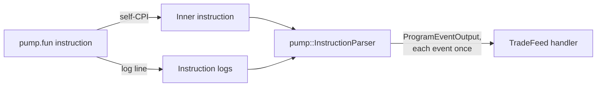

Decode pump.fun events to print trades of 1 SOL or more and each new token.

**Based on:** no upstream example. The Shipstern repository tests the same feature in [`tests/proc-macro-events`](https://github.com/solana-rpc/shipstern/tree/v0.13.0/tests/proc-macro-events). Compiled against Shipstern 0.13.0.



**Prerequisites:** a Cargo binary project with `Shipstern.toml` in its root, as in the [quickstart](/docs/get-started/quickstart#configure-the-source), and `pump.json` next to `Cargo.toml`, fetched as in [Generate a parser from the pump.fun IDL](/docs/guides/generate-a-parser-from-an-idl#fetch-the-anchor-idl).

<Steps>
<Step>

### Add dependencies

Add the empty `[workspace]` table at the top of `Cargo.toml` and replace the `[dependencies]` table. Keep the `[lints.rust]` table from the IDL guide, or add it if this is a new project:

```toml title="Cargo.toml"
# Own workspace, so `program-events` does not reach other crates.
[workspace]

[dependencies]
borsh = { version = "1", features = ["derive"] }
clap = { version = "4.5", features = ["derive"] }
rustls = "0.23"
shipstern = "0.13.0"
shipstern-core = "0.13.0"
shipstern-parser = "0.13.0"
shipstern-proc-macro = { version = "0.13.0", features = ["program-events"] }
shipstern-yellowstone-grpc-source = "0.13.0"
toml = "0.8"
tracing-subscriber = { version = "0.3", features = ["env-filter"] }

# Generated code checks for a `serde` feature; declare the cfg to avoid a warning.
[lints.rust]
unexpected_cfgs = { level = "warn", check-cfg = ['cfg(feature, values("serde"))'] }
```

`program-events` makes the macro generate the event types and changes what `InstructionParser` returns. The generated code imports `shipstern_core` and `shipstern_parser` and derives Borsh traits, so those three crates are required. [Keep the crate in its own workspace](#keep-the-crate-in-its-own-workspace) explains the empty `[workspace]` table.

</Step>
<Step>

### Write the program

Replace `src/main.rs`:

<include cwd lang="rust" meta='title="src/main.rs"'>./examples/pump-trade-events/src/main.rs</include>

| Part | What it does |
| --- | --- |
| `include_shipstern_parser!("pump.json")` | Generates the `pump` module. With `program-events` it also holds `pump::event::Event`, with one variant per IDL event, and `pump::ProgramEventOutput`. |
| `Pipeline::new(pump::InstructionParser, [TradeFeed])` | The parser's prefilter asks the server for successful transactions that include pump.fun at the configured commitment level. Results at `processed` commitment can still be rolled back. |
| `Handler<pump::ProgramEventOutput, InstructionUpdate>` | `ProgramEventOutput` is the parser's output with the feature on. The handler runs once for each pump.fun instruction the parser decodes. |
| `value.program_events` | The events that instruction emitted. Each entry holds one `Event` in its `event` field. |
| `Event::TradeEvent { args, .. }` | `args` has the IDL fields: `mint`, `sol_amount` in lamports, `token_amount`, `is_buy`, `user`, reserves and fees. Events carry no accounts, so the `accounts` field holds only an empty `remaining_accounts` list. |
| `MIN_LAMPORTS` | Most trades are small. Fewer than 1 in 10 reached 1 SOL in the live test. |
| `Event::CreateEvent { args, .. }` | A new token, with `name`, `symbol`, `uri`, `mint` and `creator`. |
| `_ => {}` | Skips the other 26 events in the IDL, such as `CompleteEvent` and `CollectCreatorFeeEvent`. |

</Step>
<Step>

### Run it

From the project root:

```bash
RUST_LOG=info cargo run -- --config ./Shipstern.toml
```

Trades and new tokens print as they land, until `Ctrl+C`:

```text
sell     2.11 SOL  4u3btNNYmtgZxuLHH3jXDUzh5STfARMTSi2frMV9pump
buy      1.98 SOL  7dvY8Ww9hYUeM2zN6vLXrn2JGwymjfbupQu4yz76pump
new  Synthra (SYNTHRA)  5eZ81DvYXPho8JECsTHE8tjcDAo2WpGxP4uwoKjApump
```

</Step>
</Steps>

## Common failures

| Symptom | Cause |
| --- | --- |
| `invalid compression flag: 32` repeats in the log | The server rejected the `x-token`. See [Troubleshooting](/docs/get-started/troubleshooting#invalid-compression-flag-32-repeats-twice-a-second). |
| Build error: `pump::event` or `pump::ProgramEventOutput` not found | `program-events` is not on for `shipstern-proc-macro`. |
| Build error `Failed to load/parse IDL` | `pump.json` is not next to `Cargo.toml`. |
| Another crate in the same workspace stops compiling on `Instructions` | `program-events` reached its generated parser. See [Keep the crate in its own workspace](#keep-the-crate-in-its-own-workspace). |
| Long gaps between lines | Most trades are under 1 SOL. Remove the `MIN_LAMPORTS` guard to see every trade. |

## What ProgramEventOutput holds

Without `program-events`, `pump::InstructionParser::Output` is `pump::Instructions` and the macro emits no event types. With it, the output is `pump::ProgramEventOutput`:

| Field | Type | Holds |
| --- | --- | --- |
| `instruction` | `Option<Instructions>` | The decoded instruction, such as `Buy`, `SellV2` or `CreateV2`. In 0.13.0 it is always `Some`, because an instruction that the parser cannot decode is a parse error and never reaches the handler. |
| `program_events` | `Vec<Events>` | The events the instruction emitted. An instruction that emits none arrives with an empty list. |

## Keep the crate in its own workspace

Cargo compiles `shipstern-proc-macro` once per build, with every feature that any crate in the build asks for, and the macro reads `program-events` at that point. A `cargo build` at a workspace root builds every member in one build. So if one member turns on `program-events`, every parser that another member generates from an IDL with events returns `ProgramEventOutput` too, and code that matches on `Instructions` stops compiling.

Give a crate that needs `program-events` its own workspace. Add the empty `[workspace]` table above, and add the crate to the parent workspace's `exclude` list if the parent's `members` would include it. The Shipstern repository does the same for its `tests/proc-macro-events` crate. A parser generated from an IDL with no events keeps `Instructions` either way. The built-in parsers, such as `shipstern-spl-token-parser`, do not use the IDL macro.

## Each trade arrives once

pump.fun writes every event twice: as a self-CPI and as a `Program data:` log line. A self-CPI is an inner instruction from the program to itself, and its data starts with Anchor's event tag `e445a52e51cb9a1d`. Since 0.12.0 ([#350](https://github.com/solana-rpc/shipstern/pull/350)) the parser returns each event once. For each pump.fun instruction it:

1. Skips the instruction if its data starts with the event tag, so a self-CPI never reaches the handler as an instruction of its own.
2. Decodes the self-CPI events among the instruction's direct inner instructions.
3. Decodes the `Program data:` lines that pump.fun wrote in this instruction's logs, and ignores lines from programs it calls. It drops each one that repeats a self-CPI event it already found.

A log event with no self-CPI twin is kept. Before 0.12.0 the parser returned both copies.

## Trades quoted in another token

`sol_amount` is 0 when the bonding curve is quoted in a token other than SOL. `quote_mint` then names that token, and `quote_amount` holds the amount. The 1 SOL guard skips such a trade. For SOL trades, `quote_mint` is `11111111111111111111111111111111` and `quote_amount` equals `sol_amount`.

## Variations

| Goal | Change |
| --- | --- |
| Print every trade | Remove the `if args.sol_amount >= MIN_LAMPORTS` guard. |
| Follow one token | Wrap the parser in `FilterPipeline` with `transaction_accounts_include([mint])`, as in [Track a single mint](/docs/guides/track-a-single-mint). |
| Act on the instruction as well | Match `value.instruction` against `pump::instruction::Instruction` variants such as `Buy` or `SellV2`. |

## Test record

On 2026-10-11 the program ran for 40 s on mainnet and printed 54 trades and 4 new tokens. An instrumented copy of its handler decoded 2,646 trades and 27 new tokens in 120 s, and the parser returned none of them twice. Every pump.fun instruction with events carried both copies in equal numbers. 74 of the 2,646 trades were quoted in another token. Not tested: sources other than Yellowstone gRPC.

## See also

- [Generate a parser from the pump.fun IDL](/docs/guides/generate-a-parser-from-an-idl): fetch the IDL and stream pump.fun accounts and instructions.
- [IDL code generation](/docs/parsers/idl-codegen#feature-flags): every macro feature flag and what the macro generates.
- [Handlers](/docs/runtime/handlers#read-the-raw-update): read the slot and signature of the transaction from `InstructionUpdate`.
