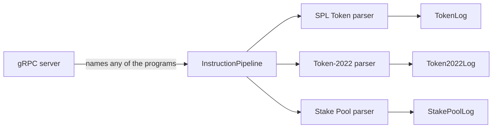

Decode the instructions of SPL Token, Token-2022 and SPL Stake Pool in one runtime, and give each program's values to its own handler. When the built-in instruction parsers are registered unchanged, their prefilters merge into a subscription that requires every program. The program wraps each parser, so a transaction that names any one of the programs matches.

**Based on:** no upstream example. Compiled against Shipstern 0.13.0; not run against a live endpoint.



**Prerequisites:** a Cargo binary project with `Shipstern.toml` in its root, as in the [quickstart](/docs/get-started/quickstart#configure-the-source).

## Why the built-in parsers need a wrapper

The runtime bundles every instruction pipeline into one `InstructionPipeline`. The subscription has a single entry for it, keyed `InstructionPipeline::ID` (`"InstructionPipeline"`). The prefilter of that entry is the merge of every instruction parser's prefilter. Account pipelines keep one entry each.

Each built-in instruction parser puts its program in the required set (`transaction_accounts`). The [merge](/docs/filtering/prefilters#how-prefilters-merge) combines the required sets, and the server sends a transaction only when it names every required account:

| Instruction parsers registered | Merged entry | Transactions the server sends |
| --- | --- | --- |
| SPL Token | Required: Token | Every successful transaction that names the Token Program |
| SPL Token, Token-2022, Stake Pool | Required: all three | Only successful transactions that name all three programs |
| The same three, each in `IncludeProgram` | Include: all three | Every successful transaction that names at least one of them |

`IncludeProgram` puts each program in the include set instead. The merge also combines include sets, and one key from the include set is enough for a match.

Parsers generated by `include_shipstern_parser!` also require their program, so the same rule applies to them. `FilterPipeline` cannot fix this, because a merge never removes a required key.

<Steps>
<Step>

### Add dependencies

Replace the `[dependencies]` table in `Cargo.toml`:

```toml title="Cargo.toml"
[dependencies]
clap = { version = "4.5", features = ["derive"] }
rustls = "0.23"
shipstern = "0.13.0"
shipstern-spl-token-extensions-parser = "0.13.0"
shipstern-spl-token-parser = "0.13.0"
shipstern-stake-pool-parser = "0.13.0"
shipstern-yellowstone-grpc-source = "0.13.0"
toml = "0.8"
tracing-subscriber = { version = "0.3", features = ["env-filter"] }
```

The program names no `spl-token-2022` type, so it needs no direct `spl-token-2022` dependency. Code that decodes Token-2022 extension data does need it. See [Read Token-2022 mint extensions](/docs/parsers#read-token-2022-mint-extensions).

</Step>
<Step>

### Write the program

Replace `src/main.rs`:

<include cwd lang="rust" meta='title="src/main.rs"'>./examples/several-programs/src/main.rs</include>

| Part | What it does |
| --- | --- |
| `IncludeProgram<P>` | Wraps an instruction parser. Its prefilter holds only an include set with the parser's `program_id()`. `parse` calls the wrapped parser. |
| `ProgramParser<Input = InstructionUpdate>` | Accepts only instruction parsers that know their program ID. An account parser does not fit. |
| `fn id` | Returns the wrapped parser's ID. All instruction parsers share the `InstructionPipeline::ID` entry, so the ID selects no filter. The `Parser::id` rule about distinct IDs for distinct prefilters does not apply. The ID still names the parser in error logs. |
| `..TransactionPrefilter::default()` | Keeps `failed = Some(false)`, the value in the built-in prefilters, so the merge keeps it too. |
| `TokenLog`, `Token2022Log`, `StakePoolLog` | Each handler is typed on the output of one parser (`TokenProgram`, `TokenExtensionProgram`, `StakePoolProgram`), so the compiler accepts it only in that parser's pipeline. |
| `fail` | Prints the error and exits with status 1. For a TOML error it prints only `message()`, because the `Debug` text of the error holds the whole file, `x-token` included. |
| Three `.instruction(..)` calls | The pipelines receive each instruction in registration order. |
| `mod tests` | Builds the bundled `InstructionPipeline` for the built-in and the wrapped parsers and checks the merged prefilter. |

</Step>
<Step>

### Check the subscription

The test builds the same `InstructionPipeline` as the runtime and reads its merged prefilter, so it needs no endpoint:

```bash
cargo test
```

```text
running 1 test
test tests::subscription_selects_any_program ... ok
```

The test asserts that the three built-in parsers require all three programs, and that the wrapped parsers include all three with no required set. Add each new parser to the test.

</Step>
<Step>

### Run it

From the project root:

```bash
RUST_LOG=info cargo run -- --config ./Shipstern.toml
```

Each line is one decoded instruction: the program, the transaction signature, the one-based instruction path, then the parsed value.

```text
spl-token <signature> ix 2 - TokenProgram { ... }
token-2022 <signature> ix 1.3 - TokenExtensionProgram { ... }
stake-pool <signature> ix 1 - StakePoolProgram { ... }
```

The program runs until `Ctrl+C`.

</Step>
</Steps>

## How each instruction reaches one handler

For each matching transaction, the `InstructionPipeline` builds the instruction tree once and passes every instruction, inner instructions included, to every parser. Each built-in parser compares the instruction's program with its own and returns `ParseError::Filtered` for any other program. The pipeline then skips its handlers and logs no error. As a result, `TokenLog` receives only SPL Token instructions, `Token2022Log` only Token-2022 instructions and `StakePoolLog` only Stake Pool instructions, even when one transaction calls all three programs.

Before 0.12.0, the Token-2022 parser also decoded SPL Token instructions as `TokenExtensionProgram` output, so a Token-2022 handler received SPL Token instructions too. See the [0.12.0 release notes](/docs/releases/v0-12-0).

If an instruction of the parser's own program does not decode, the error is logged at `error` level as `Handler failed`, with `handler` set to the parser ID. The other parsers and the next instructions still run.

### Order within and across transactions

| Scope | Behaviour |
| --- | --- |
| One transaction | Instructions go one at a time, parent before inner instructions, in tree order. For each instruction, the pipelines run in registration order, and the next instruction waits until their handlers finish. |
| Different transactions | Each transaction is a separate job. Up to `jobs` jobs run at once, so lines from different transactions interleave. |

Each instruction belongs to one program, so at most one of the three handlers runs for it. The lines of one transaction print in tree order. Registration order matters only when two pipelines accept the same instruction. A slow handler holds back the other programs' handlers for the rest of that transaction. See [Delivery and ordering](/docs/runtime/delivery#preserve-the-required-order) and [Size the worker pool](/docs/runtime#size-the-worker-pool).

## Common failures

| Symptom | Cause |
| --- | --- |
| `Error reading config file: No such file or directory (os error 2)` | The `--config` path does not exist. |
| `Error parsing config:` and a TOML message | `Shipstern.toml` does not match the Yellowstone gRPC source. See [`Error parsing config`](/docs/get-started/troubleshooting#error-parsing-config). |
| The program starts and prints nothing | Check the endpoint, token and subscription with [the no-data checklist](/docs/get-started/troubleshooting#the-runtime-starts-but-no-data-arrives). |
| Lines appear only for transactions that name every program | An instruction parser is registered without `IncludeProgram`, so its program is required. Wrap it. |
| `Duplicate instruction parser ID; both will run` in the log | The same parser is registered twice, for example once bare and once wrapped. Both copies run, and a bare copy adds its required key. |
| `invalid compression flag: 32` repeats in the log | The server rejected the `x-token`. See [Troubleshooting](/docs/get-started/troubleshooting#invalid-compression-flag-32-repeats-twice-a-second). |

## Limits of this design

- **Every successful transaction that names a program arrives.** The include set has no other condition. Measure the rate against handler throughput before handlers do more than print.
- **Every instruction parser needs the wrapper.** One bare built-in or generated instruction parser adds its program to the required set, and then every transaction must name that program.
- **An extra include set widens the subscription.** A `transaction_accounts_include` added through `FilterPipeline` joins the same include set, so it matches more transactions, not fewer. For narrower selection, check the instruction in the handler, or write a parser prefilter with the exact predicate.
- **Dispatch cost grows with parsers.** Every instruction goes to every parser, so the work per transaction is the instruction count times the parser count.
- **Failed transactions are not sent.** All three prefilters keep the default `failed = Some(false)`, and a value both sides agree on survives the merge.
- **The handlers only print.** For durable writes, use the transaction signature and instruction path as the key, as in [Index token transfers into Postgres](/docs/guides/index-transfers-into-postgres).

## Variations

| Goal | Change |
| --- | --- |
| Add another program | Wrap its instruction parser too: `.instruction(Pipeline::new(IncludeProgram(parser), [handler]))`. The parser must implement `ProgramParser`, as the built-in parsers and the parsers from [`include_shipstern_parser!`](/docs/parsers/idl-codegen) do. |
| Receive account updates too | Add `.account(Pipeline::new(shipstern_spl_token_parser::AccountParser, [handler]))` with a `Handler<TokenProgramState, AccountUpdate>`. For Token-2022, use its `AccountParser` and `TokenExtensionState`. Each account parser keeps its own entry, so no wrapper is needed. The server then sends every account that the program owns. |
| Require every program on purpose | Keep the built-in parsers unwrapped. The [preconf source](/docs/sources/preconf) example narrows a feed with a required set. |
| Change the programs while running | Replace the `InstructionPipeline::ID` entry with a [live filter update](/docs/filtering/live-filter-updates). A runtime handle also changes reconnect behaviour; read that page first. |

## See also

- [Prefilters](/docs/filtering/prefilters#how-prefilters-merge): every merge rule.
- [Delivery and ordering](/docs/runtime/delivery): concurrency, retries and idempotency keys.
- [Parsers](/docs/parsers#built-in-program-parsers): the built-in parsers, their program IDs and output types.
- [Track a single mint](/docs/guides/track-a-single-mint): narrow one instruction parser with `FilterPipeline`.
