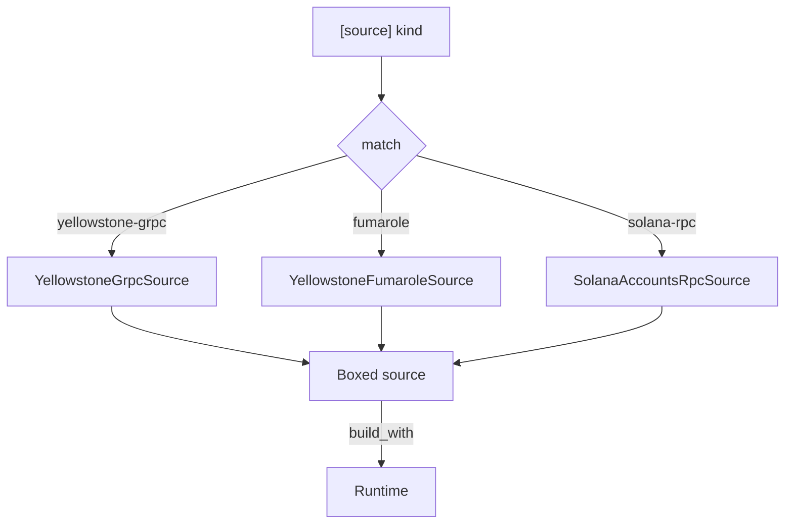

Build one binary whose `kind` key in `[source]` chooses Yellowstone gRPC, Fumarole or Solana RPC, with the pipelines registered once.

**Based on:** no upstream example. Source selection at startup is new in 0.12.0 ([#308](https://github.com/solana-rpc/shipstern/pull/308)). Compiled against Shipstern 0.13.0.



**Prerequisites:**

- A Cargo binary project, as in the [quickstart](/docs/get-started/quickstart).
- Rust 1.97.1 or newer. `shipstern-solana-rpc-source` 0.13.0 uses Agave 4.3.2, which needs it.
- The endpoint for each source to try: a Yellowstone gRPC endpoint and token, a Solana JSON-RPC URL, or Fumarole access from Triton.

<Steps>
<Step>

### Add dependencies

Replace the `[dependencies]` table in `Cargo.toml`:

```toml title="Cargo.toml"
[dependencies]
clap = { version = "4.5", features = ["derive"] }
rustls = "0.23"
serde = { version = "1", features = ["derive"] }
shipstern = "0.13.0"
shipstern-solana-rpc-source = "0.13.0"
shipstern-spl-token-parser = "0.13.0"
shipstern-stake-pool-parser = "0.13.0"
shipstern-yellowstone-fumarole-source = "0.13.0"
shipstern-yellowstone-grpc-source = "0.13.0"
toml = "0.8"
tracing-subscriber = { version = "0.3", features = ["env-filter"] }
```

</Step>
<Step>

### Write the program

Replace `src/main.rs`:

<include cwd lang="rust" meta='title="src/main.rs"'>./examples/pick-a-source/src/main.rs</include>

| Part | What it does |
| --- | --- |
| `Config` | The same two sections as `ShipsternConfig`: `[source]`, and `[buffer]` with its defaults when the section is missing. `ShipsternConfig<S>` needs `S: clap::Args`, which clap derives for structs only, so an enum needs its own wrapper. |
| `#[serde(tag = "kind")]` | Reads `kind` from `[source]` and hands the other keys to that variant's config type. A file without `kind` fails with ``missing field `kind` ``, and an unknown value fails with a list of the accepted ones. |
| `from_config(config)` | Builds each source from its own config type, the same call that `build::<S>(config)` makes. |
| `Box<dyn SourceTrait>` | `SourceTrait` is object safe and `Box<S>` is a source too, so the three arms share one type. |
| `build_with(source, buffer)` | Builds a `Runtime<Box<dyn SourceTrait>>`, which is what a bare `Runtime` means. It logs the error and exits if the builder refuses the pipelines. `try_build_with` returns `Result<Runtime, BuilderError>` instead. |
| `Logger` | Prints the slot and `is_startup` of each account update, and the path and decoded value of each instruction. |
| `tracing_subscriber::fmt::init()` | Shows the runtime's errors, which `run()` otherwise exits on without a message. Set `RUST_LOG=info` for more. |

</Step>
<Step>

### Write the config file

Create `Shipstern.toml` in the project root, or add `kind` to an existing one. The other keys in `[source]` belong to the selected source.

<Tabs items={['Yellowstone gRPC', 'Fumarole', 'Solana RPC']}>
<Tab value="Yellowstone gRPC">

```toml title="Shipstern.toml"
[source]
kind = "yellowstone-grpc"
endpoint = "https://yellowstone.example.com"
x-token = "<X-TOKEN>"
timeout = 60
commitment-level = "confirmed"
```

</Tab>
<Tab value="Fumarole">

```toml title="Shipstern.toml"
[source]
kind = "fumarole"
endpoint = "https://fumarole.example.com"
x-token = "<X-TOKEN>"
subscriber-name = "my_subscriber_group"
```

</Tab>
<Tab value="Solana RPC">

```toml title="Shipstern.toml"
[source]
kind = "solana-rpc"
endpoint = "https://api.mainnet-beta.solana.com"
timeout = 60
commitment_level = "confirmed"
```

</Tab>
</Tabs>

The Solana RPC config type spells `commitment_level` with an underscore. The other two use hyphens. Solana RPC and Yellowstone gRPC both require `timeout`. Fumarole has no `timeout` key. The [configuration reference](/docs/reference/configuration) lists every key.

</Step>
<Step>

### Run it

From the project root:

```bash
cargo run -- --config ./Shipstern.toml
```

The first line names the source that the program built, for example `source: yellowstone-grpc`. With either streaming source, the program then prints `ix 1.2 - TokenProgram { ... }` lines until stopped, plus an `account slot=... startup=false` line when a stake pool account changes. With the Solana RPC source, it prints one `account slot=... startup=true` line per stake pool account, all at the same slot, and exits once the runtime has handled them. The stake pool program also owns uninitialised accounts, which the parser rejects. The runtime logs each one as `Handler failed` with `Uninitialized Account`.

</Step>
</Steps>

## Common failures

| Symptom | Cause |
| --- | --- |
| Panic with ``missing field `kind` `` | `[source]` has no `kind` key. |
| Panic with ``unknown variant`` | `kind` is not `yellowstone-grpc`, `fumarole` or `solana-rpc`. |
| Panic with ``missing field `timeout` `` | The `yellowstone-grpc` and `solana-rpc` kinds both require `timeout`. |
| The `solana-rpc` choice logs `403 Forbidden` and exits with status 1 | The RPC endpoint refuses `getProgramAccounts` for an owner in an account prefilter. See [Choose pipelines every source can serve](#choose-pipelines-every-source-can-serve). |

## Choose pipelines every source can serve

The Solana RPC source does not stream. It runs one `getProgramAccounts` call for each owner in each account prefilter, sends the accounts, and finishes. A pipeline with no account prefilter, such as the instruction pipeline here, gets nothing from it. The source applies no account prefilter field except the owners.

<Warning>
Register account parsers only for programs the RPC endpoint can return in one call. During testing, `api.mainnet-beta.solana.com` answered `getProgramAccounts` for the Token Program with `403 Forbidden`, while the same call for the stake pool program returned 501 accounts. With the SPL Token `AccountParser` registered, the `solana-rpc` choice logs that error and exits with status 1.
</Warning>

That is why the program pairs stake pool accounts, which every source here can deliver, with Token Program instructions, which only the streaming sources deliver.

## Keep live filter updates

A `Runtime<Box<dyn SourceTrait>>` has no `handle()`, so a call to it does not compile. To change the subscription while the runtime runs, box the source as `dyn FilterUpdateSource` instead:

```rust
let source: Box<dyn FilterUpdateSource> = Box::new(YellowstoneGrpcSource::from_config(config));
```

Every arm of the match must then hold a source that implements `FilterUpdateSource`. Of the three here, only `YellowstoneGrpcSource` does, so the `fumarole` and `solana-rpc` arms would not compile. See [live filter updates](/docs/filtering/live-filter-updates) for the handle methods.

## Variations

| Goal | Change |
| --- | --- |
| Handle a builder error in the application | Call `try_build_with(source, buffer)` and match on the `BuilderError`. |
| Offer another source | Add a variant that holds its config type, and an arm that boxes the source. |
| Offer the snapshot and Jetstreamer sources too | [Run any source from one binary](/docs/sources#run-any-source-from-one-binary) has the program with all five kinds, which takes every Shipstern crate from git. |

## Test record

On 2026-10-11 the `yellowstone-grpc` choice delivered 144,608 SPL Token instructions and 1 stake pool account update from mainnet in 60 s. The `solana-rpc` choice loaded 478 stake pool accounts from `api.mainnet-beta.solana.com` and exited by itself after 2 s. The `fumarole` choice compiles and starts, but it was not run against a Fumarole server.

## See also

- [Sources](/docs/sources): what each source delivers and its limits.
- [Runtime](/docs/runtime#name-the-source): `build` against `build_with`, and what each one requires.
- [Configuration reference](/docs/reference/configuration): every key in each source's section.
- [Live filter updates](/docs/filtering/live-filter-updates): change the gRPC subscription while it runs.
