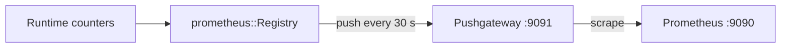

Push the runtime counters to a Prometheus Pushgateway every 30 seconds and query them in Prometheus.

**Based on:** [`examples/prometheus`](https://github.com/solana-rpc/shipstern/tree/v0.13.0/examples/prometheus) in the Shipstern repository. Compiled against Shipstern 0.13.0.



**Prerequisites:** a Cargo binary project with `Shipstern.toml` in its root, as in the [quickstart](/docs/get-started/quickstart#configure-the-source), and Docker with Compose.

<Steps>
<Step>

### Start Prometheus and a Pushgateway

The runtime serves no HTTP endpoint, so the program pushes metrics to a Pushgateway that Prometheus scrapes. The Shipstern repository has a Compose file for both. Start them from a separate terminal:

```bash
git clone --branch v0.13.0 --depth 1 https://github.com/solana-rpc/shipstern
cd shipstern
docker compose up
```

This starts a Pushgateway on port 9091 and Prometheus on port 9090. Prometheus scrapes the Pushgateway through `host.docker.internal:9091`, as set in `prometheus-config.yaml`.

</Step>
<Step>

### Add dependencies

Replace the `[dependencies]` table in `Cargo.toml`:

```toml title="Cargo.toml"
[dependencies]
clap = { version = "4.5", features = ["derive"] }
prometheus = { version = "0.14", features = ["push"] }
rustls = "0.23"
shipstern = { version = "0.13.0", features = ["prometheus"] }
shipstern-spl-token-parser = "0.13.0"
shipstern-yellowstone-grpc-source = "0.13.0"
tokio = { version = "1", features = ["macros", "rt-multi-thread", "time"] }
toml = "0.8"
tracing = "0.1"
tracing-subscriber = { version = "0.3", features = ["env-filter"] }
```

The `prometheus` feature on `shipstern` adds the builder's `.metrics()` method. The `push` feature on `prometheus` adds `push_metrics`. `tracing-subscriber` prints push failures and runtime errors.

</Step>
<Step>

### Write the program

Replace `src/main.rs`:

<include cwd lang="rust" meta='title="src/main.rs"'>./examples/prometheus-metrics/src/main.rs</include>

| Part | What it does |
| --- | --- |
| `tracing_subscriber::registry()` | Prints log lines, filtered by `RUST_LOG`. Error lines print when `RUST_LOG` is not set. |
| `registry.clone()` | One handle goes to the runtime with `.metrics()`, the other to the push loop. Both see the same counters. |
| `push_metrics("shipstern", ...)` | Pushes every gathered counter under the job name `shipstern`. |
| `spawn_blocking` | `push_metrics` blocks, so it runs off the async workers. |
| `run_async().await` | `main` is already inside `#[tokio::main]`, so the runtime uses that Tokio runtime. |

</Step>
<Step>

### Run it

From the project root:

```bash
RUST_LOG=info cargo run -- --config ./Shipstern.toml
```

`Logger` prints each decoded Token Program account and instruction. The program pushes once at startup and then every 30 seconds, so `http://localhost:9091` shows a `shipstern` group within a few seconds. To hide the decoded values and show only push errors, add `2>&1 | grep 'Failed to push'` to the command.

</Step>
<Step>

### Query the counters

Open `http://localhost:9090` and run:

```text
rate(shipstern_accounts_received[1m])
rate(shipstern_instructions_successful[1m])
increase(shipstern_instructions_parsing_errors[5m])
```

The first two return a non-zero rate while updates arrive. The [metrics reference](/docs/observability/metrics) lists every counter.

</Step>
</Steps>

## Common failures

| Symptom | Cause |
| --- | --- |
| `Failed to push metrics` every 30 seconds | The program cannot reach the Pushgateway at `http://localhost:9091`. Check that `docker compose up` is still running. |
| The program exits after an error line | The runtime stopped on a source or configuration error. The [error reference](/docs/reference/errors) lists each one. |
| The group exists but Prometheus has no series | Prometheus cannot reach `host.docker.internal:9091`. Check its targets at `http://localhost:9090/targets`. |
| `docker compose up` fails to bind a port | Another process already uses port 9090 or 9091. |

## See also

- [Metrics reference](/docs/observability/metrics): every counter name.
- [Tracing](/docs/observability/tracing): export spans with OpenTelemetry.
- [Run in production](/docs/runtime/production): alerts on the error counters.
