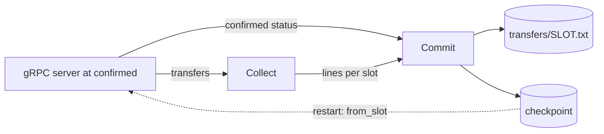
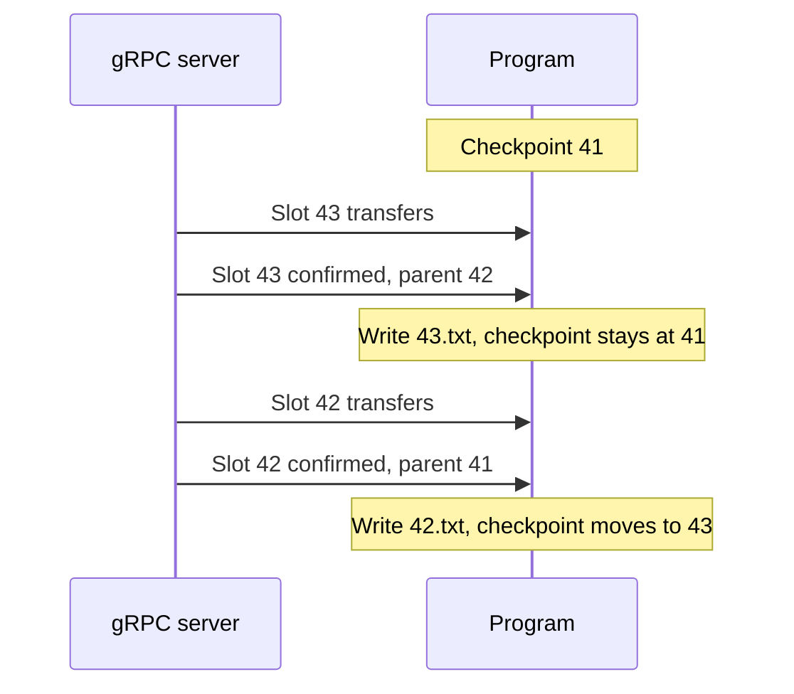

Write the SPL Token transfers of each confirmed slot to its own file, and keep a checkpoint slot that a stream loss or a restart resumes from. No confirmed slot between the start of the first run and the checkpoint is missing, and a repeated slot produces the same file again.

**Based on:** no upstream example. Compiled against Shipstern 0.13.0; not run against a live endpoint.



**Prerequisites:** a Cargo binary project with `Shipstern.toml` in its root, as in the [quickstart](/docs/get-started/quickstart#configure-the-source), and a Yellowstone gRPC server that keeps slots for replay. [Limits of this design](#limits-of-this-design) lists every server requirement.

## How the checkpoint moves

The checkpoint is one slot number in the file `checkpoint`. The program keeps this invariant:

**Every confirmed slot after the starting slot of the first run, up to and including the checkpoint, has its transfers written to `transfers/`.**

The starting slot is the slot before `from-slot`. On a run from the tip, it is the first confirmed slot. The program writes no file for the starting slot.

Three facts make it hold:

1. **One update at a time.** With `jobs = 1`, the runtime takes the next update only after every handler of the current one has returned. The handlers see updates in the order they arrive.
2. **Content before status.** On a `confirmed` stream, a yellowstone-grpc server sends a slot's transactions before the slot's confirmed status. When the status handler runs, every transfer of that slot is already in memory.
3. **Slots can complete out of order.** The server can send a parent slot after its child is complete, so the highest confirmed slot is not a safe checkpoint. The checkpoint moves to a slot only when that slot's parent is at or below the checkpoint.



Slots between a parent and its child were skipped, so they have no confirmed content. On a restart, the program sets `from_slot` to the checkpoint plus one, and the server replays every slot it still holds from there.

Repeats arrive after a stream loss, because the source drops only the repeats it has a record of. They also arrive after a restart, for slots above the checkpoint that were written before the stop. The program adds no more lines to a slot at or below the checkpoint, or to a slot already written in this run. A rewrite after a restart produces the same sorted file.

<Steps>
<Step>

### Add dependencies

Replace the `[dependencies]` table in `Cargo.toml`:

```toml title="Cargo.toml"
[dependencies]
clap = { version = "4.5", features = ["derive"] }
rustls = "0.23"
shipstern = "0.13.0"
shipstern-spl-token-parser = "0.13.0"
shipstern-yellowstone-grpc-source = "0.13.0"
toml = "0.8"
tracing = "0.1"
tracing-subscriber = { version = "0.3", features = ["env-filter"] }
```

</Step>
<Step>

### Write the program

Replace `src/main.rs`:

<include cwd lang="rust" meta='title="src/main.rs"'>./examples/resume-after-restart/src/main.rs</include>

| Part | What it does |
| --- | --- |
| `commitment_level = Confirmed` | Selects `SlotResume` for a stream loss when `auto-reconnect` is on, which is the default. It also makes the server send each slot's transactions before its confirmed status. The program sets it, so `commitment-level` in `Shipstern.toml` has no effect. |
| `jobs = Some(1)` | One update at a time, in arrival order. The program sets it, so `[buffer] jobs` has no effect. |
| `Collect` | Buffers each `Transfer` and `TransferChecked` as one line under its slot. The `BTreeSet` drops a repeated line and keeps the lines sorted. |
| `ConfirmedSlots` | A parser for slot statuses. The default `SlotPrefilter` asks only for statuses at the stream's commitment, so it receives confirmed statuses. |
| `Commit` | On a slot's confirmed status, writes `transfers/SLOT.txt`, records the slot with its parent, and saves the checkpoint when it moves. A slot with no transfers gets no file. |
| `State::complete` | Moves the checkpoint over each written slot whose parent is at or below it. A slot whose parent has no file yet waits. |
| `write_atomic` | Writes a temporary file and renames it over the target, so a crash leaves the old file or the new one, never part of one. |
| `from_slot = checkpoint + 1` | Resumes after the last slot the checkpoint covers. With no `checkpoint` file, the `from-slot` in `Shipstern.toml` applies, or the stream starts at the tip. |
| The first status of a run from the tip | Only marks the start. The run can join partway through that slot, so the program does not write its transfers. |
| `Err(...)` from `Commit` | A missing parent or a failed write leaves the slot unrecorded, so the checkpoint cannot pass it. The runtime logs the error and continues. |

</Step>
<Step>

### Run it

From the project root:

```bash
RUST_LOG=info cargo run -- --config ./Shipstern.toml
```

The `Starting` log line shows where the run begins. On a first run with no `from-slot`, both values are `None`:

```text
INFO ... Starting checkpoint=None from_slot=None
```

The program creates `checkpoint` and the `transfers` directory in the working directory. Each file holds one line per transfer: the signature, the one-based instruction path, the source and destination token accounts, and the amount in base units.

```bash
cat checkpoint
ls transfers | sort -n | tail -3
```

```text title="transfers/<slot>.txt"
<signature> 3.1 <source> <destination> 2500000
```

</Step>
<Step>

### Restart it

Stop the program with `Ctrl+C`, note the slot in `checkpoint`, and start it again with the same command. Expect `from_slot` one above the stored checkpoint:

```text
INFO ... Starting checkpoint=Some(<slot>) from_slot=Some(<slot + 1>)
```

The server replays the slots from there. A slot above the checkpoint that the program wrote before the stop gets the same file again.

</Step>
</Steps>

## Common failures

| Symptom | Cause |
| --- | --- |
| `Error parsing config:` and a TOML message, such as ``missing field `timeout` `` | `Shipstern.toml` does not match the Yellowstone gRPC source. See [`Error parsing config`](/docs/get-started/troubleshooting#error-parsing-config). |
| `Bad checkpoint: invalid digit found in string` | The `checkpoint` file does not hold one slot number. Fix it, or delete it to start from `from-slot` or the tip. |
| `InvalidArgument` with `Max amount of filters/data_slices reached, only 1 allowed` | The server allows one `slots` filter. `SlotResume` adds its own `slots` filter, and `ConfirmedSlots` adds a second one. |
| `OutOfRange` at startup | The checkpoint is older than the oldest slot the server holds. See [`OutOfRange`](/docs/get-started/troubleshooting#outofrange-ends-the-run-after-a-reconnect) and the replay window below. |
| `from_slot is not supported` | The server keeps no slots for replay, so a restart cannot resume. See [Troubleshooting](/docs/get-started/troubleshooting#from_slot-is-not-supported-ends-the-run). |
| `Handler failed` with `the status names no parent slot` | The server sent a confirmed status with no parent, so the checkpoint does not move past that slot. |
| `Written slots wait for a parent's status` | 32 written slots wait for a parent whose confirmed status has not arrived. The checkpoint stays until it arrives. |
| `Handler failed` with an I/O error | A write to `transfers/` or `checkpoint` failed. The checkpoint stops before the failed slot. Restart the program once the disk is writable. |

## Limits of this design

- **The server's replay window.** A restart recovers only the slots the server still holds: 150 by default on yellowstone-grpc. A longer stop ends the next run with `OutOfRange`, and the slots in the gap do not arrive. Backfill the gap from an archive with the [Jetstreamer source](/docs/sources/jetstreamer). Delete `checkpoint` to start the next run from `from-slot` in `Shipstern.toml`, or at the tip when `from-slot` is not set.
- **A crash between the work and the checkpoint write.** The program writes a slot's file before it moves the checkpoint. After a crash between the two, the restart replays the slot and writes the same file again, so this work loses nothing and repeats nothing. Work with a side effect that cannot repeat, such as a payment or a message to another system, happens twice in that case and needs its own idempotency key. The rename protects against a process crash, not a power loss. For a power loss, call `File::sync_all` on the file and sync the directory.
- **Server requirements.** The server must keep slots for replay, name the parent in every confirmed status, and send a slot's transactions before its status on replay too. It must also allow two `slots` filters. From 14.1.0, yellowstone-grpc-geyser names the parent and sends transactions first on replay ([rpcpool/yellowstone-grpc#809](https://github.com/rpcpool/yellowstone-grpc/pull/809)). An older server replays statuses with no parent. With an older server, the checkpoint stops moving after a restart or a stream loss, because both replay. Every replayed status then logs `Handler failed`.
- **A parent whose status never comes.** Its children wait, and the checkpoint holds. A restart then replays from the stored slot, which can end with `OutOfRange` if the wait outlasts the replay window.
- **One update at a time.** `jobs = 1` serialises all handlers. If writes fall behind the stream, lag grows. See [Lag keeps growing](/docs/get-started/troubleshooting#lag-keeps-growing).
- **The first run from the tip.** The first confirmed slot only marks the start, and the program does not write its transfers. Set `from-slot` in `Shipstern.toml` for an exact first slot.

<Note>
The source's own `SlotResume` checkpoint tracks the stream, not completed handlers. This program keeps its own checkpoint, as [Delivery and ordering](/docs/runtime/delivery#store-a-processing-checkpoint) describes.
</Note>

## See also

- [Delivery and ordering](/docs/runtime/delivery): why handler completion order differs from receive order.
- [Yellowstone gRPC source](/docs/sources/yellowstone-grpc#resume-from-a-slot-checkpoint): how `SlotResume` recovers a stream loss.
- [Index token transfers into Postgres](/docs/guides/index-transfers-into-postgres): the same transfers in a database, with a replay margin instead of a parent chain.
- [Block coordinator](/docs/outputs/block-coordinator): complete slots in strict order, for a pipeline that needs more than one job.
