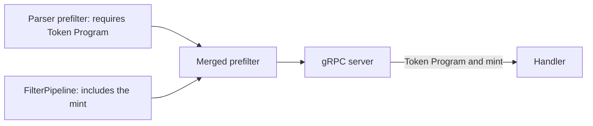

Print the Token Program instructions in every transaction that lists one mint. The gRPC server selects transactions by their account keys, so the handler receives every decoded Token Program instruction in a matching transaction, including instructions for other mints.

**Based on:** [`examples/filtered-pipeline`](https://github.com/solana-rpc/shipstern/tree/v0.13.0/examples/filtered-pipeline) in the Shipstern repository. Compiled against Shipstern 0.13.0.



**Prerequisites:** a Cargo binary project with `Shipstern.toml` in its root, as in the [quickstart](/docs/get-started/quickstart#configure-the-source).

<Steps>
<Step>

### Add dependencies

Replace the `[dependencies]` table in `Cargo.toml`:

```toml title="Cargo.toml"
[dependencies]
clap = { version = "4.5", features = ["derive"] }
rustls = "0.23"
shipstern = "0.13.0"
shipstern-spl-token-parser = "0.13.0"
shipstern-yellowstone-grpc-source = "0.13.0"
toml = "0.8"
tracing-subscriber = { version = "0.3", features = ["env-filter"] }
```

</Step>
<Step>

### Write the program

Replace `src/main.rs`:

<include cwd lang="rust" meta='title="src/main.rs"'>./examples/track-a-single-mint/src/main.rs</include>

| Part | What it does |
| --- | --- |
| `MINT` | The mint to follow. Change it to any token mint. |
| `Handler<V, InstructionUpdate>` | Typed on the raw input, so the handler can read `input.path`. The path prints one-based with dots: `1` for the first top-level instruction, `1.3` for the third inner instruction of the first. |
| `FilterPipeline::new(parser, handlers, builder)` | Merges the builder into the parser's own prefilter. It takes the builder, not a built `Prefilter`, and panics at startup if the builder does not build. |
| `transaction_accounts_include([mint])` | The transaction must include at least one of these accounts. The parser's prefilter adds the Token Program as a required account. |

</Step>
<Step>

### Run it

From the project root:

```bash
RUST_LOG=info cargo run -- --config ./Shipstern.toml
```

Each line is one decoded instruction: its path, then the parsed value.

```text
ix 3 - TokenProgram { ... }
ix 2.1 - TokenProgram { ... }
```

The program runs until `Ctrl+C`.

</Step>
</Steps>

## Common failures

| Symptom | Cause |
| --- | --- |
| Panic with `Error parsing config` | `Shipstern.toml` does not match the Yellowstone gRPC source. See [`Error parsing config`](/docs/get-started/troubleshooting#error-parsing-config). |
| Panic with `invalid mint address` | `MINT` is not a base58 32-byte address. |
| The program starts and prints nothing | Check the endpoint, token and subscription with [the no-data checklist](/docs/get-started/troubleshooting#the-runtime-starts-but-no-data-arrives). A mint with little activity can also be quiet for minutes. |
| `invalid compression flag: 32` repeats in the log | The server rejected the `x-token`. See [Troubleshooting](/docs/get-started/troubleshooting#invalid-compression-flag-32-repeats-twice-a-second). |

## Selection limits

A transaction that lists the mint can contain transfers for other tokens. For exact mint selection, check the parsed instruction or the transaction token balances in the handler.

An SPL Token `Transfer` instruction lists the source, destination and authority accounts but not the mint. The prefilter misses a transaction that contains only that transfer. `TransferChecked` lists the mint. [Watch a wallet's token moves](/docs/guides/watch-a-wallets-token-moves) resolves token accounts through balance metadata instead.

## Variations

| Goal | Change |
| --- | --- |
| Follow several mints | `.transaction_accounts_include([mint_a, mint_b])` |
| Require every listed account | `.transaction_accounts([a, b])` |
| Drop transactions that touch an account | Set the exclusion in a custom parser prefilter, or replace the instruction entry with `Filters::insert` during a live update. |
| Skip vote transactions | Set the vote flag in a custom parser prefilter, or replace the instruction entry during a live update. |

The merge drops an exclusion or vote flag added only to this `FilterPipeline` builder. The SPL Token parser's prefilter has neither, and the merge clears a setting the two sides disagree on. See [How prefilters merge](/docs/filtering/prefilters#how-prefilters-merge).

To change the mint without restarting, use [live filter updates](/docs/filtering/live-filter-updates) keyed on `InstructionPipeline::ID`. Replace that entry to switch mints, and keep the Token Program requirement in the replacement prefilter. If another include set is merged in instead, the previous mint stays eligible too.

## See also

- [Prefilters](/docs/filtering/prefilters): every option and its limits.
- [Handlers](/docs/runtime/handlers#match-typed-instructions): match on the decoded token instruction instead of printing it.
- [Watch a wallet's token moves](/docs/guides/watch-a-wallets-token-moves): the same `FilterPipeline` pattern keyed on a wallet.
