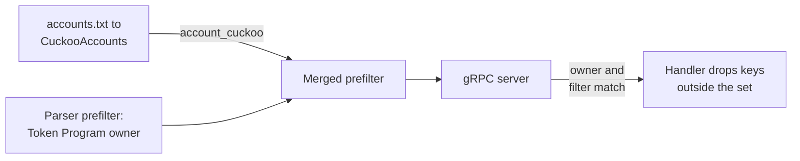

Read account addresses from a file and print updates for those accounts only. The program sends the addresses to the server as one cuckoo filter instead of a list of keys. The handler drops the few accounts that the filter matches by mistake.

**Based on:** no upstream example. Compiled against Shipstern 0.13.0.



**Prerequisites:** a Cargo binary project with `Shipstern.toml` in its root, as in the [quickstart](/docs/get-started/quickstart#configure-the-source), and a Yellowstone gRPC server that supports cuckoo account filters. Yellowstone gRPC added them in geyser 13.1.0.

<Steps>
<Step>

### Add dependencies

Replace the `[dependencies]` table in `Cargo.toml`:

```toml title="Cargo.toml"
[dependencies]
clap = { version = "4.5", features = ["derive"] }
rustls = "0.23"
shipstern = "0.13.0"
shipstern-core = "0.13.0"
shipstern-spl-token-parser = "0.13.0"
shipstern-yellowstone-grpc-source = "0.13.0"
toml = "0.8"
tracing-subscriber = { version = "0.3", features = ["env-filter"] }
```

</Step>
<Step>

### List the accounts

Create `accounts.txt` in the project root with one base58 address per line. The program skips blank lines.

```text title="accounts.txt"
fueL3hBZjLLLJHiFH9cqZoozTG3XQZ53diwFPwbzNim
6ZX6VbThwCFpBXjtnpL84B5dFMg8uN4ciMhLAd8UeEWj
```

Every address must be an account the Token Program owns: a mint, a token account or a multisig. The merged prefilter carries the Token Program as owner next to the cuckoo filter. The server requires both, so an account that another program owns never arrives.

</Step>
<Step>

### Write the program

Replace `src/main.rs`:

<include cwd lang="rust" meta='title="src/main.rs"'>./examples/cuckoo-accounts/src/main.rs</include>

| Part | What it does |
| --- | --- |
| `CuckooAccounts` | The key set, collected from the file. It sorts and deduplicates the keys, and `contains` is a binary search. |
| `account_cuckoo(accounts.iter().copied())` | Sends the set as one cuckoo filter. If the filter cannot hold a key, Shipstern also puts that key in the plain list, which the server matches as well. |
| `FilterPipeline::new(AccountParser, handlers, builder)` | Merges the builder into the parser's own prefilter. The request carries the Token Program as the owner and the key set as the filter. |
| `InSet` | Typed on the raw `AccountUpdate`, so it can read the account key. It checks the key with `contains` and drops updates for accounts outside the set. |

</Step>
<Step>

### Run it

From the project root:

```bash
RUST_LOG=info cargo run -- --config ./Shipstern.toml --accounts ./accounts.txt
```

Updates for accounts in the set go to stdout as `<address> slot <slot> TokenProgramState { ... }`. False matches go to stderr as `<address> false match, dropped`. An account prints only when it changes, so a set of idle accounts prints nothing.

</Step>
</Steps>

## Common failures

| Symptom | Cause |
| --- | --- |
| `invalid compression flag: 32` repeats in the log | The server rejected the `x-token`. See [Troubleshooting](/docs/get-started/troubleshooting#invalid-compression-flag-32-repeats-twice-a-second). |
| Panic with `Invalid account address <line>` | A line in the file is not a base58 public key. |
| Panic with `Error reading accounts file` | The `--accounts` path does not exist. |
| stderr fills with `false match, dropped` for many different addresses | The server ignores the filter and sends every Token Program account. See [Expect false matches](#expect-false-matches). |
| No output for an address in the file | The account did not change, or another program owns it. |

## Expect false matches

A cuckoo filter stores a 16-bit fingerprint for each key, so an account outside the set can share a fingerprint with one inside it. The server cannot tell them apart and sends both. For a given filter, the answer for an account never changes. A false match is therefore one fixed account, and every update to it arrives. The handler checks every update with `contains` for this reason.

The false-match rate depends on how full the filter is. Measured on 2,000,000 random keys, a filter of 2,000 keys matched about 1 key in 17,700 outside the set, and a filter of 3,800 keys about 1 in 9,100.

<Warning>
A server without cuckoo support ignores the filter, so this prefilter then matches every account the Token Program owns. A server with a lower size limit for the filter rejects the subscription. richat 13.0.2 accepts this account filter but rejects the transaction and block cuckoo fields with `InvalidArgument`. Check the provider's server implementation before using cuckoo filters.
</Warning>

## Request size

The filter replaces a list of base58 strings, so the subscription request stays small. The table gives the size of the encoded `SubscribeRequest` built from this program's prefilter.

| Keys | With `account_cuckoo` | With a plain `accounts` list |
| --- | --- | --- |
| 2,000 | 8,296 bytes | 91,866 bytes |
| 3,800 | 8,296 bytes | 174,663 bytes |

The filter grows in steps. Its table size is rounded up to a power of two, so 2,000 and 3,800 keys build a filter of the same size. The larger set fills more of it.

## Variations

| Goal | Change |
| --- | --- |
| Token accounts only, no mints | Match on the parsed `TokenProgramState` in the handler. An `account_filters` data size check does not survive the merge, because the parser's prefilter has no account comparisons ([how prefilters merge](/docs/filtering/prefilters#how-prefilters-merge)). |
| Transactions or blocks that touch the set | `transaction_cuckoo_accounts_include` or `block_cuckoo_accounts_include` on the [prefilter](/docs/filtering/prefilters#send-large-key-sets-as-cuckoo-filters). Check server support first. |

## Test record

On 2026-10-11 the program ran for 60 s against a mainnet Yellowstone gRPC endpoint (geyser 16.x) with 2,000 Token Program accounts. It printed 54,413 updates for 1,334 of them, with no update from outside the set. A second 60 s run, with a set built so that the filter also matched one busy account outside it, dropped all 2,740 updates for that account. Not tested: richat, servers without cuckoo support, and sets larger than 3,800 keys.

## See also

- [Prefilters](/docs/filtering/prefilters#send-large-key-sets-as-cuckoo-filters): the other cuckoo options and every prefilter limit.
- [Track a single mint](/docs/guides/track-a-single-mint): `FilterPipeline` with a transaction prefilter.
- [Handlers](/docs/runtime/handlers#read-the-raw-update): read the raw update next to the parsed value.
