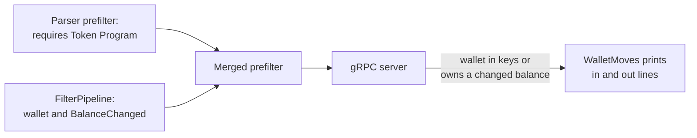

Print SPL Token transfers into and out of one wallet, including transfers to its token accounts in transactions that do not list the wallet's address.

**Based on:** no upstream example. Compiled against Shipstern 0.13.0.



**Prerequisites:** a Cargo binary project with `Shipstern.toml` in its root, as in the [quickstart](/docs/get-started/quickstart#configure-the-source), and a gRPC server that supports `token_accounts` (Yellowstone gRPC added it in [rpcpool/yellowstone-grpc#762](https://github.com/rpcpool/yellowstone-grpc/pull/762)).

<Steps>
<Step>

### Add dependencies

Replace the `[dependencies]` table in `Cargo.toml`:

```toml title="Cargo.toml"
[dependencies]
clap = { version = "4.5", features = ["derive"] }
rustls = "0.23"
shipstern = "0.13.0"
shipstern-core = "0.13.0"
shipstern-spl-token-parser = "0.13.0"
shipstern-yellowstone-grpc-source = "0.13.0"
toml = "0.8"
tracing-subscriber = { version = "0.3", features = ["env-filter"] }
```

</Step>
<Step>

### Write the program

Replace `src/main.rs`:

<include cwd lang="rust" meta='title="src/main.rs"'>./examples/wallet-token-moves/src/main.rs</include>

| Part | What it does |
| --- | --- |
| `--wallet` | The wallet to watch, parsed as a `Pubkey`. An invalid address stops the program at startup. |
| `transaction_accounts_include([wallet])` | Matches transactions that include the wallet's address. |
| `transaction_token_accounts(TokenAccounts::BalanceChanged)` | Also matches transactions in which a token account the wallet owns changes balance, is created or is closed, whether or not the wallet's address is in the transaction. |
| `FilterPipeline::new(InstructionParser, ...)` | Merges the builder into the parser's prefilter, which requires the Token Program. The parser sets no `token_accounts` mode, so the merge keeps the builder's mode. See [how prefilters merge](/docs/filtering/prefilters#how-prefilters-merge). |
| `owner_and_mint` | Finds a token account's entry in the transaction's token balances and returns its owner and mint. `raw.shared.accounts.get(account_index)` gives the entry's address. Post balances come first, and pre balances cover an account that the transaction closed. |
| `Handler<TokenProgram, InstructionUpdate>` | Runs for every decoded Token Program instruction, top-level and inner, and keeps `Transfer` and `TransferChecked`. |
| `direction` | `in`, `out` or `self`, depending on which side of the transfer the wallet owns. The handler skips transfers between other owners in the same transaction, such as the other legs of a swap. |

`amount` is in the mint's base units. To scale it, read `ui_token_amount.decimals` from the token balance entry.

</Step>
<Step>

### Run it

From the project root:

```bash
RUST_LOG=info cargo run -- --config ./Shipstern.toml --wallet <WALLET_ADDRESS>
```

Each line is one transfer: direction, amount, mint and transaction signature. A swap through a pool prints a pair:

```text
in 746381799 of So11111111111111111111111111111111111111112 in WSt5mJ7638wyPM5PPwVqRYnF4UisTz3z2kqfjd6RzQKoFCyrEU3CpWLszfFVe2qYqePMJa9S52W27yUarri6JzA
out 81652522 of EPjFWdd5AufqSSqeM2qN1xzybapC8G4wEGGkZwyTDt1v in WSt5mJ7638wyPM5PPwVqRYnF4UisTz3z2kqfjd6RzQKoFCyrEU3CpWLszfFVe2qYqePMJa9S52W27yUarri6JzA
```

</Step>
</Steps>

Nothing prints until the wallet's tokens move. An idle wallet can stay silent for hours.

## Common failures

| Symptom | Cause |
| --- | --- |
| `error: invalid value '...' for '--wallet <WALLET>'` | The address is not a base58 public key. |
| Panic with `Error parsing config` | `Shipstern.toml` does not match the Yellowstone gRPC source. See [`Error parsing config`](/docs/get-started/troubleshooting#error-parsing-config). |
| Transfers of a Token-2022 token never print | The SPL Token parser handles the Token Program only. See [Limits](#limits). |
| No output from an active wallet | Follow [the no-data checklist](/docs/get-started/troubleshooting#the-runtime-starts-but-no-data-arrives), and check that the server supports `token_accounts`. |
| `invalid compression flag: 32` repeats in the log | The server rejected the `x-token`. See [Troubleshooting](/docs/get-started/troubleshooting#invalid-compression-flag-32-repeats-twice-a-second). |

## Why the wallet's address is not enough

Tokens sit in token accounts, not in the wallet. A transaction that sends tokens to a wallet lists the destination token account, usually the wallet's associated token account. The wallet's own address can be absent. A prefilter with only `transaction_accounts_include([wallet])` never matches those transactions.

With `token_accounts` set, the server checks the include, required and exclude sets against the transaction's account keys, including keys loaded from address lookup tables, and also against a set of token-balance owners. The mode picks which owners go in that set:

| `TokenAccounts` | Owners added | Use it for |
| --- | --- | --- |
| `BalanceChanged` | Owners of a token account whose amount changed, that the transaction created, or that it closed | Transfers, mints, burns and swaps that move the wallet's tokens |
| `All` | Owners of every token account the transaction lists, changed or not | The same, plus transactions that only reference the wallet's token accounts |

The token balances come from the transaction metadata, which lists every token account in the transaction. `All` can therefore match a transaction that reads one of the wallet's token accounts without moving tokens, and `BalanceChanged` drops that transaction. A token account that the transaction creates counts as changed even when it holds nothing, so a transaction that creates an associated token account for the wallet matches.

## Limits

<Note>
The parser's prefilter requires the Token Program, so a transaction that moves only Token-2022 tokens is not delivered. In the transactions that are delivered, the SPL Token parser does not decode Token-2022 instructions.
</Note>

- A token account that the transaction creates and closes again has no balance entry, so `owner_and_mint` cannot attribute its transfers. Wrapped SOL accounts opened for one swap are the usual case.
- Failed transactions are not delivered, because a transaction prefilter receives only successful transactions by default.

## Test record

On 2026-10-11 the program ran for 45 s on mainnet against an active wallet picked from live traffic and printed 37 incoming transfers. In a separate 45 s subscription with the same prefilter, 43 of the 58 matched transactions did not include the wallet's address. A filter without `token_accounts` matched only the other 15. A 30 s run against a program account that owns token vaults printed 378 incoming and 378 outgoing transfers. Not tested: reconnects, and a window in which `All` and `BalanceChanged` differ (both matched the same 58 transactions).

## See also

- [Prefilters](/docs/filtering/prefilters#match-a-wallet-through-its-token-accounts): `transaction_token_accounts` and the other transaction options.
- [Track a single mint](/docs/guides/track-a-single-mint): the same `FilterPipeline` pattern keyed on a mint.
- [Handlers](/docs/runtime/handlers): typed handlers and the raw `InstructionUpdate`.
