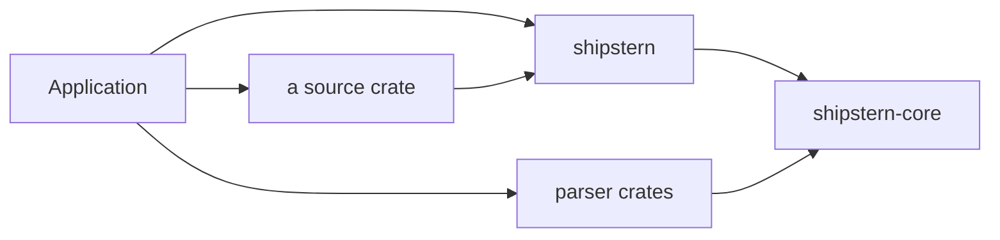

All crates share one version number. Use the same version for every `shipstern*` crate in a project.

## Availability on crates.io

Two crates are not available from crates.io at 0.13.0:

| Crate | On crates.io | Use instead |
| --- | --- | --- |
| `shipstern-kafka-sink` | never published | `{ git = "https://github.com/solana-rpc/shipstern", tag = "v0.13.0" }` |
| `shipstern-jetstream-source` | up to 0.9.0 only | the same git tag |
| every other crate on this page | 0.13.0 | `"0.13.0"` |

If any Shipstern crate comes from the git tag, take all of them from it. A mix of git and crates.io copies creates two incompatible versions of the shared types.

## Core

| Crate | Purpose | Notable features |
| --- | --- | --- |
| `shipstern` | The runtime: builder, pipelines, handlers, config, `RuntimeHandle` | `prometheus`, `opentelemetry` |
| `shipstern-core` | `Parser` trait, prefilters, `Filters`, `KeyBytes`/`Pubkey`, instruction model | `proto` |
| `shipstern-parser` | Helpers used by built-in and generated parsers | `proto` |
| `shipstern-proc-macro` | `include_shipstern_parser!` code generation from a Codama or Anchor IDL | `program-events`, `proto` |
| `shipstern-codama-from-anchor` | Converts an Anchor IDL to Codama nodes, which is how `shipstern-proc-macro` loads Anchor IDLs. Internal for now: its API may change. | |
| `shipstern-proto` | Protobuf definitions (`shipstern.stream`, `shipstern.parser.*`) | `parser`, `stream` |
| `shipstern-mock` | `account_fixture!` and `tx_fixture!` for parser tests. Each fixture is fetched from RPC once, then read from disk. | |

## Sources

| Crate | Source type | Data |
| --- | --- | --- |
| `shipstern-yellowstone-grpc-source` | `YellowstoneGrpcSource` | Live Dragon's Mouth stream, with live filter updates |
| `shipstern-yellowstone-fumarole-source` | `YellowstoneFumaroleSource` | Fumarole persistent streams |
| `shipstern-preconf-source` | `PreconfSource` | Triton Harmonic and BAM preconfirmations, as transaction updates. See [Preconfirmations](/docs/sources/preconf). |
| `shipstern-solana-rpc-source` | `SolanaAccountsRpcSource` | `getProgramAccounts` backfill |
| `shipstern-solana-snapshot-source` | `SolanaSnapshotSource` | Local ledger snapshot |
| `shipstern-jetstream-source` | `JetstreamSource` | Old Faithful archive replay. The source lives in `crates/jetstreamer-source`. |

## Parsers

| Crate | Program or update | Exports |
| --- | --- | --- |
| `shipstern-spl-token-parser` | Token Program | `AccountParser`, `InstructionParser` |
| `shipstern-spl-token-extensions-parser` | Token-2022 | `AccountParser`, `InstructionParser` |
| `shipstern-stake-pool-parser` | SPL Stake Pool | `AccountParser`, `InstructionParser` |
| `shipstern-bpf-loader-parser` | BPF Loader Upgradeable | `AccountParser`, `InstructionParser` |
| `shipstern-block-meta-parser` | Block metadata | `BlockMetaParser` |
| `shipstern-slot-parser` | Slots | `SlotParser` |

## Outputs

| Crate | Purpose |
| --- | --- |
| `shipstern-stream` | gRPC server that streams parsed events to clients over `/shipstern.stream.ProgramStreams/Subscribe` |
| `shipstern-kafka-sink` | Writes decoded instructions to Kafka one confirmed slot at a time, with a commit marker for each slot, transactional producers and schema registry support. The account path is behind `experimental-account-parser`. |
| `shipstern-block-coordinator` | Buffers parsed records per bank (`slot`, `bank_id`) and releases the confirmed bank of each slot in slot order once it is complete. Drops dead, cleared and losing banks. |

## See also

- [Installation](/docs/get-started/installation): add the crates to a project.
- [Changelog](/docs/releases): what changed in each version.
