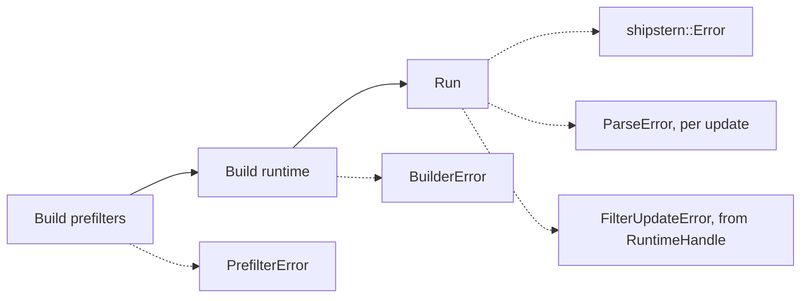

This page lists Shipstern's error types in the order a program meets them: building a prefilter, building the runtime, running it, parsing each update, and updating filters.



## `PrefilterError`

Returned by `Prefilter::builder()...build()`. `FilterPipeline::new` builds its extra prefilter itself and panics on this error. The builder checks its inputs before the source connects. It does not check provider-specific key limits, rejected keys or supported subscription types.

| Variant | Message starts with | Fix |
| --- | --- | --- |
| `AlreadySet(field)` | `Value already given for field` | Call each builder method once; pass all keys in one call. |
| `BadPubkey(bytes, _)` | `Invalid pubkey` | The key is not 32 bytes. Parse it with `Pubkey::from_str` / `KeyBytes::<32>::from_str` first. |
| `BadMemcmpData { .. }` | `Invalid {encoding} in memcmp data` | The base58 or base64 string does not decode. |
| `EmptyMemcmpData(offset)` | `Empty memcmp data at offset` | A memcmp with no bytes matches everything. Remove it or give it data. |
| `MemcmpDataTooLarge { .. }` | `Memcmp data at offset ... over the server's limit` | Compare at most 128 bytes (175 base58 or 172 base64 characters). |
| `TooManyAccountFilters { .. }` | `... account filters, over the server's limit of 4` | Use at most 4 comparisons per account prefilter. |
| `RepeatedDataSize` | `Repeated data size filter` | Keep one `AccountFilter::DataSize`. |
| `FalseTokenAccountState` | `Token account state may only be true` | Use `TokenAccountState(true)` or drop the comparison. |
| `ZeroLengthDataSlice(offset)` | `Zero-length accounts data slice` | Give every `accounts-data-slice` window a `length` above 0. |
| `DataSliceOverflow { .. }` | `Accounts data slice at offset ... overflows` | `offset + length` must fit in a `u64`. |
| `DataSliceOutOfOrder(a, b)` | `Accounts data slice at offset ... follows one at offset` | Sort the windows by `offset`. |
| `DataSliceOverlap(a, b)` | `Accounts data slice at offset ... overlaps` | Make the windows disjoint. |

The data slice variants come from the `[source]` section of the gRPC config, which is validated before the source connects.

## `BuilderError`

Returned by `Runtime::builder()...try_build::<S>(config)` and `try_build_with(source, buffer)`. `build` and `build_with` log the same error at `error` level and exit with status 1.

| Variant | Cause | Fix |
| --- | --- | --- |
| `AccountPipelineCollision` | Two account pipelines share a parser ID | Give configured parsers distinct `id()` values, or register the parser once with several handlers. |
| `TransactionPipelineCollision` | Same, for transaction pipelines | As above |
| `BlockMetaCollision`, `BlockFooterCollision`, `BlockCollision`, `SlotPipelineCollision` | Same, for those kinds | As above |
| `MissingField(name)`, `MissingConfig(name)`, `Metrics(_)` | Declared, but the 0.13.0 builder never returns them | Nothing to fix. A missing `[source]` section or key fails earlier, when `toml::from_str` parses the file. |

`BuilderError` is not `Send + Sync`, because its `Metrics` variant holds a `Box<dyn Error>`. As a result, `?` does not convert it into `anyhow::Error` or `Box<dyn Error + Send + Sync>`. Map it to a string error first:

```rust
let runtime = builder.try_build::<YellowstoneGrpcSource>(config).map_err(|e| anyhow::anyhow!("{e}"))?;
```

Two instruction pipelines with the same ID are not an error: the runtime logs a warning and runs both.

## `shipstern::Error`

Returned (boxed) by `try_run()` and `try_run_async()`. `run()` and `run_async()` log it at `error` level through `tracing` and exit with status 1, so a binary without a tracing subscriber exits without printing it.

| Variant | Meaning | What to check |
| --- | --- | --- |
| `Io(_)` | A system I/O error, for example installing signal handlers. The snapshot and Jetstreamer sources also fail with `Io`, wrapping their own error | Process limits and permissions, or the wrapped error |
| `YellowstoneBuilder(_)` | The gRPC client could not be built or could not connect | `endpoint` is a valid, reachable URL, `x-token` is a valid header value, and TLS can be set up for it |
| `YellowstoneClient(_)` | The connection opened but the subscribe request failed | `x-token` correct, and the server accepts the request |
| `YellowstoneStatus(status)` | The server ended the stream with a gRPC status, or Fumarole refused the subscription | The status code: `Unauthenticated` means the token, `ResourceExhausted` a provider limit, `FailedPrecondition` a server without bank IDs, `OutOfRange` a resume slot the server no longer holds, `Unavailable` spent bank replay retries. See [Troubleshooting](/docs/get-started/troubleshooting#running) |
| `ServerHangup` | The stream ended without an error status, and the source did not resume it. At `confirmed` or `finalized` the source resumes a clean close, and in bank replay at `processed` the client reconnects it. The run ends with this error in three cases: reconnect is off (`auto-reconnect = false`, `reconnect-max-retries = 0`, or `processed` with a `from-slot` or a `RuntimeHandle`), the retries run out at `confirmed` or `finalized`, or the close comes before the first checkpoint with no `from-slot` | Server restarts or maintenance; restart the process from a supervisor |
| `ClientHangup` | The source task ended without returning, most likely a panic | Look for a panic from the source in the logs immediately before it |
| `ConfigError` | A source is not configured correctly. No built-in source returns it in 0.13.0 | The `[source]` section |
| `Other(_)` | Any other source error: a bad `accounts-data-slice` window, a Fumarole connect failure, a Solana RPC failure, or a source that returns `SourceExitStatus::Error` | The wrapped error message |

When a source's `connect` returns `Err`, the run ends with that error unchanged, so a custom source chooses the variant. When a finite source (RPC, snapshot, Jetstreamer) finishes normally, the run returns `Ok(())` after the queue drains. A stop on `SIGINT` or `SIGTERM` does the same.

## `ParseError`

Returned by `Parser::parse`. Return these from custom parsers.

| Variant | Runtime behaviour |
| --- | --- |
| `Filtered` | No handlers run and nothing is logged. With metrics on, the update still counts in `*_successful`. Return it for input the parser does not handle. |
| `DiscriminatorNotFound(msg)` | Logged at `error` level and counted as a parse error. The usual cause is an instruction the IDL does not describe, or an IDL that is out of date with the deployed program. |
| `Other(err)` | Logged at `error` level and counted as a parse error. Errors convertible to `Box<dyn Error + Send + Sync>` convert into it with `?`. |

## `FilterUpdateError`

Returned by `RuntimeHandle` methods.

| Variant | Cause | Fix |
| --- | --- | --- |
| `UnknownParser(id)` | The set names a parser with no registered pipeline. Nothing was sent. | Use IDs from `handle.filters().parser_ids()`. For instruction parsers use `InstructionPipeline::ID`. |
| `Closed` | The runtime has stopped, or was dropped without running. | Take the handle before starting the runtime, then run it. |

## See also

- [Troubleshooting](/docs/get-started/troubleshooting): symptoms that do not show up as a typed error.
- [Prefilters](/docs/filtering/prefilters): the limits behind `PrefilterError`.
